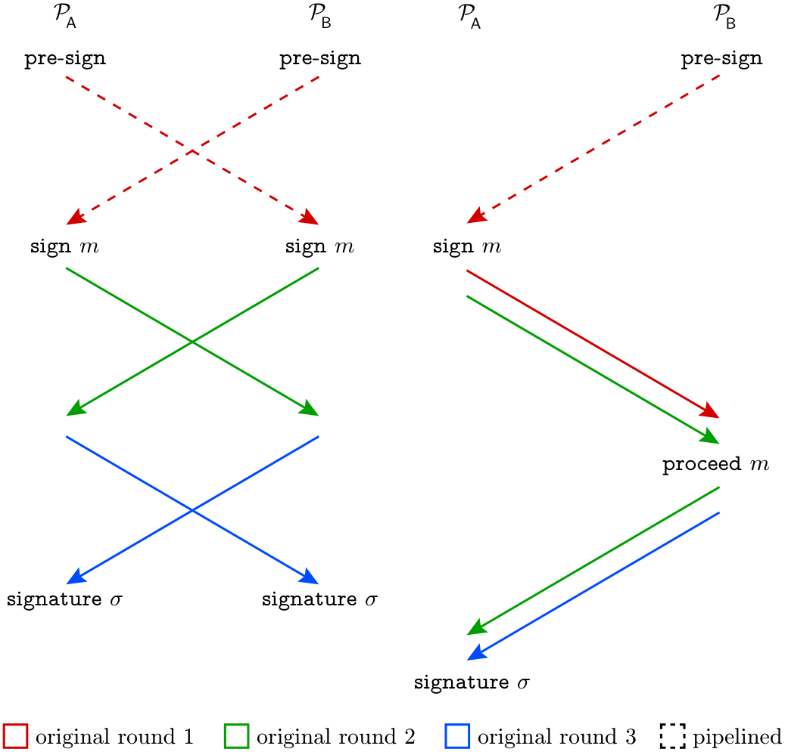

<!-- Converted from 2023-765.pdf; PDF annotations excluded. -->

[Source PDF](2023-765.pdf)

# Threshold ECDSA in Three Rounds∗

| Author | Email | Affiliation |
| --- | --- | --- |
| Jack Doerner | j@ckdoerner.net | Technion, Reichman U, Brown U |
| Yashvanth Kondi | yash@ykondi.net | Silence Labs (Deel) |
| Eysa Lee | eysa_lee@brown.edu | Brown University |
| abhi shelat | abhi@neu.edu | Northeastern University |

December 14, 2023

## Abstract

We present a three-round protocol for threshold ECDSA signing with malicious security against a dishonest majority, which information-theoretically UC-realizes a standard threshold signing functionality, assuming only ideal commitment and two-party multiplication primitives.
Our protocol combines an intermediate representation of ECDSA signatures that was recently introduced by Abram et al. [ANO+22] with an efficient statistical consistency check reminiscent of the ones used by the protocols of Doerner et al. [DKLs18, DKLs19]. We show that shared keys for our signing protocol can be generated using a simple commit-release-and-complain procedure, without any proofs of knowledge, and to compute the intermediate representation of each signature, we propose a two-round vectorized multiplication protocol based on oblivious transfer that outperforms all similar constructions.

∗A preliminary version [DKLs24] of this work appeared in IEEE S&amp;P 2024.

## Contents

- [Introduction](#section-1-introduction)
  - [A Brief History of Threshold ECDSA](#section-1-1-a-brief-history-of-threshold-ecdsa)
  - [Our Approach and Contributions](#section-1-2-our-approach-and-contributions)
- [Preliminaries](#section-2-preliminaries)
  - [Notation](#section-2-1-notation)
  - [Security and Communication Model](#section-2-2-security-and-communication-model)
  - [The ECDSA Signature Scheme](#section-2-3-the-ecdsa-signature-scheme)
- [t-Party Three-Round Threshold ECDSA](#section-3-t-party-three-round-threshold-ecdsa)
  - [Building Blocks](#section-3-1-building-blocks)
  - [The Basic Three-Round Protocol](#section-3-2-the-basic-three-round-protocol)
  - [Pipelining and Presigning](#section-3-3-pipelining-and-presigning)
  - [Comparison to DKLs19](#section-3-4-comparison-to-dkls19)
  - [Two-Party Two-Message ECDSA](#section-3-5-two-party-two-message-ecdsa)
- [Proof of Security for t-Party ECDSA](#section-4-proof-of-security-for-t-party-ecdsa)
- [Random Vector OLE from Random OT](#section-5-random-vector-ole-from-random-ot)
  - [One-Message SoftSpokenOT in the ROM](#section-5-1-one-message-softspokenot-in-the-rom)
- [Proof of Security for OT-Based VOLE](#section-6-proof-of-security-for-ot-based-vole)
  - [Simulating Against Alice](#section-6-1-simulating-against-alice)
  - [Simulating Against Bob](#section-6-2-simulating-against-bob)
- [Relaxed Threshold Key Generation](#section-7-relaxed-threshold-key-generation)
  - [The Protocol](#section-7-1-the-protocol)
  - [Proof of Security](#section-7-2-proof-of-security)
- [Analytical Efficiency](#section-8-analytical-efficiency)
  - [Oblivious Transfer](#section-8-1-oblivious-transfer)
  - [Our VOLE](#section-8-2-our-vole)
  - [VOLE from HMRT22](#section-8-3-vole-from-hmrt22)
  - [Our Key Generation and ECDSA Protocols](#section-8-4-our-key-generation-and-ecdsa-protocols)
  - [Concrete Results](#section-8-5-concrete-results)
- [A Two-Round Protocol for Honest Majorities](#section-9-a-two-round-protocol-for-honest-majorities)

## 1 Introduction

The Elliptic Curve Digital Signature Algorithm (ECDSA) is among the most common and widely deployed cryptographic tools of any kind.
Since its standardization by the US National Institute of Standards and Technology (NIST) [Nat13], it has become a ubiquitous component of the internet infrastructure.
This makes it a natural and essential target for threshold cryptography; that is, for signing mechanisms that distribute authority among a quorum of parties larger than some threshold.
Indeed, NIST has recently announced an intent to standardize threshold ECDSA schemes [BP23], much as it did the original signature, which motivates the design of schemes that are concretely efficient, yet secure under conservative assumptions and simple to analyze and implement.

In a $t$-of-$n$ ECDSA scheme, any $t$ parties can jointly sign a message under the common public key, but no group of $t-1$ corrupt parties can sign an unauthorized message, even by sending malformed protocol messages to honest parties.
Such schemes are already in use to facilitate defense-in-depth security for digital assets linked to ECDSA public keys [Lin21].

Threshold signing schemes are straightforward to construct for some elliptic curve signatures, such as BLS [BLS01] and Schnorr [Sch89], but ECDSA features a non-linear signing equation that is challenging to compute in a distributed fashion.
ECDSA uses a basic discrete-logarithm key pair comprising a uniform $\mathsf{sk}\leftarrow \mathbb{Z}_{q}$ and a public $\mathsf{pk}=\mathsf{sk}\cdot G,$ where $\mathcal{G}=(\mathbb{G},G,q)$ is the description of an elliptic curve $\mathbb{G}$ of order $q$ that is genrated by $G.$ A signature on a message $m$ consists of a public nonce $R=r\cdot G$ and a value of the form $s=(a+\mathsf{sk}\cdot b)/r,$ where $a=SHA2(m)$ and $b=r^{\mathsf{x}}$ are effectively public coefficients, $r^{\mathsf{x}}$ is the x-coordinate of the curve point $R,$ and $r$ is a uniform secret per-signature instance key.
The computation of $s$ forms the core challenge of distributing the signing process efficiently.

Most approaches to computing $s$ can be analyzed by rewriting the equation that defines $s$ in terms of some specific set of operations.
For example, the modular inverse operation can be rewritten in terms of multiplication and addition, and then generic multiparty computation (MPC) protocols (which support multiplication and addition natively) can be used to compute the rewritten equation.
Concrete efficiency improvements can be achieved by refining the machinery of the computation, but efficiency can ultimately be bottlenecked by the rewriting of the signing equation, which may impose some minimal number or depth of nonlinear operations that can be computed securely only at a significant cost in terms of bandwidth, computation, or rounds of interaction.

In this Work.
We identify a specific rewriting of the signing equation and a method to compute it that together eliminate long standing bottlenecks in round complexity without incurring additional costs elsewhere, and yield arguably-minimal MPC protocols for both key generation and signing.
Specifically, we begin from the venerable Bar-Ilan and Beaver [BB89] protocol for computing inverses of secret-shared values using secure multiplication; two fused instances of this protocol with a single denominator are used to compute the two terms that define $s.$ The intermediate secret sharing of the signature that results from this process is similar to the one used by several prior works [LN18, ANO+22, GS22a]. Unlike prior works, we make dual use of correlated random values already present in the Bar-Ilan and Beaver protocol as implicit Message Authentication Codes (MACs) to authenticate the various parts of the computation via checks evaluated over the signing curve in a manner reministent of the protocols of Doerner et al. [DKLs18, DKLs19]. This obviates the auxilliary verification mechanisms used by prior works, and it eliminates the need to extract discrete logarithms via proofs of knowledge.
The resulting protocol has no zero-knowledge proofs of any kind during key generation or signing, and its cost is dominated by the cost of our fused double-instance of Bar-Ilan and Beaver.
Finally, we propose a refinement of the secure multiplication protocols of Doerner et al. [DKLs18, DKLs19] that meets our syntactical requirements, while noticeably improving upon the efficiency of the original.

Our protocol improves upon the state of the art in three aspects:

- Simplicity.
Our signing protocol is constructed using only idealized commitments and multiplication—specifically, Vector Oblivious Linear Evaluation, or VOLE, with a vector length of two—and both are invoked only once in each direction between every pair of parties when signing a message.
In addition, every party must perform six elliptic curve scalar operations for each of its counterparties, as part of a statistical check to detect malicious behaviour.
Similarly, our key generation protocol comprises a single commit-and-release action, followed by one round in which the parties can trigger an abort if they received an inconsistent share of the secret key.
The latter condition is detectable using only two elliptic curve scalar operations per counterparty.

- Security.
Assuming ideal versions of (i.e. black-box access to) the commitment and VOLE primitives, our key generation and signing protocols permit a straightforward information-theoretic security analysis in the Universal Composition (UC) framework with a conservative threshold signing functionality that simply computes the signature internally and outputs it when a quorum of parties agrees to sign.
Our proposed VOLE instantiation is secure in the random oracle model assuming oblivious transfer (OT), and so concrete instantiations of our protocol (i.e. instantiations wherein all ideal primitives are realized) can be founded upon any single assumption that implies OT, such as the Diffie-Hellman assumption over the signing curve.

- Efficiency.
Assuming a two-round VOLE such as the one we propose, the components of our signing protocol can be arranged into three rounds without breaking any abstractions or performing any heuristic optimizations.
This is one round fewer than the best-known protocols from specific assumptions [CGG+20, CCL+20], and two rounds fewer than the best-known protocol from general assumptions (i.e.
OT) [HLNR23]. It also brings the round complexity of threshold ECDSA to par with threshold Schnorr [Lin22] for the first time.1 Under pipelining and in the honest-majority setting the round complexity of our protocol can be further reduced to two with no compromise to security, and in the two-party context under pipelining only a single message in each direction is necessary.
In terms of computation and bandwidth, our protocol incurs minimal overhead relative to the underlying VOLE, and we demonstrate via concrete benchmarks that it is the fastest threshold ECDSA protocol to date in scenarios ranging from only a few parties in a single location, to hundreds of parties participating globally.

### 1.1 A Brief History of Threshold ECDSA

In order to justify the choices we made in constructing our protocol and contextualize our claim of simplicity, we give a qualitative account of the various approaches to threshold ECDSA that have developed over time.
We focus on techniques and protocol structure, rather than security models, assumptions, or comparisons of efficiency.
In each case, we describe a rewriting of the ECDSA signing equation into a specific sequence of secure operations, summarize the protocol machinery used to compute the operations in the rewritten equation, and discuss any authentication or proof mechanism necessary to bind the various operations together and prevent malicious behavior.

Honest Majority.
Shortly after the original Digital Signature Algorithm (DSA) was standardized, Langford [Lan95] devised a $\sqrt n$-of-$n$ protocol to distribute its computation, and shortly thereafter Gennaro et al. generalized it to any $t$-of-$n$ such that $t>n/2$ [GJKR96]. Though these works came before ECDSA, they easily extend to it.
Both works rewrote the signing equation such that $s=(a+\mathsf{sk}\cdot b)\cdot r$ and $R=r^{-1}\cdot G,$ and performed their computations over Shamir-sharings of the secrets $\mathsf{sk}$ and $r.$ When $n\geq 2t+1,$ secure multiplication of Shamir-shared secrets is is easy, and if the output need not be multiplied again, then degree-reduction is unnecessary.
Gennaro et al. were the first to propose computing $r^{-1}$ via the Bar-Ilan Beaver technique [BB89]. In their protocol, uniform sharings of $r$ and $\phi$ are sampled, their product $r\cdot \phi$ is publicly revealed, as is $\phi \cdot G,$ and then $R=(r\cdot \phi )^{-1}\cdot \phi \cdot G=r^{-1}\cdot G$ can be computed publicly.

These first protocols were secure in the semi-honest honest majority setting, but honest majorities also permit simple and clean techniques for achieving malicious security.
Gennaro et al. [GJKR96] and Cerecedo et al. [CMI93] used verifiable secret sharing (VSS) techniques to build robust protocols when $n\geq$ $3t+1,$ and Damgård et al. [DJN+20] constructed a simple protocol that is secure with abort against malicious adversaries when $n\geq 2t+1.$ More recently, Groth and Shoup [GS22a] developed the first distributed ECDSA protocol that achieves guaranteed output delivery in the asynchronous setting when $n\geq 3t+1,$ which is optimal.
Our focus in this work is the dishonest-majority setting, and so we dwell no further on the details of these protocols.

1A number of two-round distributed Schnorr protocols such as MuSig2 [NRS21] and FROST [BCK+22] also exist, with game-based security under non-standard assumptions.

Dishonest Majority.
MacKenzie and Reiter [MR01] constructed the first two-party (and thus dishonest-majority) protocol for ECDSA signing.
They expressed the ECDSA signing equation as $s=(a/r)+(\mathsf{sk}\cdot b/r),$ and then specified that the parties sample multiplicative shares of $\mathsf{sk}$ and $r,$ from which $R$ can be computed using a Diffie-Hellman key exchange and multiplicative shares of the terms $a/r$ and $\mathsf{sk}\cdot b/r$ can be computed non-interactively.
The latter terms must be summed without revealing either of them.
MacKenzie and Reiter do this via Paillier’s additively homomorphic encryption (AHE) scheme [Pai99]. Fifteen years later, Gennaro et al. [GGN16] used threshold AHE to extend this idea to the many-party setting, and then Boneh et al. [BGG17] reduced the round count to four.
Both many-party extensions rely on two severely inefficient components: threshold AHE requires an auxiliary RSA modulus of unknown factorization, which can only be sampled via an additional highly-complex protocol [HMRT12, FLOP18, CCD+20, CHI+21], and using Paillier encryption to operate over a prime-order field like the one in which the shares-to-be-combined lie requires expensive zero-knowledge range proofs to ensure ciphertext well-formedness.
Further proofs are required to verify the relationships of the encrypted values to the public ones.
Lindell [Lin17] eliminated these bottlenecks in the two-party setting by ensuring that one of the parties is given a homomorphic encryption of the other party’s share of the signing key during key generation: this allows the same party to compute an encryption of $s$ non-interactively, and the other party can simply check if the signature is valid upon decryption.
Lindell’s signing protocol requires a new ad-hoc assumption on the Paillier cryptosystem in order to achieve simulation security, but it is computationally limited only by the large-integer arithmetic required to work with Paillier encryption.
Unfortunately, it is unclear how to generalize Lindell’s improvements to the multiparty setting.

Doerner et al. [DKLs18] used the same form of the signing equation as MacKenzie and Reiter and the same multiplicative secret sharings.
They combined the multiplicative shares using an ideal secure multiplication functionality, and then proposed an actively-secure variant of Gilboa’s OT-based multiplication protocol [Gil99] to realize this functionality.
Because their multiplication protocol operates natively over any prime-order field, it avoids large integer arithmetic and range proofs.
Its compatibility with OT extension [IKNP03, KOS15, Roy22] techniques makes it computationally lightweight relative to Lindell’s scheme, at the expense of somewhat higher bandwidth consumption.
In a subsequent work, Doerner et al. [DKLs19] extended their scheme to the multiparty setting by introducing a log $t$-round protocol to convert a $t$-party multiplicative sharing to an additive one.
Both of these works [DKLs18, DKLs19] verified the consistency of intermediate computations against malicious behavior using a set of bespoke checks that relate secret shares to public values in the curve group $\mathbb{G},$ and show reductions to standard assumptions on $\mathbb{G}$ if the checks are violated without detection.
In the multi-party follow-up these checks are carried out via the simple commit-and-release of shares that will sum to a known public target value if and only if all parties have behaved honestly.
In the original two-party protocol the check shares are instead used to encrypt the final protocol message, such that it can only be decrypted correctly if both parties are honest; this trick among others allows the original protocol to produce a signature in two messages.
Our work bespoke checks that are similar in spirit to those employed previously by Doerner et al., but ours are evaluated in a pairwise fashion, and they are statistical instead of computational.

Gennaro and Goldfeder [GG18] returned to Langford’s forumulation of the ECDSA signing equation and devised a Paillier-based mechanism to compute it that differs from previous Paillier-based schemes [GGN16, BGG17] in that it does not require the secure sampling of biprimes of unknown factorization.
Their protocol is eight rounds in total and achieves malicious security: the first three rounds resemble the protocol of Gennaro et al. [GJKR96], except that they use Paillier encryption to perform secure multiplication.
After these three rounds, the signature cannot be revealed immediately: instead a five-round interactive protocol is used to perform a masked verification of the putative signature, ensuring that the signature is well-formed (and thus no cheating has occurred) before it is assembled.

Concurrently, Lindell and Nof [LN18] presented a different eight-round Paillier-based threshold ECDSA protocol that similarly avoided secure biprime sampling.
Unlike Goldfeder and Gennaro’s protocol, Lindell and Nof used a new rewriting of the ECDSA equation wherein $R=r\cdot G$ and $s=w/u,$ where $w=(a+\mathsf{sk}\cdot b)\cdot \phi ,$ and $u=r\cdot \phi$ for some randomly sampled $\phi .$ This was the first appearance in the literature of the rewriting that we use in this work, i.e. the fused double-instance of Bar-Ilan an Beaver.
Again like Gennaro and Goldfeder, Lindell and Nof proposed to use a “private but unauthenticated” computation mechanism for this rewriting, and then verify the well-formedness of the signature before revealing it.
Their verification mechanism essentially repeats the signing computation in encrypted form, using a combination of ElGamal encryption and relatively-efficient zero-knowledge proofs.
Since their analysis is in the UC model, these proofs must be compiled for straight-line extraction via the Fischlin transform [Fis05], which induces an overhead of roughly one order of magnitude in terms of computation and communication.

Somewhat later, Canetti et al. [CGG+20] presented a four-round signing protocol that essentially followed the same core protocol layout as Gennaro and Goldfeder [GG18], but they replaced the interactive masked signature verification to validate honest behaviour with a conceptuatlly-straightforward GMW-style [GMW87] mechanistm in which the parties prove honest execution of each step in zero-knowledge.
The advantage of this alteration is an improved round count and the ability to identify cheating parties.
The downside is the increased computational cost due to performing zero-knoweledge proofs over cryptographic statements.
Parties must prove at every step that certain Paillier ciphertexts encrypt the discrete logarithms of public values, the results of some affine operations, or values in some restricted range.

Lindell and Nof, Gennaro and Goldfeder, and Canetti et al. all instantiated their secure multiplication primitives using Paillier encryption, and thus they rely upon expensive range proofs to guarantee correctness.
In a recent update to Lindell and Nof’s work, Haitner et al. [HLNR23] replaced the original secure multiplication protocol with OT-based weak multiplication (which guarantees privacy but not correct outputs), and achieved a round count of five by making optimizations at the expense of breaching abstraction boundaries.

Castagnos et al. [CCL+23] started from the protocol of Canetti et al. and replaced Paillier encryption with the Castagnos-Laguillaumie (CL) encryption scheme [CL15] from class groups of imaginary quadratic order, which eliminated the zero-knowledge range proofs required by Canetti et al. and yielded a significant bandwidth improvement, but did not reduce the computational burden of the original protocol due the inherently higher cost of CL encryption, relative to Paillier.

Generic Approaches.
Smart and Talibi [ST19] and Dalskov et al. [DOK+20] concurrently proposed generic MPC approaches to ECDSA signing.
Both groups observed that the MAC checks of SPDZ-style [DPSZ12] protocols can be evaluated in an elliptic curve group directly.
SPDZ-style protocols are typically black-box in a Beaver-triple generator, which is essentially an authenticated secure multiplication primitive, and since SPDZ-style protocols are generic, they can compute any rewriting of the ECDSA signing equation.
The downside of such generic approaches was evident in the benchmarks that Dalskov et al. reported [DOK+20]: the overhead due generating MACs amounts to several additional rounds of interaction relative to other approaches, and a factor of two in terms of bandwidth and computation.

Abram et al. [ANO+22] studied how to construct threshold ECDSA in the Pseudorandom Correlation Generator (PCG) paradigm, using a variant of the Ring-LPN assumption.
This involves first defining a multiparty correlation that can be derandomized into an ECDSA signature, and then constructing cryptographic machinery to derive many instances of the correlation non-interactively after a one-time setup.
The correlation they defined comprises $(\phi ,r,u,v)$ such that $u=\phi \cdot r$ and $v=\phi \cdot \mathsf{sk}.$ They refer to it as an “ECDSA Tuple.” Assuming a linear secret sharing scheme, this correlation can be assembled with the message into an ECDSA signature in one round by locally computing shares of $w=a\cdot \phi +b\cdot v$ and then publishing shares of both $w$ and $u,$ and publicly computing $s=w/u.$ This correlation essentially distills Lindell and Nof’s [LN18] rewriting of the ECDSA equation into a clean, succinct format, suitable for many different kinds of secure computation machinery.
Abram et al. themselves took a generic approach: they augmented the correlation with BeDOZa-style MACs [BDOZ11], which can be checked in an elliptic curve group much as SPDZ-style MACs can be, and used these MACs to authenticate the honest generation and assembly of the correlation.

### 1.2 Our Approach and Contributions

Just as we have done with prior works, we can break down our protocol into a rewriting of the ECDSA equation, a mechanism for securely computing the operations in the rewritten equation, and an approach to hardening the secure computation against malicious adversaries.

Rewriting ECDSA. In this work, we propose a protocol that securely computes $R=r\cdot G$ and $w=(a+\mathsf{sk}\cdot b)\cdot \phi$ and $u=r\cdot \phi ,$ where $a=SHA2(m)$ is a public coefficient, $b=r^{\mathsf{x}}$ is the x-coordinate of $R,$ and $r$ is a uniform secret.
Once $R,$ $w,$ and $u$ are known to the signing parties, they can information-theoretically construct an ECDSA signature by locally calculating $s=w/u.$ This is the same formulation of the signing equation originally introduced by Lindell and Nof [LN18] and later explicitly construed as a random correlation by Abram et al. [ANO+22]. Unlike Lindell and Nof, we leverage the fact that under this formulation (as opposed to others), the three nonlinear relations defining $R,$ $w,$ and $u$ can be securely computed in parallel.
This is critical for achieving a three-round protocol.
Unlike Abram et al. [ANO+22], we compute the correlation exactly as we have written it, rather than extending it with explicit BeDOZa-style MACs.

Computing the ECDSA Correlation Securely.
We propose a protocol that leverages the structure of the correlation itself to achieve security against malicious adversaries, rather than relying upon zero-knowledge proofs or explicit MACs on computed values.
Specifically, we propose to use a pairwise consistency check that depends only upon the inputs and outputs of the operations in our rewritten signing equation.
This frees us to model the operations of the signing equation as ideal objects and to instantiate them modularly.
Among prior works, only Doerner et al. [DKLs18, DKLs19] use a similar approach, but our consistency checks are pairwise and statistical, whereas theirs were global and computational, and the simulation strategy used in their proof requires the checks to be evaluated over the course of multiple rounds, whereas ours can be performed simultaneously with the computation of the correlation.

As we have said, our protocol securely computes $R=r\cdot G$ and $w=(a+$ $\mathsf{sk}\cdot b)\cdot \phi$ and $u=r\cdot \phi ,$ where $a=SHA2(m)$ is a public coefficient, $b=r^{\mathsf{x}}$ is the x-coordinate of $R,$ and $r$ is a uniform secret.
The computation of secret shares of $w$ can be performed locally by the parties given shares $\phi$ and $v=\mathsf{sk}\cdot \phi .$ Assuming that shares of the two products $v$ and $u$ are computed ideally (i.e. in each case it is guaranteed that nothing is leaked in the course of computing the product, and that the outputs are really shares of the product of the shared inputs), there are only a few avenues to cheat:

1. A corrupt party could bias the sampling of $r.$ This can be prevented by using a standard commit-and-release sampling mechanism: the parties sample shares of $r,$ commit to corresponding shares of $R$ (which collectively fix $r),$ and then decommit the latter shares.
This requires two rounds.
So long as $r$ is otherwise information-theoretically hidden until after the commitment is complete, this precludes any bias on the part of the adversary.

2. A corrupt party could use inconsistent values of $\phi$ in the computations that produce $v$ and $u.$ This can be prevented by using a vectorized multiplication primitive to compute both values at once, given a single value of $\phi .$ Specifically, we use vector oblivious linear evaluation (VOLE), which is evaluated pairwise.
Given any ordinary two-party two-message OLE (i.e. multiplication) protocol in which the party who speaks first supplies a share of $\phi ,$ the party who speaks second can vectorize their input simply by reusing the first message for multiple responses.
This essentially fuses the two multiplications.

3. In the computations that produce $v$ and $u,$ a corrupt party could use values of $\mathsf{sk}$ and $r$ that are not actually the respective discrete logarithms of $\mathsf{pk}$ and $R.$ To mitigate this form of attack, we devise an extremely simple consistency check mechanism hinging on the observation that if the shares of $\phi$ are interpreted as MAC keys, then the parties are already in possession of BeDOZa-style MACs on each other’s shares of $\mathsf{sk}$ and $r.$ Furthermore, these MACs can be checked in the elliptic curve group against the publicly known values of $\mathsf{pk}$ and $R,$ and if the party that supplies a share of $\phi$ speaks first in the multiplication protocol, and the protocol requires two messages, then the check can be performed simultaneously and without additional messages.
Let us be more specific: $\phi _{i}$ is party $\mathcal P_{i}$’s share of $\phi ,r_{j}$ is $\mathcal P_{j}$’s share of $r,$ and $R_{j}=r_{j}\cdot G$ is known to both parties.
The two parties use a two-message multiplication protocol that privately outputs $c$ to $\mathcal{P}_{j}$ and $d$ to $\mathcal{P}_{i}$ such that $c+d=r_{j}\cdot \phi _{i}.$ If the multiplication protocol involves two messages and $\mathcal{P}_{i}$ speaks first, then $\mathcal{P}_{j}$ must learn $c$ after receiving the first message from $\mathcal{P}_{i}.$ To ensure consistency, we specify that $\mathcal{P}_{j}$ transmits Γ $=c\cdot G$ to $\mathcal{P}_{i}$ along with the second message of the multiplication protocol, and then $\mathcal{P}_{i}$ checks that Γ $+d\cdot G=\phi _{i}\cdot R_{j}.$ The same check can be performed with respect to $\mathsf{pk}_{j}=\mathsf{sk}_{j}\cdot G.$

This statistical check is cheap, overwhelmingly sound, and extremely simple to simulate.
Since Γ can be computed as a function of $R_{j}$ and the secrets of $\mathcal{P}_{i},$ simulating this value toward $\mathcal{P}_{i}$ without knowledge of $r_{j}$ is trivial.
On the other hand, fixing $R_{j},\phi _{i},$ and $d$ fixes exactly one value of Γ that will cause the consistency check to pass.
Since $\phi _{i}$ and $d$ are uniform and information-theoretically hidden from $\mathcal{P}_{j},$ the correct value of Γ can be guessed with probability at most $1/q$ if $r_{j}\cdot G\not =R_{j}.$ Finally, even if the check is passed— that is, if $R_{j}$ and a the correct value of Γ are known to $\mathcal{P}_{j}$—the remaining degree of freedom defining the relationship between $\phi _{i}$ and $d$ ensures that $\phi _{i}$ is information-theoretically hidden from $\mathcal{P}_{j},$ and thus it remains safe to use $\phi _{i}$ in constructing the signature even though it is also used in this check.

4. A corrupt party could send an incorrect share of $v$ or $u,$ after they are computed.
Since fixing $m,R,$ and $\mathsf{pk}$ fixes the corresponding ECDSA signature exactly, a cheat of this kind can be detected perfectly by verifying the signature that is assembled.

We have discussed a two-round commit-and-release mechanism to compute $R$ and a two-round fused multiplication protocol with a consistency check that requires (shares of) $R$ to be known after the second round.
These two operations can be performed concurrently.
Afterward, only one more round is needed to assemble the signature from the correlation, and the final check is performed locally.
Thus our protocol requires three rounds, in total.
Our final theorem statement is:

Theorem 1.1 (Informal Threshold ECDSA Security Theorem). In the $(\mathcal{F}_{\mathsf{Com}},\mathcal{F}_{\mathsf{Zero}},\mathcal{F}_{\mathsf{RVOLE}},\mathcal{F}_{\mathsf{RelaxedKeyGen}})$-hybrid model, $\pi _{\mathsf{ECDSA}}(\mathcal{G},n,t)$ statistically UC-realizes $\mathcal{F}_{\mathsf{ECDSA}}(\mathcal{G},n,t)$ against a malicious adversary that statically corrupts up to $t-1$ parties.

where $n$ is the number of parties in total, $t$ is the threshold of parties required for a signature to be produced, and $\mathcal{G}$ is the description of an elliptic curve.
In addition to the commitment functionality $\mathcal{F}_{\mathsf{Com}}$ and the randomized VOLE functionality $\mathcal{F}_{\mathsf{RVOLE}},^{2}$ our protocol uses $\mathcal{F}_{\mathsf{Zero}}$ to generate secret-sharings of zero, and we abstract the key generation process behind $\mathcal{F}_{\mathsf{RelaxedKeyGen}}.$

Machinery for Multiplication.
The protocol we have just described requires a two-message vector OLE protocol in which the first party to speak supplies one value, and the second supplies two.
Doerner et al. [DKLs18] gave a two-round multiplication protocol based upon oblivious transfer (OT), and in a follow-up work they gave a three-round variant with reduced bandwidth [DKLs19]. In this work, we refine their techniques and propose a new VOLE protocol2 that has lower concrete bandwidth costs than either of their protocols, only two rounds, and no new assumptions or primitives.
In other words, our new protocol is the best of both worlds.
Specifically, if $\mathcal{F}_{\mathsf{EOTE}}$ is an endemic OT-extension functionality,3 which can be realized efficiently from many public-key assumptions using well-known techniques, we prove:

Theorem 1.2 (Informal Random VOLE Security Theorem). In the $\mathcal{F}_{\mathsf{EOTE}}-$ hybrid non-programmable global random oracle model, $\pi _{\mathsf{RVOLE}}(q,\ell )$ UC-realizes $\mathcal{F}_{\mathsf{RVOLE}}(q,\ell )$ against a PPT malicious adversary that statically corrupts no more than one party.

Since $\mathcal{F}_{\mathsf{EOTE}}$ can be instantiated efficiently assuming only the decisional or computational Diffie-Hellman assumption over the signing curve [MR19, CSW20], it is possible to implement our protocol entirely from native assumptions, much as Doerner et al. did [DKLs18, DKLs19]. We believe this VOLE protocol to inhabit a practically-advantageous position in the spectrum of bandwidth/computation tradeoffs, but we stress that our protocol can use any VOLE protocol that realizes a suitable functionality, and in particular, if bandwidth savings is paramount, then a VOLE derived from additively-homomorphic encryption [CGG+20, CCL+23] can be substituted.

2 Technically, we only require and only propose a random VOLE protocol, but such a protocol can be trivially lifted to the standard notion of VOLE.

3We introduce this functionality and the rationale behind it in section 5. For now it can be thought of as as performing batches of oblivious transfers, with random inputs.

Zero Zero-Knowledge Required.
Because our signing protocol uses ideal multiplication, and our consistency check ensures that the inputs to the multiplication functionality are the discrete logarithms of $R_{i}$ and $\mathsf{pk}_{i}$ for each party $\mathcal{P}_{i},$ the multiplication functionality can be used to extract the adversary’s secrets.
Viewed in this way, the multiplication and consistency check together form a designated-verifier zero-knowledge proof of knowledge.
Since the adversary’s secrets are required only to simulate the last message in the signing protocol, after the extraction has occurred, no additional proofs of knowledge are necessary, even during key generation.
This allows us to introduce a relaxed key generation functionality and an extremely simple commit-release-and-complain protocol to realize that functionality, and it allows us to completely avoid the overhead typically incurred when proofs of knowledge are compiled for straight-line extraction via the Fischlin [Fis05] or Kondi-shelat [Ks22] transforms.
This is particularly advantageous when new keys are generated almost as frequently as signatures, as is sometimes the case in blockchain contexts.

Bandwidth and Computational Efficiency.
We show via closed-form analysis that when our VOLE protocol is used with our threshold ECDSA protocol, the overall bandwidth cost is significantly reduced relative all prior OT-based threshold ECDSA schemes [DKLs18, DKLs19, DOK+20]. In terms of bandwidth, our combined protocol is competitive with techniques based on weak multiplication [HMRT22, HLNR23], which require more rounds.
In terms of concretely demonstrated performance (i.e. minimal wall-clock time in practical benchmarks), the protocols of Doerner et al. [DKLs18, DKLs19] have heretofore remained the state of the art due to the fact that competing approaches based upon Paillier encryption [Pai99, CGG+20] or class groups [CL15, CCL+23] have excessive computational costs.
We show empirically that the protocol in this work provides a strict improvement upon and fully subsumes the works of Doerner et al.. Moreover, the modularity and simplicity of our ECDSA signing protocol imply that its performance properties can be adjusted to mimic those of threshold ECDSA schemes based on other approaches simply by replacing the VOLE with a different instantiation.

Organization of this Paper.
After our preliminaries, we introduce our Threshold ECDSA protocol in section 3 and prove it secure in section 4. In section 5 we give our random VOLE construction, and we prove it secure in section 6. In section 7 we give our key generation protocol.
In section 8 we give a closed-form cost analysis of all of our prototocols, and in section ?? we discuss a proof-of-concept implementation and report benchmark results in a number of settings.
Finally, we give a brief account of a significantly simplified two-round honest-majority protocol in section 9.

## 2 Preliminaries

### 2.1 Notation

We use = for equality, $:=$ for right-to-left assignment, $=:$ for left-to-right assignment, and $\leftarrow$ for right-to-left sampling from a distribution.
Single-letter variables are set in italic font, function names are set in $sans-serif$ font, and string literals are set in $slab-serif$ font.
We use $\mathbb{X}$ for an unspecified domain, $\mathbb{G}$ for a group, $\mathbb{Z}$ for the integers, and $\mathbb{N}$ for the natural numbers.
We use $\lambda _{\mathsf{c}}$ and $\lambda _{\mathsf{s}}$ to denote the computational and statistical security parameters, respectively, and $\kappa$ is the number of bits required to represent an element of the order field of an elliptic curve.4

Vectors and arrays are given in bold and indexed by subscripts; thus $\mathbf{a}_{i}$ is the $i^{\mathrm{th}}$ element of the vector $\mathbf{a},$ which is distinct from the scalar variable $a.$ When we wish to select a row or column from a multi-dimensional array, we place a $\ast$ in the dimension along which we are not selecting.
Thus $\mathbf{b}_{\ast ,j}$ is the $j^{\mathrm{th}}$ column of matrix $\mathbf{b},\mathbf{b}_{j,\ast}$ is the $j^{\mathrm{th}}$ row, and $\mathbf{b}_{\ast ,\ast}=\mathbf{b}$ refers to the entire matrix.
We use bracket notation to generate inclusive ranges, so $[n]$ denotes the integers from 1 to $n$ and $[5,7]=\{5,6,7\}.$ We use $|x|$ to denote the bit-length of $x,$ and $|\mathbf{y}|$ to denote the number of elements in the vector $\mathbf{y}.$ Elliptic curve operations are expressed additively, and curve points are typically given capitalized variables.

We use $\mathcal{P}_{i}$ to indicate a party with index $i;$ in a typical context, there will be a fixed set of $n$ parties denoted $\mathcal{P}_{1},...,\mathcal{P}_{n}.$ In contexts with only two parties, they are given indices $\mathsf{A}$ and $\mathsf{B}$ and referred to as Alice and Bob, respectively.
The threshold is denoted $t.$

### 2.2 Security and Communication Model

We consider a malicious PPT adversary who can statically corrupt up to $t-1$ parties.
All of our proofs are expressed in the Universal Composition framework [Can01]. Our techniques do not rely on any specific properties of the framework.
We assume that all of the parties in any protocol are fully connected via authenticated channels, and that the network is asynchronous.
We do not assume a broadcast channel, and we do not guarantee output or termination.

### 2.3 The ECDSA Signature Scheme

All algorithms in the ECDSA signature scheme are parameterized by $\mathcal{G}=$ $(\mathbb{G},G,q),$ which is the description of an elliptic curve group $\mathbb{G}$ of order $q$ that is generated by $G.$ Here $\kappa =|q|.$ At a minimum, security requires a curve-sampling algorithm $\mathcal{G}\leftarrow \mathsf{GrpGen}(1^{\lambda _{\mathsf{c}}})$ against which the discrete logarithm assumption must hold.5 In practice, the group description is fixed and standardized.

4In the context of non-pairing-friendly curves, $\kappa =2\cdot \lambda _{\mathsf{c}},$ and all three security parameters are asymptotically equivalent.

5This is necessary, but not known to be sufficient; as of writing ECDSA cannot be proven secure under any standard assumption.

#### Algorithm $2.1.\mathsf{ECDSAGen}(\mathcal{G})$

1. Uniformly choose a secret key $\mathsf{sk}\leftarrow \mathbb{Z}_{q}.$

2. Calculate the public key as $\mathsf{pk}:=\mathsf{sk}\cdot G.$

3. Output $(\mathsf{pk},\mathsf{sk}).$

Algorithm $2.2.\mathsf{ECDSASign}(\mathcal{G},\mathsf{sk}\in \mathbb{Z}_{q},m\in \{0,1\}^{\ast})$

1. Uniformly choose an instance key $r\leftarrow\mathbb{Z}_q$.
2. Calculate $R:=r\cdot G$ and let $r^{\mathsf{x}}$ be the $x$-coordinate of $R$, modulo $q$.
3. Calculate

$$
s:=\frac{\mathsf{SHA2}(m)+\mathsf{sk}\cdot r^{\mathsf{x}}}{r}.
$$

4. Output $\sigma:=(s,r^{\mathsf{x}})$.

Algorithm $2.3.\mathsf{ECDSAVerify}(\mathcal{G},\mathsf{pk}\in \mathbb{G},m\in \{0,1\}^{\ast},\sigma \in \mathbb{Z}_{q}^{2})$

1. Parse $\sigma$ as $(s,r^{\mathsf{x}})$.
2. Calculate

$$
R':=\frac{\mathsf{SHA2}(m)\cdot G+r^{\mathsf{x}}\cdot\mathsf{pk}}{s}.
$$

and let $r^{\mathsf{x}\prime}$ be the $x$-coordinate of $R^{\prime},$ modulo $q.$

3. Output 1 if and only if $r^{\mathsf{x}\prime}=r^{\mathsf{x}}.$

## 3 $t$-Party Three-Round Threshold ECDSA

We present the functionality that our threshold ECDSA protocol realizes.
In contrast to the functionality given by Doerner et al. [DKLs19], ours uses the ECDSA algorithms as black boxes, does not leak $R$ early, and formally distinguishes aborts, which prevent further interactions with the functionality, from failed signatures, which do not.
This distinction is important in threshold functionalities, because a single corrupt party should not, by participating in one signing, be able to prevent signatures from being created in the future by other groups of parties that exclude it.

Functionality $3.1.\mathcal{F}_{\mathsf{ECDSA}}(\mathcal{G},n,t):$ Threshold ECDSA

This functionality is parameterized by the party count $n,$ the threshold $t,$ and the elliptic curve $\mathcal{G}=(\mathbb{G},G,q).$ The setup phase runs once with $n$ parties, and the signing phase may be run many times between (varying) subgroups of parties indexed by $\mathbf{P}\subseteq [n]$ such that $|\mathbf{P}|=t.$ If any party is corrupt, then the adversary $\mathcal{S}$ may instruct the functionality to abort selectively during the setup phase only. $\mathcal{S}$ may also instruct the functionality to fail during the signing phase if any party indexed by $\mathbf{P}$ is corrupt, but in this case the functionality does not halt, and further signatures may be attempted.

Setup: On receiving $(\mathtt{init},\mathsf{sid})$ from some party $\mathcal{P}_{i}$ such that $\mathsf{sid}=:$ $\mathcal{P}_{1}\Vert ...\Vert \mathcal{P}_{n}\Vert \mathsf{sid}^{\prime}$ and $i\in [n]$ and $\mathsf{sid}$ is fresh, send $(init-req,\mathsf{sid},i)$ to $\mathcal{S}.$ On receiving $(\mathtt{init},\mathsf{sid})$ from all parties,

1. Sample the joint secret and public keys, $(\mathsf{pk},\mathsf{sk})\leftarrow \mathsf{ECDSAGen}(\mathcal{G}).$

2. Store $(secret-key,\mathsf{sid},\mathsf{sk})$ in memory.

3. Send $(public-key,\mathsf{sid},\mathsf{pk})$ directly to $\mathcal{S}.$

4. On receiving $(\mathtt{release},\mathsf{sid},i)$ for $i$ $\in$ $[n]$ from $\mathcal{S},$ send $(public-key,\mathsf{sid},\mathsf{pk})$ to $\mathcal{P}_{i}$ and store $(pk-delievered,\mathsf{sid},i)$ in memory.
On receiving $(\mathtt{abort},\mathsf{sid},i),$ send $(\mathtt{abort},\mathsf{sid})$ to $\mathcal{P}_{i},$ and do not interact with $\mathcal{P}_{i}$ any further in this session.

Signing: On receiving $(\mathtt{sign},\mathsf{sid},\mathsf{sigid},m_{i})$ from any party $\mathcal{P}_{i},$ parse $\mathsf{sigid}=: \mathbf P\Vert\mathsf{sigid}^{\prime}$ such that $|\mathbf{P}|=t$ and ignore the message if $i\notin\mathbf P$ or $\mathbf P\nsubseteq[n]$ or $\mathsf{sigid}$ is not fresh or if $(pk-delievered,\mathsf{sid},i)$ does not exist in memory.
Otherwise, send $(sig-req,\mathsf{sid},\mathsf{sigid},i,m_{i})$ directly to $\mathcal{S}.$ On receiving $(\mathtt{sign},\mathsf{sid},\mathsf{sigid},m_{i})$ from $\mathcal{P}_{i}$ for every $i\in \mathbf{P},$ sample $\sigma \leftarrow$ $\mathsf{ECDSASign}(\mathcal{G},\mathsf{sk},m_{\mathbf{P}_{1}})$ and then

5. If there is any pair of signers $\mathcal{P}_{i}$ and $\mathcal{P}_{j}$ such that $SHA2(m_{i})\not =$ $SHA2(m_{j}),$ then for every $i\in \mathbf{P},$ then send $(\mathtt{failure},\mathsf{sid},\mathsf{sigid})$ to $\mathcal{P}_{i}.$

6. If a corrupt party is indexed by $\mathbf{P},$ and $\mathcal{S}$ sends $(\mathtt{fail},\mathsf{sid},\mathsf{sigid},i)$ such that $i\in \mathbf{P},$ send $(\mathtt{failure},\mathsf{sid},\mathsf{sigid})$ to $\mathcal{P}_{i}$ and ignore any future $(\mathtt{fail},\mathsf{sid},\mathsf{sigid},i)$ or $(\mathtt{proceed},\mathsf{sid},\mathsf{sigid},i)$ message.

7. If a corrupt party is indexed by $\mathbf{P},$ and $\mathcal{S}$ sends $(\mathtt{proceed},\mathsf{sid},\mathsf{sigid},i)$ such that $i\in \mathbf{P},$ send $(\mathtt{signature},\mathsf{sid},\mathsf{sigid},\sigma )$ to $\mathcal{P}_{i}$ and ignore any future $(\mathtt{fail},\mathsf{sid},\mathsf{sigid},i)$ or $(\mathtt{proceed},\mathsf{sid},\mathsf{sigid},i)$ message.

8. If no corrupt parties are indexed by $\mathbf{P},$ send $(\mathtt{signature},\mathsf{sid},\mathsf{sigid},\sigma )$ to $\mathcal{P}_{i}$ for every $i\in \mathbf{P}.$

9. Once every signing party has received an output, ignore all future messages with this $\mathsf{sigid}$ value.

In this work we do not make any assumptions about the $SHA2$ function.
If it is assumed to be collision resistant, then step 5 of $\mathcal{F}_{\mathsf{ECDSA}}(\mathcal{G},n,t)$ can be changed to emit a failure when the messages are unequal, rather than when their images under $SHA2$ are unequal.

### 3.1 Building Blocks

Here we define simpler functionalities from which our protocol will be constructed.
All are standard and can be realized via standard techniques.
We also give notes on realization strategies and performance.

We begin with a functionality that samples Shamir sharings of keys for discrete-log cryptosystems (e.g.
ECDSA, the Schnorr signature scheme, the ElGamal encryption scheme, the BBS+ signature scheme, etc). We refer to this functionality as the relaxed key generation functionality, because it does not explicitly sample a secret key, and it may not even have enough information interally to compute the secret key, depending on the values of $t$ and $n.$ However, it always denies the adversary the ability to compute the secret key, assuming that the discrete logarithm problem is hard.
In section 7 we discuss this design decision and its implications, and introduce a protocol to realize our functionality.

### Functionality $3.2.\mathcal{F}_{\mathsf{RelaxedKeyGen}}(\mathcal{G},n,t):$ Relaxed DLog Keygen

This functionality is parameterized by the party count $n,$ the threshold $t,$ and the elliptic curve $\mathcal{G}=(\mathbb{G},G,q).$ The adversary $\mathcal{S}$ may corrupt up to $t-1$ parties that are indexed by $\mathbf{P}^{\ast},$ and if $|\mathbf{P}^{\ast}|\geq 1,$ then the adversary $\mathcal{S}$ may instruct the functionality to abort.

Key Generation: On receiving $(\mathtt{keygen},\mathsf{sid})$ from some party $\mathcal{P}_{i}$ such that $\mathsf{sid}=: \mathcal P_1\Vert\cdots\Vert\mathcal P_n\Vert\mathsf{sid}^{\prime}$ and $i\in [n]$ and $\mathsf{sid}$ is fresh, send $(keygen-req,\mathsf{sid},i)$ to $\mathcal{S}.$ On receiving $(\mathtt{keygen},\mathsf{sid})$ from all parties,

1. Receive $(\mathtt{adv\text{-}poly},\mathsf{sid},\{\check{p}(i)\}_{i\in [n]\setminus \mathbf{P}^{\ast }},\{\check{P}(j)\}_{j\in \mathbf{P}^{\ast }})$ from $\mathcal{S}.$ Let $\check{P}(i):=$ $\check{p}(i)\cdot G$ for $i\in [n]\setminus \mathbf{P}^{\ast},$ and abort if $\check{P}$ is not a degree-($t-1)$ polynomial over $\mathbb{G}.$

2. Sample a degree-($t-1)$ polynomial $\hat{p}$ uniformly over $\mathbb{Z}_{q}.$ Let $\hat{P}(k):=$ $\hat{p}(k)\cdot G$ and $P(k):=\check{P}(k)+\hat{P}(k)$ for all $k\in [n],$ and let $p(i):=\check{p}(i)+\hat{p}(i)$ for $i\in [n]\setminus \mathbf{P}^{\ast}.$ Note that $P$ is a polynomial of degree $t-1$ over $\mathbb{G}.$ Interpolate $P(0).$

3. Send $(\mathtt{hon\text{-}poly},\mathsf{sid},P(0),\{\hat{P}(i)\}_{i\in [n]\setminus \mathbf{P}^{\ast }},\{\hat{p}(j)\}_{j\in \mathbf{P}^{\ast }})$ directly to $\mathcal{S}.$

4. On receiving $(\mathtt{release},\mathsf{sid},i)$ for $i\in [n]$ directly from $\mathcal{S},$ if $\mathcal{P}_{i}$ is honest, then send $(key-pair,\mathsf{sid},P(0),p(i))$ to $\mathcal{P}_{i}.$ If $\mathcal{P}_{i}$ is corrupt, then do nothing.
If $(\mathtt{abort},\mathsf{sid},i)$ is received instead, then send $(\mathtt{abort},\mathsf{sid})$ to $\mathcal{P}_{i}.$

Next, we introduce the standard commitment functionality, which can be realized in the random oracle model via a folklore method: the commitment is the image under the oracle of the committed value concatenated with a salt of length $2\lambda _{\mathsf{c}},$ and the decommitment is simply the committed value plus the salt.

### Functionality $3.3.\mathcal{F}_{\mathsf{Com}}:$ Commitment [CLOS02]

In each instance one specific party $\mathcal{P}_{\mathsf{S}}$ commits, and the other party $\mathcal{P}_{\mathsf{R}}$ receives the commitment and committed value.

Commit: On receiving $(\mathtt{commit},\mathsf{sid},x)$ from party $\mathcal{P}_{\mathsf{S}},$ parse $\mathsf{sid}=:$ $\mathcal{P}_{\mathsf{S}^{\prime }}\Vert \mathcal{P}_{\mathsf{R}}\Vert \mathsf{sid}^{\prime }.$ If $\mathsf{sid}$ is a fresh value and $\mathsf{S}^{\prime}$ = $\mathsf{S},$ then store $(\mathtt{commitment},\mathsf{sid},x)$ in memory and send $(\mathtt{committed},\mathsf{sid})$ to $\mathcal{P}_{\mathsf{R}}.$

Decommit: On receiving $(\mathtt{decommit},\mathsf{sid})$ from $\mathcal{P}_{\mathsf{S}},$ if a record of the form $(\mathtt{commitment},\mathsf{sid},x)$ exists in memory, then send $(\mathtt{opening},\mathsf{sid},x)$ to $\mathcal{P}_{\mathsf{R}}.$

We use a functionality that non-interactively samples uniform secret-sharings of zero.
It can be implemented in the $\mathcal{F}_{\mathsf{Com}}$-hybrid random oracle model: to initialize the protocol, each pair of parties commits and decommits a pair of $\lambda _{\mathsf{c}}$-bit seeds to one another, then sums the pair to form a single shared seed.
When a party invokes the protocol, it evaluates the random oracle on each of its shared seeds concatenated with the next index in sequence, and accumulates the outputs: it subtracts oracle outputs for the party pairs in which it is lower-indexed, and adds oracle outputs for the party pairs in which it is higher-indexed.
The seeds can be reused indefinitely.

### Functionality $3.4.\mathcal{F}_{\mathsf{Zero}}(\mathbb{G},n):$ Zero-Sharing Sampling [DKL+23]

This functionality is parameterized by the party count $n$ and a group $\mathbb{G}.$ Sample: Upon receiving $(\mathtt{sample},\mathsf{sid})$ from some party $\mathcal{P}_{i}$ such that $\mathsf{sid}=: \mathcal P_1\Vert\cdots\Vert\mathcal P_n\Vert\mathsf{sid}^{\prime}$ and $i\in [n]$ and $\mathsf{sid}$ is fresh, uniformly sample $\mathbf{x}\leftarrow \mathbb{G}^{n}$ conditioned on $\sum_{i\in[n]}x_i\equiv 0_{\mathbb G}$ and send $(\mathtt{mask},\mathsf{sid},x_{i})$ to $\mathcal{P}_{i}.$ Upon receiving $(\mathtt{sample},\mathsf{sid})$ from any other $\mathcal{P}_{j}$ for $j\in [n]\setminus \{i\},$ send $(\mathtt{mask},\mathsf{sid},x_{j})$ to $\mathcal{P}_{j}.$

Finally, we use a randomized VOLE functionality $\mathcal{F}_{\mathsf{RVOLE}}:^{6}$ the first party (Bob) to invoke the functionality receives a single random value; the second party (Alice) then supplies a vector of chosen values, and $\mathcal{F}_{\mathsf{RVOLE}}$ outputs to both of them secret shares of the product of the random value and each of the elements in the vector.
We give a protocol to realize $\mathcal{F}_{\mathsf{RVOLE}}$ in section 5, and prove it secure in section 6.

### Functionality $3.5.\mathcal{F}_{\mathsf{RVOLE}}(q,\ell ):$ Random Vector OLE

This functionality interacts with two parties, $\mathcal{P}_{\mathsf{A}}$ and $\mathcal{P}_{\mathsf{B}},$ who we refer to as Alice and Bob.
It also interacts directly with the ideal adversary $\mathcal{S},$ who can instruct the functionality to abort at any time.
It is parameterized by a prime $q$ that determines the order of the field over which multiplications are performed.

6As we discuss in section 5, this is equivalent to plain VOLE under a simple information-theoretic transformation.

Sampling: On receiving $(\mathtt{sample},\mathsf{sid})$ from Bob such that $\mathsf{sid}=:$ $\mathcal{P}_{\mathsf{B}}\Vert \mathcal{P}_{\mathsf{A}}\Vert \mathsf{sid}^{\prime}$ and $\mathsf{sid}$ is fresh and no record of the form $(\mathtt{instance},\mathsf{sid},\ast )$ exists in memory, sample $b\leftarrow \mathbb{Z}_{q}$ if Bob is honest, or receive $(bob-sample,\mathsf{sid},b)$ from $\mathcal{S}$ if he is corrupt, and then store $(\mathtt{instance},\mathsf{sid},b)$ in memory, send $(\mathtt{sample},\mathsf{sid},b)$ to Bob, and send $(\mathtt{ready},\mathsf{sid})$ to Alice.

Multiplication: On receiving $(\mathtt{multiply},\mathsf{sid},\mathbf{a})$ from Alice, where $\mathbf{a}\in$ $\mathbb{Z}_{q}^{\ell },$ if there exists a message of the form $(\mathtt{instance},\mathsf{sid},b)$ in memory, and if $(\mathtt{complete},\mathsf{sid})$ does not exist in memory, then:

- If Alice is corrupt, receive $(alice-share,\mathsf{sid},\mathbf{c})$ from $\mathcal{S}$ and compute $\mathbf{d}:=\{\mathbf{a}_{i}\cdot b-\mathbf{c}_{i}\}_{i\in [\ell ]}.$

- If Bob is corrupt, send $(alice-multiplied,\mathsf{sid})$ to $\mathcal{S},$ wait for $(bob-share,\mathsf{sid},\mathbf{d})$ in response, and compute $\mathbf{c}:=\{\mathbf{a}_{i}\cdot b-\mathbf{d}_{i}\}_{i\in [\ell ]}.$

- If neither party is corrupt, sample $\mathbf{c}\leftarrow \mathbb{Z}_{q}^{\ell }$ and $\mathbf{d}\leftarrow \mathbb{Z}_{q}^{\ell }$ uniformly subject to $\{\mathbf{a}_{i}\cdot b\}_{i\in [\ell ]}=\{\mathbf{c}_{i}+\mathbf{d}_{i}\}_{i\in [\ell ]}.$

and send $(\mathtt{share},\mathsf{sid},\mathbf{c})$ to Alice, send $(\mathtt{share},\mathsf{sid},\mathbf{d})$ to Bob, and store $(\mathtt{complete},\mathsf{sid})$ in memory.

### 3.2 The Basic Three-Round Protocol

In this section we give our three round signing protocol.
We begin by developing some intuition, building upon the sketch of our protocol in section 1.2. Suppose that each party $\mathcal{P}_{i}$ knows additive shares $r_{i}$ and $\mathsf{sk}_{i}$ of $r$ and $\mathsf{sk}$ respectively, and samples a uniform mask $\phi _{i}.$ Suppose also that they know $u_{i}$ and $v_{i}$ such that

$$
\sum_{i \in \mathbf{P}}u_{i}= \sum_{i \in \mathbf{P}}r_{i}\cdot \sum_{i \in \mathbf{P}}\phi_{i}\qquad{\mathrm{a n d ~}}\qquad \sum_{i \in \mathbf{P}}v_{i}= \sum_{i \in \mathbf{P}}\mathsf{sk}_{i}\cdot \sum_{i \in \mathbf{P}}\phi_{i}
$$

It is easy to see that given these correlations,

$$
\frac{\sum_{i \in \mathbf{P}}( \mathsf{SHA2}( m ) \cdot \phi_{i}+ r^{\mathsf{x}}\cdot v_{i})}{\sum_{i \in \mathbf{P}}u_{i}}= \frac{\mathsf{SHA2}( m ) + r^{\mathsf{x}}\cdot \mathsf{sk}}{r}
$$

is a valid signature on $m$ under $\mathsf{pk}=\mathsf{sk}\cdot G$ when combined with the nonce $R=r\cdot G.$ Assuming the correlation to be generated with security against malicious adversaries, it remains only to ensure that $\mathsf{pk}=\mathsf{sk}\cdot G$ and that $R=r\cdot G,$ and to ensure that the adversary does not add any offsets to the correlation when the signature is assembled.
For the latter problem, once $m,R,$ and $\mathsf{pk}$ are fixed, there exists only one valid ECDSA signature, and so output offsets can be detected perfectly by verifying the signature after it is assembled.
This leaves the problem of consistency.

Towards ensuring consistency, our main contribution is a novel method to verify an enriched version of the correlation: each $\mathcal{P}_{i}$ knows $\mathbf{c}_{i,j}^{\mathsf{u}}$ and $\mathbf{c}_{i,j}^{\mathsf{v}}$ and each $\mathcal{P}_{j}$ knows $\mathbf{d}_{j,i}^{\mathsf{u}}$ and $\mathbf{d}_{j,i}^{\mathsf{v}}$ such that

$$
\mathbf{c}_{i , j}^{\mathsf{u}}= r_{i}\cdot \phi_{j}- \mathbf{d}_{j , i}^{\mathsf{u}}\qquad \mathrm{and}\qquad \mathbf{c}_{i , j}^{\mathsf{v}}= \mathsf{sk}_{i}\cdot \phi_{j}- \mathbf{d}_{j , i}^{\mathsf{v}}
$$

Under this correlation, if $\mathcal{P}_{i}$ sends $R_{i}=r_{i}\cdot G$ and $\mathsf{pk}_{i}=\mathsf{sk}_{i}\cdot G$ to $\mathcal{P}_{j},$ then it can also send $\Gamma _{i,j}^{\mathsf{u}}=\mathbf{c}_{i,j}^{\mathsf{u}}\cdot G$ and $\Gamma _{i,j}^{\mathsf{v}}=\mathbf{c}_{i,j}^{\mathsf{v}}\cdot G$ to authenticate the former values.
Because $\phi _{j}$ is uniform and information-theoretically hidden from $\mathcal{P}_{i},$ if $\mathcal{P}_{i}$ sends $R_{i}\not =r_{i}\cdot G,$ then its chance of sending $\Gamma _{i,j}^{\mathsf{u}}$ satisfying

$$
\mathbf{\Gamma}_{i , j}^{\mathsf{u}}= R_{i}\cdot \phi_{j}- \mathbf{d}_{j , i}^{\mathsf{u}}\cdot G
$$

is exactly $1/q.$ Thus by checking the latter equality, $\mathcal{P}_{j}$ can ensure that $\mathcal{P}_{i}$ has behaved consistently with overwhelming probability.
A similar check allows $\mathcal{P}_{j}$ to ensure the consistency of $\mathsf{pk}_{i}$ and $\mathsf{sk}_{i}$ via $\mathbf{c}_{i,j}^{\mathsf{v}}$ and $\mathbf{d}_{j,i}^{\mathsf{v}}.$ Finally, it is easy to compute an appropriate value $u_{i}$ given knowledge of $r_{i},\phi _{i},\mathbf{c}_{i,\ast}^{\mathsf{u}},$ and $\mathbf{d}_{i,\ast}^{\mathsf{u}},$ and to compute an appropriate $v_{i}$ given knowledge of $\mathsf{sk}_{i},\phi _{i},\mathbf{c}_{i,\ast}^{\mathsf{v}},$ and $\mathbf{d}_{i,\ast}^{\mathsf{v}},$ which implies that signature assembly can happen as before.

A few adjustments to the above simple scheme are required to write a security proof.
First, we do not insist that each $\mathcal{P}_{i}$ use a consistent inversion mask $\phi _{i}$ with all of the other parties: instead, it uses an individual random mask with each counterparty and checks consistency relative to that mask, and then adjusts the correlation before signature assembly.
This allows the correlation to be generated by $\mathcal{F}_{\mathsf{RVOLE}}.$ Second, $R_{i}$ is not sent, but committed and then released, to avoid adversarial bias.
Third, the shares of $\mathsf{pk}$ are rerandomized during each signature, in order to prevent the adversary from inducing offsets that depend on the honest parties’ secrets by using its mask values inconsistently among the honest parties.

Our final protocol is three rounds.
In the first round, each $\mathcal{P}_{i}$ commits to $R_{i}$ and instantiates an $\mathcal{F}_{\mathsf{RVOLE}}$ instance toward each of the other parties.
In the second round, each party decommits $R_{i},$ inputs $\mathsf{sk}_{i}$ and $r_{i}$ into the instances of $\mathcal{F}_{\mathsf{RVOLE}}$ that the other parties have instantiated toward it, and sends each of the parties the values necessary to authenticate its inputs to $\mathcal{F}_{\mathsf{RVOLE}}$ and adjust the outputs of $\mathcal{F}_{\mathsf{RVOLE}}$ so that they can be assembled into a signature.
After the second round, the inputs to $\mathcal{F}_{\mathsf{RVOLE}}$ are authenticated.
In the third round, shares of the signature are swapped.

Protocol $3.6.\pi _{\mathsf{ECDSA}}(\mathcal{G},n,t):t$-Party Three-Round ECDSA

This protocol is parameterized by the party count $n,$ the threshold $t,$ and the elliptic curve $\mathcal{G}=(\mathbb{G},G,q).$ The setup phase runs once with parties $\mathcal{P}_{1},...,\mathcal{P}_{n},$ and the signing phase may be run many times between (varying) subsets of parties of size $t.$ The parties in this protocol interact with the ideal functionalities $\mathcal{F}_{\mathsf{Com}},\mathcal{F}_{\mathsf{Zero}}(\mathbb{Z}_{q},t),\mathcal{F}_{\mathsf{RVOLE}}(q,2),$ and $\mathcal{F}_{\mathsf{RelaxedKeyGen}}(\mathcal{G},n,t).$ The $SHA2$ function is not assumed to have any cryptographic properties.

#### Setup:

1. On receiving $(\mathtt{init},\mathsf{sid})$ from the environment $\mathcal{Z},$ each party $\mathcal{P}_{i}$ checks whether there exists a record of the form $(key-pair,\mathsf{sid},\mathsf{pk},p(i))$ in memory.
If not, then $\mathcal{P}_{i}$ sends $(\mathtt{keygen},\mathsf{sid})$ to $\mathcal{F}_{\mathsf{RelaxedKeyGen}}(\mathcal{G},n,t).$

2. On receiving $(key-pair,\mathsf{sid},\mathsf{pk},p(i))$ from $\mathcal{F}_{\mathsf{RelaxedKeyGen}}(\mathcal{G},n,t)$ each $\mathcal{P}_{i}$ stores this message in memory and outputs $(public-key,\mathsf{sid},\mathsf{pk})$ to the environment.
If $\mathcal{F}_{\mathsf{RelaxedKeyGen}}(\mathcal{G},n,t)$ aborts, then $\mathcal{P}_{i}$ aborts to the environment.

3. The parties perform any initialization procedure associated with $\mathcal{F}_{\mathsf{RVOLE}}(q,2)$ and $\mathcal{F}_{\mathsf{Zero}}(\mathbb{Z}_{q},t).$a

#### Signing:

4. On receiving $(\mathtt{sign},\mathsf{sid},\mathsf{sigid},m)$ from the environment $\mathcal{Z},\mathcal{P}_{i}$ parses $\mathbf P\Vert\mathsf{sigid}^{\prime}:=\mathsf{sigid}$ such that $|\mathbf{P}|=t,$ and ignores the environment’s message if $i\notin\mathbf P$ or $\mathbf P\nsubseteq[n]$ or $\mathsf{sigid}$ is not fresh or $(key-pair,\mathsf{sid},\mathsf{pk},p(i))$ does not exist in memory.
Otherwise, $\mathcal{P}_{i}$ continues to the next step.

5. $\mathcal{P}_{i}$ samples a secret instance key $r_{i}\leftarrow \mathbb{Z}_{q}$ and an inversion mask $\phi _{i}\leftarrow \mathbb{Z}_{q}$ and computes

$$
\begin{aligned}R_i&:=r_i\cdot G,\\\mathbf P^{-j}&:=\mathbf P\setminus\{j\}\qquad\text{for }j\in\mathbf P.\end{aligned}
$$

6. $\mathcal{P}_{i}$ sends

- $(\mathtt{commit},\mathcal{P}_{i}\Vert \mathcal{P}_{j}\Vert \mathsf{sid}\Vert \mathsf{sigid},R_{i})$ to $\mathcal{F}_{\mathsf{Com}}$ for every $j\in \mathbf{P}^{-i}$

- $(\mathtt{sample},\mathcal{P}_{i}\Vert \mathcal{P}_{j}\Vert \mathsf{sid}\Vert \mathsf{sigid})$ to $\mathcal{F}_{\mathsf{RVOLE}}(q,2)$ for every $j\in \mathbf{P}^{-i}$

- $(\mathtt{sample},\mathcal{P}_{\mathbf{P}_{1}}\Vert ...\Vert \mathcal{P}_{\mathbf{P}_{t}}\Vert \mathsf{sid}\Vert \mathsf{sigid})$ to $\mathcal{F}_{\mathsf{Zero}}(\mathbb{Z}_{q},t)$

This completes the first round.

if pipelining, supply $m$ hereb

7. On receiving

- $(\mathtt{committed},\mathcal{P}_{j}\Vert \mathcal{P}_{i}\Vert \mathsf{sid}\Vert \mathsf{sigid})$ from $\mathcal{F}_{\mathsf{Com}}$ for every $j\in \mathbf{P}^{-i}$

- $(\mathtt{ready},\mathcal{P}_{j}\Vert \mathcal{P}_{i}\Vert \mathsf{sid}\Vert \mathsf{sigid})$ from $\mathcal{F}_{\mathsf{RVOLE}}(q,2)$ for every $j\in \mathbf{P}^{-i}$

- $(\mathtt{sample},\mathcal{P}_{i}\Vert \mathcal{P}_{j}\Vert \mathsf{sid}\Vert \mathsf{sigid},\chi _{i,j})$ from $\mathcal{F}_{\mathsf{RVOLE}}(q,2)$ for every $j\in \mathbf{P}^{-i}$

- $(\mathtt{mask},\mathcal{P}_{\mathbf{P}_{1}}\Vert ...\Vert \mathcal{P}_{\mathbf{P}_{t}}\Vert \mathsf{sid}\Vert \mathsf{sigid},\zeta _{i})$ from $\mathcal{F}_{\mathsf{Zero}}(\mathbb{Z}_{q},t)$

$\mathcal{P}_{i}$ computes $\mathsf{sk}_{i}:=p(i)\cdot \mathsf{lagrange}(\mathbf{P},i,0)+\zeta _{i}$ and sends $(\mathtt{multiply},\mathcal{P}_{j}\Vert \mathcal{P}_{i}\Vert \mathsf{sid}\Vert \mathsf{sigid},\{r_{i},\mathsf{sk}_{i}\})$ to $\mathcal{F}_{\mathsf{RVOLE}}(q,2)$ for $j\in$ $\mathbf{P}^{-i},$ and receives $(\mathtt{share},\mathcal{P}_{j}\Vert \mathcal{P}_{i}\Vert \mathsf{sid}\Vert \mathsf{sigid},\{\mathbf{c}_{i,j}^{\mathsf{u}},\mathbf{c}_{i,j}^{\mathsf{v}}\})$ for $j\in \mathbf{P}^{-i}$ in response.
Then $\mathcal{P}_{i}$ computes

$$
\begin{aligned}\mathbf{\Gamma}_{i, j}^{\mathsf{u}}& :=\mathbf{c}_{i, j}^{\mathsf{u}}\cdot G \\\mathbf{\Gamma}_{i, j}^{\mathsf{v}}& :=\mathbf{c}_{i, j}^{\mathsf{v}}\cdot G \\\mathsf{pk}_{i}& :=\mathsf{sk}_{i}\cdot G \\\boldsymbol{\psi}_{i, j}& :=\boldsymbol{\phi}_{i}-\boldsymbol{\chi}_{i, j}\end{aligned}
$$

for every $j\in \mathbf{P}^{-i}$ and for every $j\in \mathbf{P}^{-i}$ sends

- $(\mathtt{decommit},\mathcal{P}_{i}\Vert \mathcal{P}_{j}\Vert \mathsf{sid}\Vert \mathsf{sigid})$ to $\mathcal{F}_{\mathsf{Com}}$

- $(\mathtt{check\text{-}adjust},\mathsf{sid},\mathsf{sigid},\Gamma^{\mathsf u}_{i,j},\Gamma^{\mathsf v}_{i,j},\psi_{i,j},\mathsf{pk}_i)$ to $\mathcal P_j$

if presigning, supply $m$ hereb

8. On receiving

- $(\mathtt{opening},\mathcal{P}_{j}\Vert \mathcal{P}_{i}\Vert \mathsf{sid}\Vert \mathsf{sigid},R_{j})$ from $\mathcal{F}_{\mathsf{Com}}$

- $(\mathtt{share},\mathcal P_i\Vert\mathcal P_j\Vert\mathsf{sid}\Vert\mathsf{sigid},\{d^{\mathsf u}_{i,j},d^{\mathsf v}_{i,j}\})$ from $\mathcal F_{\mathsf{RVOLE}}(q,2)$
- $(\mathtt{check\text{-}adjust},\mathsf{sid},\mathsf{sigid},\Gamma^{\mathsf u}_{j,i},\Gamma^{\mathsf v}_{j,i},\psi_{j,i},\mathsf{pk}_j)$ from $\mathcal P_j$

for every $j\in \mathbf{P}^{-i},\mathcal{P}_{i}$ checks whether

$$
\begin{aligned}{\chi_{i , j}\cdot R_{j}- \mathbf{\Gamma}_{j , i}^{\mathsf{u}}}&{{}= \mathbf{d}_{i , j}^{\mathsf{u}}\cdot G}\\{\chi_{i , j}\cdot \mathsf{pk}_{j}- \mathbf{\Gamma}_{j , i}^{\mathsf{v}}}&{{}= \mathbf{d}_{i , j}^{\mathsf{v}}\cdot G}\\ \end{aligned}
$$

for every $j\in \mathbf{P}^{-i},$ and whether

$$
\sum_{k\in\mathbf P}\mathsf{pk}_k=\mathsf{pk}
$$

and if these equations hold, then $\mathcal{P}_{i}$ computes

$$
\begin{aligned}{R}&{{}: = \sum_{j \in \mathbf{P}}R_{j}}\\{u_{i}}&{{}: = r_{i}\cdot \Big ( \phi_{i}+ \sum_{j \in \mathbf{P}^{-i}}\psi_{j , i}\Big ) + \sum_{j \in \mathbf{P}^{-i}}( \mathbf{c}_{i , j}^{\mathsf{u}}+ \mathbf{d}_{i , j}^{\mathsf{u}})}\\{v_{i}}&{{}: = \mathsf{sk}_{i}\cdot \Big ( \phi_{i}+ \sum_{j \in \mathbf{P}^{-i}}\psi_{j , i}\Big ) + \sum_{j \in \mathbf{P}^{-i}}( \mathbf{c}_{i , j}^{\mathsf{v}}+ \mathbf{d}_{i , j}^{\mathsf{v}})}\\{w_{i}}&{{}: = \mathsf{SHA2}( m ) \cdot \phi_{i}+ r^{\mathsf{x}}\cdot v_{i}}\\ \end{aligned}
$$

where $r^{\mathsf{x}}$ is the $x$-coordinate of $R,$ and sends $(\mathtt{fragment},\mathsf{sid},\mathsf{sigid},w_{i},u_{i})$ to $\mathcal{P}_{j}$ for every $j\in \mathbf{P}^{-i}.$ On the other hand, if $\mathcal P_{i}$’s shared instance of $\mathcal{F}_{\mathsf{RVOLE}}$ with $\mathcal{P}_{j}$ aborts, or if any of the aforementioned equations do not hold for some $j\in \mathbf{P}^{-i},$ then $\mathcal{P}_{i}$ sends $(\mathtt{fail},\mathsf{sid},\mathsf{sigid})$ to all other parties and sends an analogous message at the corresponding point in all concurrent signing sessions that involve $\mathcal{P}_{j},$ outputs $(\mathtt{failure},\mathsf{sid},\mathsf{sigid})$ to the environment, does not continue to step 10, and does not participate in any future signature signing sessions involving $\mathcal{P}_{j}.$ This completes the third round.

9. On receiving $(\mathtt{fail},\mathsf{sid},\mathsf{sigid})$ from any $\mathcal{P}_{j}$ for $j\in \mathbf{P},\mathcal{P}_{i}$ outputs $(\mathtt{failure},\mathsf{sid},\mathsf{sigid})$ to the environment, and does not continue to step 10.

10. On receiving $(\mathtt{fragment},\mathsf{sid},\mathsf{sigid},w_{j},u_{j})$ from $\mathcal{P}_{j}$ for every $j\in \mathbf{P}^{-i},\mathcal{P}_{i}$ computes 

$$
s : ={\frac{\sum_{j \in \mathbf{P}}w_{j}}{\sum_{j \in \mathbf{P}}u_{j}}}
$$

and outputs $(\mathtt{signature},\mathsf{sid},\mathsf{sigid},(s,r^{\mathsf{x}}))$ to the environment if and only if $\mathsf{ECDSAVerify}(\mathcal{G},\mathsf{pk},m,(s,r^{\mathsf{x}}))=1;$ otherwise, $\mathcal{P}_{i}$ outputs $(\mathtt{failure},\mathsf{sid},\mathsf{sigid}).$

aThe functionalities have no such initialization per se, but their realizations might, and this is the appropriate time for it.

bIn this case, the signing phase is initiated with a $(pre-sign,\mathsf{sid},\mathsf{sigid})$ message from the environment, and waits at the indicated point for a $(\mathtt{sign},\mathsf{sid},\mathsf{sigid},m)$ message from the enviornment. See section 3.3.

### 3.3 Pipelining and Presigning

We have marked the above protocol in two places to show how it can be modified to add pipelining or presigning in order to reduce the number of rounds under certain circumstances (like several previous works [DOK+20, CGG+20, CCL+23]). In each case, the parties must supply the message $m$ to the protocol at the indicated point, instead of at the beginning of the protocol.

Pipelining.
Pipelining allows the first round of the protocol to be evaluated before the message is known.
If a single group of parties signs many messages together, they can evaluate the first round of one signing instance along simultaneously with the third round of a previous signature, which enables the signing procedure to be completed with only two rounds of latency.
Because the nonce $R$ is not defined until the second round, the standard order of quantifiers, in which the message cannot depend upon $R$ is respected, and the output signatures are secure if single-party ECDSA signatures are.
However, $R$ becomes well-defined from the point of view of the adversary as soon as the the honest parties are activated by the environment, and potentially before the corrupt parties are.
This necessitates a revised functionality, which we present below.

Functionality $3.7.\mathcal{F}_{\mathsf{PipelinableECDSA}}(\mathcal{G},n,t):$ Pipelineable TECDSA

This functionality is parameterized by the party count $n,$ the threshold $t,$ and the elliptic curve $\mathcal{G}=(\mathbb{G},G,q).$ The setup phase runs once with $n$ parties, and the signing phase may be run many times between (varying) subgroups of parties indexed by $\mathbf{P}\subseteq [n]$ such that $|\mathbf{P}|=t.$ If any party is corrupt, then the adversary $\mathcal{S}$ may instruct the functionality to abort during the setup phase. $\mathcal{S}$ may also instruct the functionality to fail during the signing phase if any party indexed by $\mathbf{P}$ is corrupt, but in this case the functionality does not halt, and further signatures may be attempted.

Setup: On receiving $(\mathtt{init},\mathsf{sid})$ from some party $\mathcal{P}_{i}$ such that $\mathsf{sid}=:$ $\mathcal{P}_{1}\Vert ...\Vert \mathcal{P}_{n}\Vert \mathsf{sid}^{\prime}$ and $i\in [n]$ and $\mathsf{sid}$ is fresh, send $(init-req,\mathsf{sid},i)$ to $\mathcal{S}.$ On receiving $(\mathtt{init},\mathsf{sid})$ from all parties,

1. Sample the joint secret and public keys, $(\mathsf{pk},\mathsf{sk})\leftarrow \mathsf{ECDSAGen}(\mathcal{G}).$

2. Store $(secret-key,\mathsf{sid},\mathsf{sk})$ in memory.

3. Send $(public-key,\mathsf{sid},\mathsf{pk})$ directly to $\mathcal{S}.$

4. On receiving $(\mathtt{release},\mathsf{sid},i)$ for $i$ $\in$ $[n]$ from $\mathcal{S},$ send $(public-key,\mathsf{sid},\mathsf{pk})$ to $\mathcal{P}_{i}$ and store $(pk-delievered,\mathsf{sid},i)$ in memory.

Signing: On receiving $(pre-sign,\mathsf{sid},\mathsf{sigid})$ from any party $\mathcal{P}_{i},$ parse $\mathsf{sigid}=:\mathbf{P}\Vert \mathsf{sigid}^{\prime }$ such that $|\mathbf{P}|=t$ and ignore the message if $i\not \in \mathbf{P}$ or $\mathbf{P}\not \subseteq [n]$ or $\mathsf{sigid}$ is not fresh or if $(pk-delievered,\mathsf{sid},i)$ does not exist in memory.
Otherwise, send $(presig-req,\mathsf{sid},\mathsf{sigid},i)$ directly to $\mathcal{S}$ and store $(\mathtt{ready},\mathsf{sid},\mathsf{sigid},i)$ in memory.
On receiving $(\mathtt{sign},\mathsf{sid},\mathsf{sigid},m)$ from $\mathcal{P}_{i}$ for some $i$ $\in$ $\mathbf{P},$ if $(\mathtt{ready},\mathsf{sid},\mathsf{sigid},j)$ exists in memory for all $j\in \mathbf{P}$ then

5. If $(\mathtt{signature},\mathsf{sid},\mathsf{sigid},\sigma )$ does not exist in memory, then sample $\sigma \leftarrow \mathsf{ECDSASign}(\mathcal{G},\mathsf{sk},m),$ store $(\mathtt{signature},\mathsf{sid},\mathsf{sigid},\sigma )$ in memory, and if at least one party indexed by $\mathbf{P}$ is corrupt, then send $(\mathtt{leakage},\mathsf{sid},\mathsf{sigid},r^{\mathsf{x}})$ directly to $\mathcal{S}.$

6. If at least one party indexed by $\mathbf{P}$ is corrupt, then send $(sig-req,\mathsf{sid},\mathsf{sigid},i,m)$ directly to $\mathcal{S}.$

Once every $\mathcal{P}_{i}$ for $i\in \mathbf{P}$ has sent $(\mathtt{sign},\mathsf{sid},\mathsf{sigid},m),$

7. If the value of $m$ submitted is not consistent among all parties, then for every $i\in \mathbf{P},$ wait for $\mathcal{S}(\mathtt{fail},\mathsf{sid},\mathsf{sigid},i)$ and then send $(\mathtt{failure},\mathsf{sid},\mathsf{sigid})$ to $\mathcal{P}_{i}.$

8. If a corrupt party is indexed by $\mathbf{P},$ and $\mathcal{S}$ sends $(\mathtt{fail},\mathsf{sid},\mathsf{sigid},i)$ such that $i\in \mathbf{P},$ send $(\mathtt{failure},\mathsf{sid},\mathsf{sigid})$ to $\mathcal{P}_{i}$ and ignore any future $(\mathtt{fail},\mathsf{sid},\mathsf{sigid},i)$ or $(\mathtt{proceed},\mathsf{sid},\mathsf{sigid},i)$ message.

9. If a corrupt party is indexed by $\mathbf{P},$ and $\mathcal{S}$ sends $(\mathtt{proceed},\mathsf{sid},\mathsf{sigid},i)$ such that $i\in \mathbf{P},$ send $(\mathtt{signature},\mathsf{sid},\mathsf{sigid},\sigma )$ to $\mathcal{P}_{i}$ and ignore any future $(\mathtt{fail},\mathsf{sid},\mathsf{sigid},i)$ or $(\mathtt{proceed},\mathsf{sid},\mathsf{sigid},i)$ message.

10. If no corrupt parties are indexed by $\mathbf{P},$ send $(\mathtt{signature},\mathsf{sid},\mathsf{sigid},\sigma )$ to $\mathcal{P}_{i}$ for every $i\in \mathbf{P}.$

11. Once every signing party has received an output, ignore all future messages with this $\mathsf{sigid}$ value.

Presigning.
Presigning allows the first two rounds of the protocol to be evaluated before the message is known, which leaves only the last round (containing nothing but a few simple field operations and one signature verification per party) as the only round that must be evaluated online.
Unlike pipelining, pre-signing does not preserve the standard order of quantifiers: the environment can potentially condition the message on $R,$ which is fixed in the second round.
Groth and Shoup [GS22b] gave a proof under a new assumption on $SHA2$ in a variant of the generic group model that ECDSA is secure even if this occurs.
They also show a number of conditions under which presigning can lead to attacks (none of which apply to our protocol, as presented). We warn that presigning should only be used in practice by those who understand and accept the implications and risks associated with it.
Nevertheless, our protocol is compatible with it.

### 3.4 Comparison to DKLs19

The clearest single ancestor of our protocol is the $t$-of-$n$ signing protocol of Doerner et al. [DKLs19], hereafter referred to as the 2019 DKLs protocol.
Although our protocol contains some of the same fundamental ideas as that one, ours rearranges the main protocol structure and the eliminates an intermediate functionality (the so-called inverse-sampling functionality) to yield a significant improvement in the number of rounds and a completely new information-theoretic proof.
Specifically, whereas the 2019 DKLs protocol requires either 6 + log $t$ or 10 rounds under the computational Diffie-Hellman assumption in the signing curve, our new protocol requires only 3 rounds (one of which is pipelineable) and is statistically secure without a random oracle.
Both protocols are otherwise expressed in similar hybrid models.
Our new protocol requires exactly as many secure multiplications to be performed as does the 10-round version of the 2019 protocol, whereas the (6 + log $t$)-round version requires fewer.
In spite of this fact, our improvements to the secure multiplication protocol (i.e. our random VOLE) ensure that our new protocol has a lower bandwidth cost overall, as we discuss in section 8. While the number of rounds is significantly improved relative to the 2019 DKLs scheme, we note that the number of elliptic curve scalar operations grows with the number of signers in our new scheme, whereas in the 2019 DKLs scheme it is a constant.

The heart of the structural difference between the two protocols lies in the way they compute shares of $1/r$ and $\mathsf{sk}/r,$ and in the way they check the correctness of these computations.
In the 2019 DKLs protocol, a distinct functionality is defined to sample $R$ along with shares of $r$ and $1/r.$ This functionality is realized by a protocol that samples multiplicative shares of $r,$ inverts them locally, and then uses a $O$(log $t$)-long sequence of pairwise secure multiplications to compute additive shares of both $r$ and $\phi /r,$ where $\phi$ is a uniform mask.
A single commit-and-release check assures the well-formedness of the shares in the 2019 scheme, before they are unmasked.
At this point shares of $1/r$ are multiplied by shares of $\mathsf{sk},$ and an additional commit-and-release check establishes the correctness of this multiplication with respect to $\mathsf{pk}.$ The 2019 protocol’s higher round count is due the fact that it performs the inversion and multiplication operations sequentially, and the fact that it performs two sequential commit-and-release checks.
In contrast the protocol introduced here performs inversion, multiplication with $\mathsf{sk},$ and consistency checking simultaneously.

### 3.5 Two-Party Two-Message ECDSA

In addition to their general $t$-of-$n$ protocol, Doerner et al. also proposed a specialized 2-of-$n$ protocol [DKLs18] that required only one message to be sent in each direction.
When $t=2,$ a simple modification of our new protocol allows it to match the communication properties of theirs.
In each signing instance, one of the two parties is chosen as the initiator.
We will label the initiator as Alice, and the other party as Bob.
Only Alice will receive the signature at the end.
The parties run $\pi _{\mathsf{ECDSA}}$ with pipelining, as described in sections 3.2 and 3.3, and make the following modifications:

1. Alice’s pipelined first message is not triggered by any message from the environment.
Instead, she sends her first message with her second message, upon receiving $(\mathtt{sign},\mathsf{sid},\mathsf{sigid})$ from the environment.

2. Bob’s second message is not triggered by a $(\mathtt{sign},\mathsf{sid},\mathsf{sigid})$ message from the environment.
Instead, upon receiving Alice’s first and second messages, Bob outputs $(sig-req,\mathsf{sid},\mathsf{sigid})$ to the environment, and sends his second message only after the environment responds with $(\mathtt{proceed},\mathsf{sid},\mathsf{sigid},m).$

3. Bob sends his third message at the same time he sends his second message.
Since Alice’s second message has already been received, this is possible.

4. Alice never sends her third message, depriving Bob of the $s$ component of the output signature.

We note that these modifications to the protocol are secure because they are essentially equivalent to rushing behavior, and our proof in section 4 already acounts for rushing adversaries.
We illustrate the modifications in figure 1.

Figure 1: Two-party Message Structures Illustrated.
The diagram follows $\mathcal P_{\mathsf A}$ and $\mathcal P_{\mathsf B}$ from pre-signing, through signing a message $m$, to the output signature $\sigma$. Red, green, and blue denote the original first, second, and third rounds; dashed arrows denote pipelined messages.
On the left is the protocol structure, with pipelining, as described in sections 3.2 and 3.3. On the right is the protocol structure suggested for the two-party setting in this section.

The resulting protocol comprises three messages, and if the parties pipeline the messages of each signature to occur simultaneously with the last message of a previous signature, then the resulting protocol has two messages in effect, just like the 2018 2-of-$n$ DKLs protocol.

Comparison to DKLs18. Compared to the 2-of-$n$ DKLs protocol from 2018, our new protocol requires pipelining (and thus the storage of intermediate state) in order to achieve a two-round structure.
We note that in the two party-case the downside implied by this is minimal: the stored state is exclusively pairwise, just like the stored state already required by the OT-extension protocol that is used to realize $\mathcal{F}_{\mathsf{RVOLE}}.$ On the other hand, our new protocol realizes a standard threshold signing functionality, whereas the 2018 DKLs protocol realizes a weaker functionality that allows the adversary to bias $R,$ and that is only known to be equivalent to the standard functionality in the generic group model.
Moreover, our protocol is statistically secure, whereas the 2018 protocol requires a reduction to the computational Diffie-Hellman assumption in the signing curve, and a reduction to the forgery game for ECDSA. Finally, our protocol improves upon the efficiency of the 2018 protocol.
We do not make use of zero-knowledge proofs of knolwedge, whereas the 2018 DKLs protocol does; this allows us to avoid the overhead of straight-line extractable proofs [Fis05, Ks22], which is by far the most computationally-expensive component of the 2018 protocol.
We also improve upon the bandwidth of the 2018 protocol: the chosen-input multiplication subprotocols used in that work require a total of $4\kappa +4\lambda _{\mathsf{s}}$ correlated OT instances, half of which have a payload size of $2\kappa$ and half of which have a correlation size of $4\kappa .$ Realizing the randomized VOLE instances required by our new protocol via the VOLE protocol proposed in section 6 requires a total of $2\kappa +4\lambda _{\mathsf{s}}$ correlated OT instances, all of which have a correlation size of $3\kappa .$ When $\kappa =256$ and $\lambda _{\mathsf{s}}=80,$ as is common in practice, this yields a 38% savings in the bandwidth due to the OT payload alone.
This improvement is independent of improvements due to new OT-extension techniques, and independent of an additional bandwidth-saving optimization that we introduce in our VOLE construction.
As discussed in section 8, the overall bandwidth reduction achieved by our protocol when these improvements are considered is 57.3%.

## 4 Proof of Security for $t$-Party ECDSA

In section 1, we stated our security theorem:

Theorem 1.1 (Informal Threshold ECDSA Security Theorem). In the $(\mathcal{F}_{\mathsf{Com}},\mathcal{F}_{\mathsf{Zero}},\mathcal{F}_{\mathsf{RVOLE}},\mathcal{F}_{\mathsf{RelaxedKeyGen}})$-hybrid model, $\pi _{\mathsf{ECDSA}}(\mathcal{G},n,t)$ statistically UC-realizes $\mathcal{F}_{\mathsf{ECDSA}}(\mathcal{G},n,t)$ against a malicious adversary that statically corrupts up to $t-1$ parties.

There is, however, one caveat we must address when formalizing the above theorem.
The UC model officially captures only a computational notion of security, and if it is extended to permit unbounded environments and adversaries, then a problem arises when considering protocols that realize reactive functionalities such as $\mathcal{F}_{\mathsf{ECDSA}}:$ if each invocation implies a statistically negligible chance of distinguishing the real and ideal worlds, but the environment is allowed exponentially-many invokations, then, the overall probability of distinguishing such a protocol from its functionality becomes noticeable.
To avoid this, we enforce explicit (but arbitrary) polynomial bounds on both the number of parties and the number of times the honest parties may be invoked, while allowing the environment to be otherwise unbounded.
Thus we have the following formal theorem:

Theorem 4.1 (Formal Threshold ECDSA Security Theorem). For every malicious adversary $\mathcal{A}$ that statically corrupts up to $t-1$ parties, there exists a PPT simulator $\mathcal{S}_{\mathsf{ECDSA}}^{\mathcal{A}}$ that uses $\mathcal{A}$ as a black box, such that for every environment $\mathcal{Z}$ and every pair of polynomials $\mu,\nu,$ if $\mu(\lambda)$ bounds the number of times $\mathcal{Z}$ invokes any honest party, then

$$
\begin{aligned} &\left\{\begin{gathered}\operatorname{REAL}_{\substack{\pi_{\mathsf{ECDSA}}(\mathcal G,n,t),\\\mathcal A,\mathcal Z}}(\lambda,z):\\\mathcal G\leftarrow\mathsf{GrpGen}(1^{\lambda})\end{gathered}\right\}_{\substack{\lambda\in\mathbb N,\ n\in[2,\nu(\lambda)],\\t\in[2,n],\ z\in\{0,1\}^{*}}}\\\approx_{\mathrm s}\;&\left\{\begin{gathered}\operatorname{IDEAL}_{\substack{\mathcal F_{\mathsf{ECDSA}}(\mathcal G,n,t),\\\mathcal S^{\mathcal A}_{\mathsf{ECDSA}}(\mathcal G,n,t),\mathcal Z}}(\lambda,z):\\\mathcal G\leftarrow\mathsf{GrpGen}(1^{\lambda})\end{gathered}\right\}_{\substack{\lambda\in\mathbb N,\ n\in[2,\nu(\lambda)],\\t\in[2,n],\ z\in\{0,1\}^{*}}}\end{aligned}
$$

Proof.
We begin by specifying the simulator $\mathcal{S}_{\mathsf{ECDSA}}^{\mathcal{A}}(\mathcal{G},n,t),$ after which we will give a sequence of hybrid experiments to establish that it produces a view for the environment that is indistinguishable from the real world.
Simulator $4.2.\mathcal{S}_{\mathsf{ECDSA}}^{\mathcal{A}}(\mathcal{G},n,t):t$-Party ECDSA

This simulator is parameterized by the party count $n,$ the threshold $t,$ and the elliptic curve $\mathcal{G}=(\mathbb{G},G,q).$ The simulator has oracle access to the adversary $\mathcal{A},$ and emulates for it an instance of the protocol $\pi _{\mathsf{ECDSA}}(\mathcal{G},n,t)$ involving the parties $\mathcal{P}_{1},...,\mathcal{P}_{n}.$ The simulator forwards all messages from its own environment $\mathcal{Z}$ to $\mathcal{A},$ and vice versa.
When the emulated protocol instance begins, $\mathcal{A}$ announces the identities of up to $t-1$ corrupt parties.
Let the indices of these parties be given by $\mathbf{P}^{\ast}\subseteq [n].\mathcal{S}_{\mathsf{ECDSA}}^{\mathcal{A}}(\mathcal{G},n,t)$ interacts with the ideal functionality $\mathcal{F}_{\mathsf{ECDSA}}(\mathcal{G},n,t)$ on behalf of every corrupt party, and in the exeriment that it emulates for $\mathcal{A},$ it interacts with $\mathcal{A}$ and the corrupt parties on behalf of every honest party and on behalf of the ideal oracles $\mathcal{F}_{\mathsf{Com}},\mathcal{F}_{\mathsf{Zero}}(\mathbb{Z}_{q},t),\mathcal{F}_{\mathsf{RVOLE}}(q,2),$ and $\mathcal{F}_{\mathsf{RelaxedKeyGen}}(\mathcal{G},n,t).$

#### Setup:

1. On receiving $(\mathtt{keygen},\mathsf{sid})$ from $\mathcal{P}_{i}$ for some $i\in \mathbf{P}^{\ast}$ on behalf of $\mathcal{F}_{\mathsf{RelaxedKeyGen}}(\mathcal{G},n,t),$ send

- $(\mathtt{init},\mathsf{sid})$ to $\mathcal{F}_{\mathsf{ECDSA}}(\mathcal{G},n,t)$ on behalf of $\mathcal{P}_{i}$

- $(keygen-req,\mathsf{sid},i)$ directly to $\mathcal{A}$ on behalf of $\mathcal{F}_{\mathsf{RelaxedKeyGen}}(\mathcal{G},n,t)$

2. On receiving $(init-req,\mathsf{sid},j)$ for some $j\in [n]\setminus \mathbf{P}^{\ast}$ directly from $\mathcal{F}_{\mathsf{ECDSA}}(\mathcal{G},n,t),$ send $(keygen-req,\mathsf{sid},j)$ directly to $\mathcal{A}$ on behalf of $\mathcal{F}_{\mathsf{RelaxedKeyGen}}(\mathcal{G},n,t).$

3. On receving $(\mathtt{abort},\mathsf{sid})$ from $\mathcal{A}$ on behalf of $\mathcal{F}_{\mathsf{RelaxedKeyGen}}(\mathcal{G},n,t),$ send $(\mathtt{abort},\mathsf{sid})$ to $\mathcal{F}_{\mathsf{ECDSA}}(\mathcal{G},n,t).$

4. On receiving $(\mathtt{adv\text{-}poly},\mathsf{sid},\{\check{p}(i)\}_{i\in [n]\setminus \mathbf{P}^{\ast }},\{\check{P}(j)\}_{j\in \mathbf{P}^{\ast }})$ from $\mathcal{A}$ on behalf of $\mathcal{F}_{\mathsf{RelaxedKeyGen}}(\mathcal{G},n,t),$ compute $\check{P}(i):=\check{p}(i)\cdot G$ for $i\in [n]\setminus \mathbf{P}^{\ast}$ and abort if $\check{P}(i)$ is not a polynomial of degree $t-1$ over $\mathbb{G}.$

5. On receiving

- $(public-key,\mathsf{sid},\mathsf{pk})$ directly from $\mathcal{F}_{\mathsf{ECDSA}}(\mathcal{G},n,t)$

• $(\mathtt{adv\text{-}poly},\mathsf{sid},\{\check{p}(i)\}_{i\in [n]\setminus \mathbf{P}^{\ast }},\{\check{P}(j)\}_{j\in \mathbf{P}^{\ast }})$ from $\mathcal{A}$ on behalf of $\mathcal{F}_{\mathsf{RelaxedKeyGen}}(\mathcal{G},n,t)$

sample $\hat{p}_{i}(j)\leftarrow \mathbb{Z}_{q}$ uniformly for all $j\in \mathbf{P}^{\ast}$ and $i\in [n]\setminus \mathbf{P}^{\ast}$ and compute

$$
P ( j ) : = \check{P}( j ) + \sum_{i \in [ n ] \setminus \mathbf{P}^{*}}\hat{p}_{i}( j ) \cdot G_{i}
$$

for every $j\in \mathbf{P}^{\ast}.$ Let $P(0):=\mathsf{pk}.$ If there are fewer than $t$ points fixed on the polynomial $P,$ then fix $t-1-|\mathbf{P}^{\ast}|$ points uniformly.
Now, interpreting $P$ as a polynomial of degree $t-1$ over $\mathbb{G},$ interpolate $P(i)$ for $i\in [n]\setminus \mathbf{P}^{\ast}$ and compute $\hat{P}(i):=P(i)-\check{p}(i)\cdot G.$ Send $(\mathtt{hon\text{-}poly},\mathsf{sid},\{\hat{P}(i)\}_{i\in [n]\setminus \mathbf{P}^{\ast }},\{\hat{p}(j)\}_{j\in \mathbf{P}^{\ast }})$ directly to $\mathcal{A}$ on behalf of $\mathcal{F}_{\mathsf{RelaxedKeyGen}}(\mathcal{G},n,t),$ and store $(public-key,\mathsf{sid},\mathsf{pk},\{P(i)\}_{i\in [n]})$ in memory.

6. On receiving $(\mathtt{release},\mathsf{sid},i)$ or $(\mathtt{abort},\mathsf{sid},i)$ from $\mathcal{A}$ on behalf of $\mathcal{F}_{\mathsf{RelaxedKeyGen}}(\mathcal{G},n,t),$ forward this message directly to $\mathcal{F}_{\mathsf{ECDSA}}(\mathcal{G},n,t).$

7. On receiving $(public-key,\mathsf{sid},\mathsf{pk})$ from $\mathcal{F}_{\mathsf{ECDSA}}(\mathcal{G},n,t)$ on behalf of $\mathcal{P}_{j}$ for $j\in \mathbf{P}^{\ast},$ store $(sk-released,\mathsf{sid},j)$ in memory.

8. Initialize the blacklist for $\mathsf{sid}$ to be empty.

#### Signing:

9. On receiving $(sig-req,\mathsf{sid},\mathsf{sigid},j,m_{j})$ from $\mathcal{F}_{\mathsf{ECDSA}}(\mathcal{G},n,t)$ on behalf of the corrupt signers, compute

$$
\begin{aligned}
\mathbf P\Vert\mathsf{sigid}'&:=\mathsf{sigid}\quad\text{such that }|\mathbf P|=t,\\
\mathbf C&:=\mathbf P\cap\mathbf P^*,\\
\mathbf H&:=\mathbf P\setminus\mathbf C,\\
\mathbf P^{-k}&:=\mathbf P\setminus\{k\}\quad\text{for }k\in\mathbf P.
\end{aligned}
$$

and if there is any $i\in \mathbf{P}^{-j}$ such that $(j,i)$ is in the blacklist for $\mathsf{sid},$ then ignore these messages and act as though they had never arrived.
Otherwise, for every $i\in \mathbf{C}$ send to $\mathcal{P}_{i}$

- $(\mathtt{committed},\mathcal{P}_{j}\Vert \mathcal{P}_{i}\Vert \mathsf{sid}\Vert \mathsf{sigid})$ on behalf of $\mathcal{F}_{\mathsf{Com}}$

- $(\mathtt{ready},\mathcal{P}_{j}\Vert \mathcal{P}_{i}\Vert \mathsf{sid}\Vert \mathsf{sigid})$ on behalf of $\mathcal{F}_{\mathsf{RVOLE}}(q,2)$

10. Upon receiving $(\mathtt{sample},\mathcal{P}_{\mathbf{P}_{1}}\Vert ...\Vert \mathcal{P}_{\mathbf{P}_{t}}\Vert \mathsf{sid}\Vert \mathsf{sigid})$ from $\mathcal{P}_{i}$ on behalf of $\mathcal{F}_{\mathsf{Zero}}(\mathbb{Z}_{q},t),$ sample $\zeta _{i}$ $\leftarrow$ $\mathbb{Z}_{q}$ and respond with $(\mathtt{mask},\mathcal{P}_{\mathbf{P}_{1}}\Vert ...\Vert \mathcal{P}_{\mathbf{P}_{t}}\Vert \mathsf{sid}\Vert \mathsf{sigid},\zeta _{i})$ on behalf of $\mathcal{F}_{\mathsf{Zero}}(\mathbb{Z}_{q},t).$ Note that this step may occur at any time.

11. Upon receiving

- $(\mathtt{sample},\mathcal{P}_{i}\Vert \mathcal{P}_{j}\Vert \mathsf{sid}\Vert \mathsf{sigid})$ from $\mathcal{P}_{i}$ on behalf of $\mathcal{F}_{\mathsf{RVOLE}}(q,2)$

- $(adv-sample,\mathcal{P}_{i}\Vert \mathcal{P}_{j}\Vert \mathsf{sid}\Vert \mathsf{sigid},\chi _{i,j})$ from $\mathcal{A}$ on behalf of $\mathcal{F}_{\mathsf{RVOLE}}(q,2)$ for some $i\in \mathbf{C}$ and some $j\in \mathbf{H},$ send $(\mathtt{sample},\mathcal{P}_{i}\Vert \mathcal{P}_{j}\Vert \mathsf{sid}\Vert \mathsf{sigid},\chi _{i,j})$ to $\mathcal{P}_{i}$ on behalf of $\mathcal{F}_{\mathsf{RVOLE}}(q,2).$

12. Upon satisfying satisfying step 9 for every $j\in \mathbf{H}$ and also receiving • $(\mathtt{commit},\mathcal{P}_{i}\Vert \mathcal{P}_{j}\Vert \mathsf{sid}\Vert \mathsf{sigid},\mathbf{R}_{i,j})$ from $\mathcal{P}_{i}$ on behalf of $\mathcal{F}_{\mathsf{Com}}$

- $(\mathtt{sample},\mathcal{P}_{i}\Vert \mathcal{P}_{j}\Vert \mathsf{sid}\Vert \mathsf{sigid})$ from $\mathcal{P}_{i}$ on behalf of $\mathcal{F}_{\mathsf{RVOLE}}(q,2)$

- $(adv-sample,\mathcal{P}_{i}\Vert \mathcal{P}_{j}\Vert \mathsf{sid}\Vert \mathsf{sigid},\chi _{i,j})$ from $\mathcal{A}$ on behalf of $\mathcal{F}_{\mathsf{RVOLE}}(q,2)$ • $(adv-share,\mathcal{P}_{i}\Vert \mathcal{P}_{j}\Vert \mathsf{sid}\Vert \mathsf{sigid},\{\mathbf{d}_{i,j}^{\mathsf{u}},\mathbf{d}_{i,j}^{\mathsf{v}}\})$ from $\mathcal{A}$ on behalf of $\mathcal{F}_{\mathsf{RVOLE}}(q,2)$

for every $i\in \mathbf{C}$ and some consistent $j\in \mathbf{H},$ if $\mathsf{sigid}$ is fresh and the records $(public-key,\mathsf{sid},\mathsf{pk},\{P(i)\}_{i\in [n]})$ and $(sk-released,\mathsf{sid},i)$ for every $i\in$ $\mathbf{C}$ are stored in memory, then

- if $\mathcal{P}_{j}$ is not the last honest party for whom these conditions hold, then sample $r_{j}\leftarrow \mathbb{Z}_{q},\mathsf{sk}_{j}\leftarrow \mathbb{Z}_{q},\phi _{j}\leftarrow \mathbb{Z}_{q},\delta _{j}^{\mathsf{u}}\leftarrow \mathbb{Z}_{q},$ and $\delta _{j}^{\mathsf{v}}\leftarrow \mathbb{Z}_{q},$ and compute $R_{j}:=r_{j}\cdot G$ and $\mathsf{pk}_{j}:=\mathsf{sk}_{j}\cdot G$

- if $\mathcal{P}_{j}$ is the last honest party for whom these conditions hold, then let $h:=j.$ For every $i\in \mathbf{C},$ send $(\mathtt{sign},\mathsf{sid},\mathsf{sigid},m_{h})$ to $\mathcal{F}_{\mathsf{ECDSA}}(\mathcal{G},n,t)$ on behalf of $\mathcal{P}_{i}$ and send $(\mathtt{proceed},\mathsf{sid},\mathsf{sigid},i)$ directly to $\mathcal{F}_{\mathsf{ECDSA}}(\mathcal{G},n,t).$ If $(\mathtt{signature},\mathsf{sid},\mathsf{sigid},(s,r^{\mathsf{x}}))$ is received in reply on behalf of the corrupt parties, reconstruct $R$ from the x-coordinate $r^{\mathsf{x}}$ and compute

$$
R_{h}: = R - \sum_{k \in \mathbf{P}^{\cdot h}}R_{k}\quad{\mathrm{and}}\quad{\mathsf{pk}}_{h}: ={\mathsf{pk}}- \sum_{k \in \mathbf{P}^{\cdot h}}{\mathsf{pk}}_{k}
$$

If $(\mathtt{failure},\mathsf{sid},\mathsf{sigid})$ is received in reply, then sample $R\leftarrow \mathbb{G}$ and $s\leftarrow \mathbb{Z}_{q}$ uniformly and compute $R_{h}$ and $\mathsf{pk}_{h}$ as above. and then for every $i\in \mathbf{C}$ compute

$$
\begin{aligned}
\psi_{j,i}&\leftarrow\mathbb Z_q,\\
\Gamma^{\mathsf u}_{j,i}&:=\chi_{i,j}\cdot R_j-d^{\mathsf u}_{i,j}\cdot G,\\
\Gamma^{\mathsf v}_{j,i}&:=\chi_{i,j}\cdot\mathsf{pk}_j-d^{\mathsf v}_{i,j}\cdot G.
\end{aligned}
$$

and send to $\mathcal{P}_{i}$

- $(\mathtt{opening},\mathcal{P}_{j}\Vert \mathcal{P}_{i}\Vert \mathsf{sid}\Vert \mathsf{sigid},R_{j})$ on behalf of $\mathcal{F}_{\mathsf{Com}}$ • $(check-adjust,\mathsf{sid},\mathsf{sigid},\Gamma _{j,}^{\mathsf{u}},\Gamma _{j,i}^{\mathsf{v}},\psi _{j,i},\mathsf{pk}_{j})$ on behalf of $\mathcal{P}_{j}$ • $(\mathtt{share},\mathcal{P}_{i}\Vert \mathcal{P}_{j}\Vert \mathsf{sid}\Vert \mathsf{sigid},\{\mathbf{d}_{i,j}^{\mathsf{u}},\mathbf{d}_{i,j}^{\mathsf{v}}\})$ on behalf of $\mathcal{F}_{\mathsf{RVOLE}}(q,2)$ 13. Upon satisfying satisfying steps 9 and 12 for every $j\in \mathbf{H}$ and receiving $(\mathtt{abort},\mathcal{P}_{j}\Vert \mathcal{P}_{i}\Vert \mathsf{sid}\Vert \mathsf{sigid})$ directly from $\mathcal{A}$ on behalf of $\mathcal{F}_{\mathsf{RVOLE}}(q,2)$ for some $i\in \mathbf{C}$ and some $j\in \mathbf{H},$ send $(\mathtt{fail},\mathsf{sid},\mathsf{sigid})$ to all corrupt parties on behalf of $\mathcal{P}_{j},$ send the $\mathtt{fail}$ message on behalf of $\mathcal{P}_{j}$ at the corresponding point in all concurrent signing sessions involving $\mathcal{P}_{j}$ and $\mathcal{P}_{i},$ append $(j,i)$ to the blacklist for $\mathsf{sid},$ and ignore all future instructions pertaining to the signature ID $\mathsf{sigid}.$ 14. Upon satisfying satisfying steps 9 and 12 for every $j\in \mathbf{H}$ and receiving • $(\mathtt{multiply},\mathcal{P}_{j}\Vert \mathcal{P}_{i}\Vert \mathsf{sid}\Vert \mathsf{sigid},\{\mathbf{a}_{i,j}^{\mathsf{u}},\mathbf{a}_{i,j}^{\mathsf{v}}\})$ from $\mathcal{P}_{i}$ on behalf of $\mathcal{F}_{\mathsf{RVOLE}}(q,2)$ • $(adv-share,\mathcal{P}_{j}\Vert \mathcal{P}_{i}\Vert \mathsf{sid}\Vert \mathsf{sigid},\{\mathbf{c}_{i,j}^{\mathsf{u}},\mathbf{c}_{i,j}^{\mathsf{v}}\})$ from $\mathcal{A}$ on behalf of $\mathcal{F}_{\mathsf{RVOLE}}(q,2)$ for some $i$ $\in$ $\mathbf{C}$ and some $j$ $\in$ $\mathbf{H},$ send $(\mathtt{share},\mathcal{P}_{j}\Vert \mathcal{P}_{i}\Vert \mathsf{sid}\Vert \mathsf{sigid},\{\mathbf{c}_{i,j}^{\mathsf{u}},\mathbf{c}_{i,j}^{\mathsf{v}}\})$ to $\mathcal{P}_{i}$ on behalf of $\mathcal{F}_{\mathsf{RVOLE}}(q,2).$ 15. Upon satisfying satisfying steps 9 and 12 for every $j\in \mathbf{H}$ and receiving • $(\mathtt{decommit},\mathcal{P}_{i}\Vert \mathcal{P}_{j}\Vert \mathsf{sid}\Vert \mathsf{sigid})$ from $\mathcal{P}_{i}$ on behalf of $\mathcal{F}_{\mathsf{Com}}$ • $(\mathtt{multiply},\mathcal{P}_{j}\Vert \mathcal{P}_{i}\Vert \mathsf{sid}\Vert \mathsf{sigid},\{\mathbf{a}_{i,j}^{\mathsf{u}},\mathbf{a}_{i,j}^{\mathsf{v}}\})$ from $\mathcal{P}_{i}$ on behalf of $\mathcal{F}_{\mathsf{RVOLE}}(q,2)$ • $(adv-share,\mathcal{P}_{j}\Vert \mathcal{P}_{i}\Vert \mathsf{sid}\Vert \mathsf{sigid},\{\mathbf{c}_{i,j}^{\mathsf{u}},\mathbf{c}_{i,j}^{\mathsf{v}}\})$ from $\mathcal{A}$ on behalf of $\mathcal{F}_{\mathsf{RVOLE}}(q,2)$ • $(check-adjust,\mathsf{sid},\mathsf{sigid},\Gamma _{i,j}^{\mathsf{u}},\Gamma _{i,j}^{\mathsf{v}},\psi _{i,j},\mathsf{pk}_{i,j})$ from $\mathcal{P}_{i}$ on behalf of $\mathcal{P}_{j}$ for every $i\in \mathbf{C}$ and some consistent $j\in \mathbf{H},$

- If there exists some $i\in\mathbf C$ such that $a^{\mathsf u}_{i,j}\cdot G\ne R_{i,j}$ or $a^{\mathsf v}_{i,j}\cdot G\ne\mathsf{pk}_{i,j}$ or $\Gamma^{\mathsf u}_{i,j}\ne c^{\mathsf u}_{i,j}\cdot G$ or $\Gamma^{\mathsf v}_{i,j}\ne c^{\mathsf v}_{i,j}\cdot G$, or if

$$
\sum_{i \in \mathbf{C}}\mathbf{pk}_{i , j}+ \sum_{k \in \mathbf{H}}\mathsf{pk}_{k}\neq \mathsf{pk}
$$

then send $(\mathtt{fail},\mathsf{sid},\mathsf{sigid},k)$ directly to $\mathcal{F}_{\mathsf{ECDSA}}(\mathcal{G},n,t)$ for every $k\in$ $\mathbf{H},$ send $(\mathtt{fail},\mathsf{sid},\mathsf{sigid})$ to all corrupt parties on behalf of $\mathcal{P}_{j},$ send the $\mathtt{fail}$ message on behalf of $\mathcal{P}_{j}$ at the corresponding point in all concurrent signing sessions involving $\mathcal{P}_{j}$ and $\mathcal{P}_{i},$ append $(j,i)$ to the blacklist for $\mathsf{sid},$ and ignore all future instructions pertaining to the signature ID $\mathsf{sigid}.$

- If $j\ne h$ and $a^{\mathsf u}_{i,j}\cdot G=R_{i,j}$ and $a^{\mathsf v}_{i,j}\cdot G=\mathsf{pk}_{i,j}$ and $\Gamma^{\mathsf u}_{i,j}=c^{\mathsf u}_{i,j}\cdot G$ and $\Gamma^{\mathsf v}_{i,j}=c^{\mathsf v}_{i,j}\cdot G$ for every $i\in\mathbf C$, and if

$$
\sum_{i \in \mathbf{C}}\mathbf{pk}_{i , j}+ \sum_{k \in \mathbf{H}}\mathsf{pk}_{k}= \mathsf{pk}
$$

then compute

$$
\begin{aligned}
u_j&:=r_j\cdot\sum_{i\in\mathbf C}\psi_{i,j}+\delta^{\mathsf u}_j
+\sum_{i\in\mathbf C}\bigl((\phi_j-\psi_{j,i})\cdot\mathbf a^{\mathsf u}_{i,j}+\chi_{i,j}\cdot r_j-\mathbf c^{\mathsf u}_{i,j}-\mathbf d^{\mathsf u}_{i,j}\bigr),\\
v_j&:=\mathsf{sk}_j\cdot\sum_{i\in\mathbf C}\psi_{i,j}+\delta^{\mathsf v}_j
+\sum_{i\in\mathbf C}\bigl((\phi_j-\psi_{j,i})\cdot\mathbf a^{\mathsf v}_{i,j}+\chi_{i,j}\cdot\mathsf{sk}_j-\mathbf c^{\mathsf v}_{i,j}-\mathbf d^{\mathsf v}_{i,j}\bigr),\\
w_j&:=\mathsf{SHA2}(m_h)\cdot\phi_j+r^{\mathsf x}\cdot v_j.
\end{aligned}
$$

and send $(\mathtt{fragment},\mathsf{sid},\mathsf{sigid},w_j,u_j)$ to $\mathcal P_i$ for every $i\in\mathbf C$ on behalf of $\mathcal P_j$.

- If $j=h$ and $\mathbf a^{\mathsf u}_{i,h}\cdot G=R_{i,h}$ and $\mathbf a^{\mathsf v}_{i,h}\cdot G=\mathsf{pk}_{i,h}$ and $\Gamma^{\mathsf u}_{i,h}=\mathbf c^{\mathsf u}_{i,h}\cdot G$ and $\Gamma^{\mathsf v}_{i,h}=\mathbf c^{\mathsf v}_{i,h}\cdot G$ for every $i\in\mathbf C$, and if

$$
\sum_{i\in\mathbf C}\mathsf{pk}_{i,j}+\sum_{k\in\mathbf H}\mathsf{pk}_k=\mathsf{pk}
$$

then sample $u_{h}\leftarrow \mathbb{Z}_{q}$ and compute

$$
\phi_{i}: = \pmb{\psi}_{i , h}+ \pmb{\chi}_{i , h}\qquad \mathrm{f o r ~}i \in \mathbf{C}
$$

$$
\begin{aligned}{\hat{u}}&{{}: = \sum_{i \in \mathbf{C}}\Bigg ( \begin{matrix}{\mathbf{a}_{i , h}^{\mathsf{u}}\cdot \Big (  \sum_{k \in \mathbf{P}^{\cdot h}}\phi_{k}+ \boldsymbol{\psi}_{h , i}\Big )}\\{+ \mathbf{c}_{i , h}^{\mathsf{u}}+ \mathbf{d}_{i , h}^{\mathsf{u}}}\\ \end{matrix}\Bigg )}\\{}&{{}\quad + \sum_{j \in \mathbf{H}\setminus \{h \}}\Bigg ( \delta_{j}^{\mathsf{u}}+ r_{j}\cdot \sum_{i \in \mathbf{C}}\phi_{i}\Bigg )}\\{\hat{v}}&{{}: = \sum_{i \in \mathbf{C}}\Bigg ( \begin{matrix}{\mathbf{a}_{i , h}^{\mathsf{v}}\cdot \Big (  \sum_{k \in \mathbf{P}^{\cdot h}}\phi_{k}+ \boldsymbol{\psi}_{h , i}\Big )}\\{+ \mathbf{c}_{i , h}^{\mathsf{v}}+ \mathbf{d}_{i , h}^{\mathsf{v}}}\\ \end{matrix}\Bigg )}\\{}&{{}\quad + \sum_{j \in \mathbf{H}\setminus \{h \}}\Bigg ( \delta_{j}^{\mathsf{v}}+ \mathsf{sk}_{j}\cdot \sum_{i \in \mathbf{C}}\phi_{i}\Bigg )}\\{\hat{w}}&{{}: = \mathsf{SHA2}( m_{h}) \cdot \sum_{k \in \mathbf{P}^{\cdot h}}\phi_{k}+ r^{\mathsf{x}}\cdot \hat{v}}\\{w_{h}}&{{}: = s \cdot u_{h}+ s \cdot \hat{u}- \hat{w}}\\ \end{aligned}
$$

and send $(\mathtt{fragment},\mathsf{sid},\mathsf{sigid},w_{h},u_{h})$ to $\mathcal{P}_{i}$ for every $i\in \mathbf{C}$ on behalf of $\mathcal{P}_{h}.$

16. On receiving $(\mathtt{fail},\mathsf{sid},\mathsf{sigid})$ from $\mathcal{P}_{i}$ on behalf of $\mathcal{P}_{j}$ for some $j\in \mathbf{H}$ and some $i\in \mathbf{C},$ send $(\mathtt{fail},\mathsf{sid},\mathsf{sigid},j)$ directly to $\mathcal{F}_{\mathsf{ECDSA}}(\mathcal{G},n,t).$

17. On receiving $(\mathtt{fragment},\mathsf{sid},\mathsf{sigid},\mathbf{w}_{i,j},\mathbf{u}_{i,j})$ from $\mathcal{P}_{i}$ on behalf of $\mathcal{P}_{j}$ for some $j\in \mathbf{H}$ and every $i\in \mathbf{C},$ if

$$
\frac{\sum_{k \in \mathbf{H}}w_{k}+ \sum_{i \in \mathbf{C}}\mathbf{w}_{i , j}}{\sum_{k \in \mathbf{H}}u_{k}+ \sum_{i \in \mathbf{C}}\mathbf{u}_{i , j}}= s .
$$

then send $(\mathtt{proceed},\mathsf{sid},\mathsf{sigid},j)$ directly to $\mathcal{F}_{\mathsf{ECDSA}}(\mathcal{G},n,t);$ otherwise, send $(\mathtt{fail},\mathsf{sid},\mathsf{sigid},j)$ directly to $\mathcal{F}_{\mathsf{ECDSA}}(\mathcal{G},n,t).$

Our sequence of hybrid experiments begins with the real world

$$
\mathcal H_0=\left\{\begin{gathered}\operatorname{REAL}_{\substack{\pi_{\mathsf{ECDSA}}(\mathcal G,n,t),\\\mathcal A,\mathcal Z}}(\lambda,z):\\\mathcal G\leftarrow\mathsf{GrpGen}(1^\lambda)\end{gathered}\right\}_{\substack{\lambda\in\mathbb N,\ n\in[2,\nu(\lambda)],\\t\in[2,n],\ z\in\{0,1\}^{*}}}
$$

and proceeds by gradually replacing the code of the real parties with elements of the simulator until $\mathcal{S}_{\mathsf{ECDSA}}^{\mathcal{A}}(\mathcal{G},n,t)$ is fully implemented and the experiment is the ideal one.

Hybrid $\mathcal{H}_{1}.$ This hybrid experiment replaces all of the individual honest parties and ideal functionalities in $\mathcal{H}_{0}$ with a single simulator machine $\mathcal{S}$ that runs their code and interacts with the adversary, environment, and corrupt parties on their behalf.
Since $\mathcal{S}$ interacts with the adversarial entities on behalf of the ideal functionalities, it learns any values they receive or that are defined by their internal state (for example, the value $\hat{p}(0)$ that defines the honest parties’ contributions to the secret key $\mathsf{sk}).$ This is a purely syntactical change, and so it must be the case that $\mathcal{H}_{1}=\mathcal{H}_{0}.$

Hybrid $\mathcal{H}_{2}.$ This hybrid behaves identically to $\mathcal{H}_{1},$ except that the consistency checks that are performed by $\mathcal{S}$ on behalf of the honest parties in step 8 of $\pi _{\mathsf{ECDSA}}$ are replaced.
Let $\mathbf{R}_{i,j}$ denote the value of $R_{i}$ actually transmitted from party $\mathcal{P}_{i}$ to party $\mathcal{P}_{j}$ (although the protocol specifies that $\mathcal{P}_{i}$ should use a single consistent value $R_{i}$ with all honest parties, $\mathcal{P}_{i}$ might use inconsistent values if it is corrupt and misbehaves). Similarly, let $\mathsf{pk}_{i,j}$ be the value of $\mathsf{pk}_{i}$ actually transmitted to $\mathcal{P}_{j}.$ In $\mathcal{H}_{2},\mathcal{S}$ does not check whether

$$
\mathbf{\chi}_{j , i}\cdot \mathbf{R}_{i , j}- \mathbf{\Gamma}_{i , j}^{\mathsf{u}}= \mathbf{d}_{j , i}^{\mathsf{u}}\cdot G \quad ( 1 )
$$

$$
\begin{align*}\boldsymbol{\chi}_{j,i}\cdot \boldsymbol{\mathsf{pk}}_{i,j}- \boldsymbol{\Gamma}^{\vee}_{i,j}&= \boldsymbol{\mathsf{d}}^{\vee}_{j,i}\cdot G \quad (2)\end{align*}
$$

but instead checks whether $\mathbf{a}_{i,j}^{\mathsf{u}}\cdot G=\mathbf{R}_{i,j}$ and $\mathbf{a}_{i,j}^{\mathsf{v}}\cdot G=\mathsf{pk}_{i,j}$ and $\Gamma _{i,j}^{\mathsf{u}}=\mathbf{c}_{i,j}^{\mathsf{u}}\cdot G$ and $\Gamma _{i,j}^{\mathsf{v}}=\mathbf{c}_{i,j}^{\mathsf{v}}\cdot G,$ as specified in step 15 of $\mathcal{S}_{\mathsf{ECDSA}}.$ Because the code of $\mathcal{F}_{\mathsf{RVOLE}}$ enforces that

$$
\begin{array}{r}{\pmb{\chi}_{j , i}\cdot \mathbf{a}_{i , j}^{\mathsf{u}}= \mathbf{c}_{i , j}^{\mathsf{u}}+ \mathbf{d}_{j , i}^{\mathsf{u}}\qquad \mathrm{and}\qquad \pmb{\chi}_{j , i}\cdot \mathbf{a}_{i , j}^{\mathsf{v}}= \mathbf{c}_{i , j}^{\mathsf{v}}+ \mathbf{d}_{j , i}^{\mathsf{v}}}\end{array}
$$

we know that if the consistency checks evaluated in $\mathcal{H}_{2}$ pass, then the checks in $\mathcal{H}_{1}$ also pass.
We also know that if $\mathbf{a}_{i,j}^{\mathsf{u}}\cdot G=\mathbf{R}_{i,j}$ and $\mathbf{a}_{i,j}^{\mathsf{v}}\cdot G=\mathsf{pk}_{i,j},$ then the checks in both hybrids pass if and only if $\Gamma _{i,j}^{\mathsf{u}}=\mathbf{c}_{i,j}^{\mathsf{u}}\cdot G$ and $\Gamma _{i,j}^{\mathsf{v}}=\mathbf{c}_{i,j}^{\mathsf{v}}\cdot G.$ Thus, the adversary can only distinguish the two by setting $\mathbf{a}_{i,j}^{\mathsf{u}}\cdot G\not =\mathbf{R}_{i,j}$ or $\mathbf{a}_{i,j}^{\mathsf{v}}\cdot G\not =\mathsf{pk}_{i,j}$ for some corrupt $\mathcal{P}_{j}$ and contriving to pass the consistency check in $\mathcal{H}_{1},$ while failing the check (with certainty) in $\mathcal{H}_{2}.$ Because $\mathbf{R}_{i,j}$ is fixed, there is exactly one value of $\Gamma _{i,j}^{\mathsf{u}}$ that will satisfy equation 1 for any assignment of $\chi _{j,i}$ and $\mathbf{d}_{j,i}^{\mathsf{u}}.$ Since $\chi _{j,i}$ and $\mathbf{d}_{j,i}^{\mathsf{u}}$ are uniformly sampled and information-theoretically hidden from the adversary at the time that it must commit to $\Gamma _{i,j}^{\mathsf{u}},$ the probability that the adversary sends this value is exactly $1/q$ if $\mathbf{a}_{i,j}^{\mathsf{u}}\cdot G\not =\mathbf{R}_{i,j}.$ A similar argument implies that the adversary has a $1/q$ probability of satisfying equation 2 if $\mathbf{a}_{i,j}^{\mathsf{v}}\cdot G\not =\mathsf{pk}_{i,j}.$

Note that if a consistency check fails, the honest party that observes the failure will never again allow a signing session to produce an output when it involves the party that caused the failure.
Even if an unbounded environment were permitted to invoke an unbounded number of signing sessions, at most $(t-1)\cdot (n-t+1)$ failed consistency checks can occur before there are no honest parties that are willing to sign with any corrupt party.
The probability that at least one of the first $(t-1)\cdot (n-t+1)$ distinguishing attempts will result in success is upper-bounded by $(t-1)\cdot (n-t+1)/q\leq n^{2}/q,$ and since $n=\nu (\lambda )$ is polynomially-bounded while $q$ is exponential in $\lambda ,$ it follows that $\mathcal{H}_{2}\approx _{\mathrm{s}}\mathcal{H}_{1}.$

Hybrid $\mathcal{H}_{3}.$ This hybrid behaves identically to $\mathcal{H}_{2},$ except that if the environment triggers a single signing instance with ID $\mathsf{sigid}$ among a group of exclusively honest parties with messages that have consistent images under $SHA2,$ then the protocol code no longer runs.
Instead, upon $(\mathtt{sign},\mathsf{sid},\mathsf{sigid},m)$ on behalf of all of the parties, $\mathcal{S}$ reconstructs $\mathsf{sk}$ from the honest parties’ points on the polynomial $p,$ locally evaluates $\sigma \leftarrow \mathsf{ECDSASign}(\mathcal{G},\mathsf{sk},m),$ and outputs $(\mathtt{signature},\mathsf{sid},\mathsf{sigid},\sigma )$ to the environment on behalf of all parties.
Observe that in $\mathcal{H}_{2},$ a group of honest parties compute their views such that

$$
\begin{aligned}
r_i&\leftarrow\mathbb Z_q&&\text{for every }i\in\mathbf P\qquad\text{(3)}\\
r_i\cdot\chi_{j,i}&=\mathbf c^u_{i,j}+\mathbf d^u_{j,i}&&\text{for every }i,j\in\mathbf P:i\ne j\\
\mathsf{sk}_i\cdot\chi_{j,i}&=\mathbf c^v_{i,j}+\mathbf d^v_{j,i}&&\text{for every }i,j\in\mathbf P:i\ne j\\
\psi_{j,i}&=\phi_j-\chi_{j,i}&&\text{for every }i,j\in\mathbf P:i\ne j\\
u&=\sum_{i\in\mathbf P}\left(r_i\phi_i+\sum_{j\in\mathbf P\setminus\{i\}}(r_i\psi_{j,i}+\mathbf c^u_{i,j}+\mathbf d^u_{i,j})\right)\\
&=r\cdot\phi\\
v&=\sum_{i\in\mathbf P}\left(\mathsf{sk}_i\phi_i+\sum_{j\in\mathbf P\setminus\{i\}}(r_i\psi_{j,i}+\mathbf c^v_{i,j}+\mathbf d^v_{i,j})\right)\\
&=\mathsf{sk}\cdot\phi\\
s&=\frac{\mathsf{SHA2}(m)\phi+r^{\mathsf x}v}{u}=\frac{\mathsf{SHA2}(m)+r^{\mathsf x}\mathsf{sk}}{r}.\qquad\text{(4)}
\end{aligned}
$$

The consistency checks introduced in $\mathcal{H}_{2}$ trivially pass when all of the participants are honest, and by inspection we can see that equations 3 and 4 yield a signature with a distribution identical to that produced by $\mathsf{ECDSASign},$ which implies that the verification check in step 10 of $\pi _{\mathsf{ECDSA}}$ always passes when all signing parties are honest.
Thus the output distributions for all signing parties are identical in $\mathcal{H}_{3}$ and $\mathcal{H}_{2},$ and in both hybrids the probability of a failed signature is zero.
No other values are observable by the adversary, and so the two hybrids are perfectly indistinguishable.

Hybrid $\mathcal{H}_{4}.$ This hybrid behaves identically to $\mathcal{H}_{3},$ except when the environment triggers a single signing instance with ID $\mathsf{sigid}$ between a group containing two or more honest parties, but uses inconsistent messages with the honest parties.
Suppose $\mathcal{P}_{h}$ is the last honest party in the group to be activated by the environment.
In $\mathcal{H}_{4},\mathcal{S}$ replaces $m_{j}$ with $m_{h}$ in the calculations of every honest $\mathcal{P}_{j}$ for $j\in \mathbf{H}\setminus \{h\}.$ If there exists some $j\in \mathbf{H}\setminus \{h\}$ such that environment sends $(\mathtt{sign},\mathsf{sid},\mathsf{sigid},m_{j})$ to $\mathcal{P}_{j}$ and $SHA2(m_{j})\not =SHA2(m_{h}),$ then $\mathcal{S}$ samples $w_{h}\leftarrow \mathbb{Z}_{q}$ instead of calculating $w_{h}$ per the instructions in step 8 of $\pi _{\mathsf{ECDSA}}$ as in $\mathcal{H}_{3},$ always outputs $(\mathtt{failure},\mathsf{sid},\mathsf{sigid})$ to the environment on behalf of all honest parties, and ignores all future messages with the same $\mathsf{sigid}.$

In $\mathcal{H}_{3},$ honest parties fail if they do not receive a valid signature as output, and we have argued in the context of $\mathcal{H}_{3}$ that a group of signers always receives a valid signature as output when their messages have the same image under $SHA2$ and nobody deviates from the protocol.
In $\mathcal{H}_{3},\mathcal{S}$ always calculates $w_{h}:=SHA2(m_{h})\cdot \phi _{h}+r^{\mathsf{x}}\cdot v_{h}$ and $w_{j}:=SHA2(m_{j})\cdot \phi _{j}+r^{\mathsf{x}}\cdot v_{j}.$ We make three observations.
First, the leftmost terms of these equations are the only constituent parts of the final signature that depend upon $m_{h}$ or $m_{j}.$ Second, $\mathcal{S}$ effectively samples $w_{h}$ and $w_{j}$ uniformly subject to a condition on their sum, because $v_{j}$ and $v_{h}$ depend linearly on $\mathbf{c}_{j,h}^{\mathsf{v}}+\mathbf{d}_{j,h}^{\mathsf{v}}$ and $\mathbf{c}_{h,j}^{\mathsf{v}}+\mathbf{d}_{h,j}^{\mathsf{v}}$ respectively, and the latter values are sampled uniformly subject to a condition on their sum.
Third, due to similar linear dependencies upon $\mathbf{c}_{j,h}^{\mathsf{u}}+\mathbf{d}_{j,h}^{\mathsf{u}}$ and $\mathbf{c}_{h,j}^{\mathsf{u}}+\mathbf{d}_{h,j}^{\mathsf{u}},$ we can conclude that $u_{j}$ and $u_{h}$ commit $\mathcal{S}$ to the sum of $\phi _{j}$ and $\phi _{h},$ but $\mathcal{S}$ still has a degree of freedom in choosing the individual values.7

Summing and rewriting, we have

$$
\begin{aligned}{w_{h}+ w_{j}}&{{}= \mathsf{SHA2}( m_{h}) \cdot ( \phi_{h}+ \phi_{j}) + r^{\mathsf{x}}\cdot ( v_{h}+ v_{j})}\\{}&{{}\quad + ( \mathsf{SHA2}( m_{j}) - \mathsf{SHA2}( m_{h}) ) \cdot \phi_{j}}\\ \end{aligned}
$$

If $SHA2(m_{h})=SHA2(m_{j}),$ then $(SHA2(m_{j})-SHA2(m_{h}))\cdot \phi _{j}=0$ and the signature is valid if the corrupt parties follow the protocol.
If $SHA2(m_{h})\not =$ $SHA2(m_{j}),$ then $(SHA2(m_{j})-SHA2(m_{h}))\cdot \phi _{j}$ is distributed uniformly, because $\phi _{j}$ is, as we have observed, uniformly sampled and information-theoretically hidden from the adversary.
All other terms that the honest parties contribute to the signature are the same in either case.
In other words, if $SHA2(m_{h})\not =$ $SHA2(m_{j}),$ then $w_{h}$ and $w_{j}$ are not uniform subject to a condition on their sum, but simply uniform.
This implies that the joint distribution of $w_{i}$ for every $i\in \mathbf{H}$ is identical in $\mathcal{H}_{4}$ and $\mathcal{H}_{3},$ both when $SHA2(m_{h})=SHA2(m_{j})$ and when $SHA2(m_{h})\not =SHA2(m_{j}).$

Once the message, public key, and nonce are fixed, there is exactly one valid ECDSA signature.
When $SHA2(m_{h})\not =SHA2(m_{j})$ and $w_{h}$ and $w_{j}$ are uniform without constraint, the chance that the resulting signature will be valid for any honest party’s message (and that party will consequently output a signature in $\mathcal{H}_{3})$ is no greater than $t/q$ in each signing session.
Since $t<n=\nu (\lambda )$ is polynomial in $\lambda ,$ and we have assumed the number of signing sessions to be bounded by $\mu (\lambda ),$ which is polynomial in $\lambda ,$ but $q$ is exponential in $\lambda ,$ we can conclude that the distribution of honest party failures in $\mathcal{H}_{4}$ is statistically indistinguishable from the distribution in $\mathcal{H}_{3}.$ It follows that $\mathcal{H}_{4}\approx _{\mathrm{s}}\mathcal{H}_{3}$ overall.
For the remainder of this proof, we will assume that if any group of honest signing parties does not output a failure, then their messages have identical images under $SHA2.$

Hybrid $\mathcal{H}_{5}.$ The behavior of this hybrid differs from $\mathcal{H}_{4}$ when the environment triggers a signing instance among a group of parties, some of whom are corrupt.
In $\mathcal{H}_{5},$ if the honest parties receive messages that have identical images under $SHA2,$ then $\mathcal{S}$ uses the $\mathsf{ECDSASign}$ to generate the signature, and embeds it into the protocol by altering the code of one of the honest signers.
Specifically, $\mathcal{S}$ follows the code of the honest parties on their behalves until step 7 of $\pi _{\mathsf{ECDSA}}.$ Whichever honest party reaches this step last is designated $\mathcal{P}_{h}$ (as before), and if the honest parties have messages with identical images under $SHA2,$ then the code of $\mathcal{P}_{h}$ is replaced for the remainder of the protocol.

7Fixing one of these two values also fixes the other, but the simulator cannot calculate both without implicitly breaking the discrete logarithm problem on $R.$ Fortunately it will not be necessary to calculate both.

When the time comes for $\mathcal{S}$ to decommit $\mathcal P_{h}$’s contribution to the nonce on behalf of $\mathcal{F}_{\mathsf{Com}},$ rather that decommitting the value of $R_{h}$ that was committed by $\mathcal{P}_{h}$ in step 6 of $\pi _{\mathsf{ECDSA}},\mathcal{S}$ instead computes

$$
\mathsf{sk}: = \sum_{i \in \mathbf{C}}\mathbf{a}_{i , h}^{\mathsf{v}}+ \sum_{i \in \mathbf{H}}\mathsf{sk}_{i}
$$

samples $(s,r^{\mathsf{x}})\leftarrow \mathsf{ECDSASign}(\mathcal{G},\mathsf{sk},m),$ reconstructs $R$ from the x-coordinate $r^{\mathsf{x}},$ computes 

$$
R_{h}: = R - \sum_{k \in \mathbf{P}^{\cdot h}}R_{k}
$$

and then decommits this value of $R_{h}$ on behalf of $\mathcal{F}_{\mathsf{Com}}.$ This embeds the value of $r^{\mathsf{x}}$ that was sampled by $\mathsf{ECDSASign}$ into the protocol output, if the parties do not deviate from the protocol.
Note that the distribution of $r^{\mathsf{x}}$ has not changed: in both $\mathcal{H}_{5}$ and $\mathcal{H}_{4}$ it is uniform.

Next, if the consistency checks (specified in step 15 of $\mathcal{S}_{\mathsf{ECDSA}})$ pass, then $\mathcal{S}$ uses its knowledge of the corrupt parties’ inputs and outputs from $\mathcal{F}_{\mathsf{RVOLE}}$ to predict the values of $u_{i}$ and $w_{i}$ that all of the parties apart from $\mathcal{P}_{h}$ would use, if no parties cheated.
We will denote the sum of these predicted values as $\hat{u}$ and $\hat{w}$ respectively.
These values depend upon $\phi _{i}$ for $i\in \mathbf{C},$ which might have been used inconsistently in interactions with the different honest parties, if the corrupt parties have misbehaved. $\mathcal{S}$ defines the true value of $\phi _{i}$ to be the value implied by the interaction between $\mathcal{P}_{i}$ and $\mathcal{P}_{h}.$ Note that $\phi _{i}-\psi _{i,h}-\chi _{i,h}=0$ by definition, which implies that there is no discrepancy between the values $\mathcal{P}_{h}$ computes if the corrupt parties follow the protocol and the values it computes if they misbehave, conditioned on the fact that the consistency check passes.

If we let $\delta _{j}^{\mathsf{u}}$ for $j\in \mathbf{H}\setminus \{h\}$ represent the sum of the terms comprising $u_{j}$ that arise from interactions between the honest $\mathcal{P}_{j}$ and the other honest parties, and likewise let $\delta _{j}^{\mathsf{v}}$ represent the sum of the honestly-derived terms comprising $v_{j},$ then we have

$$
\begin{aligned}{\delta_{j}^{\mathsf{u}}}&{{}= r_{j}\cdot \phi_{j}+ \sum_{k \in \mathbf{H}\setminus \{j \}}\left( \mathbf{c}_{j , k}^{\mathsf{u}}+ \mathbf{d}_{j , k}^{\mathsf{u}}\right) \qquad{\text{for }}j \in \mathbf{H}}\\{\delta_{j}^{\mathsf{u}}}&{{}= \mathsf{sk}_{j}\cdot \phi_{j}+ \sum_{k \in \mathbf{H}\setminus \{j \}}\left( \mathbf{c}_{j , k}^{\mathsf{v}}+ \mathbf{d}_{j , k}^{\mathsf{v}}\right) \qquad{\text{for }}j \in \mathbf{H}}\\{\hat{u}}&{{}: = \sum_{i \in \mathbf{C}}\left( \mathbf{a}_{i , h}^{\mathsf{u}}\cdot \Big ( \sum_{k \in \mathbf{P}^{- h}}\phi_{k}+ \mathbf{\psi}_{h , i}\Big ) + \mathbf{c}_{i , h}^{\mathsf{u}}+ \mathbf{d}_{i , h}^{\mathsf{u}}\right)}\\{}&{{}\quad + \sum_{j \in \mathbf{H}\setminus \{h \}}\left( \delta_{j}^{\mathsf{u}}+ r_{j}\cdot \sum_{i \in \mathbf{C}}\phi_{i}\right)}\\ \end{aligned}
$$

$$
\begin{aligned}{\hat{v}}&{{}: = \sum_{i \in \mathbf{C}}\left( \mathbf{a}_{i , h}^{\mathsf{v}}\cdot \Big ( \sum_{k \in \mathbf{P}^{\cdot h}}\phi_{k}+ \boldsymbol{\psi}_{h , i}\Big ) + \mathbf{c}_{i , h}^{\mathsf{v}}+ \mathbf{d}_{i , h}^{\mathsf{v}}\right)}\\{}&{{}\quad + \sum_{j \in \mathbf{H}\setminus \{h \}}\left( \delta_{j}^{\mathsf{v}}+ \mathsf{sk}_{j}\cdot \sum_{i \in \mathbf{C}}\phi_{i}\right)}\\{\hat{w}}&{{}: = \mathsf{SHA2}( m ) \cdot \sum_{k \in \mathbf{P}^{\cdot h}}\phi_{k}+{r}^{\mathsf{x}}\cdot \hat{v}}\\ \end{aligned}
$$

Note that because $\mathbf{c}^{\mathsf{u}},\mathbf{d}^{\mathsf{u}},\mathbf{c}^{\mathsf{v}},$ and $\mathbf{d}^{\mathsf{v}}$ are uniformly sampled subject to constraints upon their component-wise sums, $\delta _{j}^{\mathsf{u}}$ and $\delta _{j}^{\mathsf{v}}$ are uniform when considered indepently of the view of $\mathcal{P}_{h}.$ Note also that when the consistency check passes for $\mathcal{P}_{h},$ we can be sure that $\mathbf{a}_{i,h}^{\mathsf{v}}\cdot G=\mathsf{pk}_{i,h}$ for every $i\in \mathbf{C},$ which implies that $\mathsf{sk}\cdot G=\mathsf{pk}.$ By the same argument as we made in the context of $\mathcal{H}_{3},$ these constraints imply that the output of the protocol in $\mathcal{H}_{4}$ is a valid ECDSA signature on $m$ under $\mathsf{pk}$ and $R$ when all parties follow the protocol.
In $\mathcal{H}_{5},\mathcal{S}$ samples $u_{h}\leftarrow \mathbb{Z}_{q}$ and $\delta _{j}^{\mathsf{u}}\leftarrow \mathbb{Z}_{q}$ and $\delta _{j}^{\mathsf{v}}\leftarrow \mathbb{Z}_{q}$ for $j\in \mathbf{H}\setminus \{h\}$ uniformly, calculates $\hat{u}$ and $\hat{w}$ as defined above, and then computes

$\hat u$ and $\hat w$ as defined above, and then

$$
w_h:=s\cdot u_h+\sum_{k\in\mathbf P^{-h}}(s\cdot\hat u_k-\hat w_k).
$$

This embeds the value of $s$ that was sampled by $\mathsf{ECDSASign}$ into the protocol output, if the parties do not deviate from the protocol.
In both hybrids $u_{j}$ and $w_{j}$ for $j\in \mathbf{H}$ are all uniformly distributed subject to the fact that $s$ is the single valid ECDSA signature on $m$ that exists under $\mathsf{pk}$ and $R$ when no party deviates (and the honest parties have messages with identical images under $SHA2).$ If the corrupt parties do deviate then the offsets they induce upon the output satisfy the same algebraic relationship with the embedded value of $s$ in $\mathcal{H}_{5}$ as they do with the hypothetical value of $s$ that would occur if they did not cheat in $\mathcal{H}_{4}.$ Thus $\mathcal{H}_{5}=\mathcal{H}_{4}.$

Hybrid $\mathcal{H}_{6}.$ This final hybrid differs from $\mathcal{H}_{5}$ in the following way: $\mathcal{S}$ no longer acts on behalf of any honest parties, nor does it use $\mathsf{ECDSAGen}$ or $\mathsf{ECDSASign}$ internally to sample signatures.
Instead, $\mathcal{S}_{\mathsf{ECDSA}}^{\mathcal{A}}(\mathcal{G},n,t)$ is fully implemented in $\mathcal{H}_{6}$ (that is, $\mathcal{S}=\mathcal{S}_{\mathsf{ECDSA}}^{\mathcal{A}}(\mathcal{G},n,t)),$ and the experiment now incorporates $\mathcal{F}_{\mathsf{ECDSA}}(\mathcal{G},n,t).$ The honest parties run dummy-party code as is standard for ideal-world experiements in the UC model, and $\mathcal{S}_{\mathsf{ECDSA}}^{\mathcal{A}}(\mathcal{G},n,t)$ speaks to $\mathcal{F}_{\mathsf{ECDSA}}$ on behalf of corrupt parties.

The differences between $\mathcal{H}_{6}$ and $\mathcal{H}_{5}$ are purely syntactical, which is to say that $\mathcal{H}_{5}=\mathcal{H}_{6}.$ Notice that in $\mathcal{H}_{5},\mathcal{S}$ did not require knowledge of $r_{h}$ or $\mathsf{sk}_{h}$ in order to simulate, except insofar as $\mathsf{sk}_{h}$ determined $\mathsf{sk}.$ Moreover, because $\mathsf{sk}_{k}$ for $k\in \mathbf{P}$ were computed by adding a uniform secret-sharing of zero $\zeta _{k}$ to the interpolated Shamir-shares $\mathsf{lagrange}(\mathbf{P},k,0)\cdot p(k)$ of the secret key, $\mathsf{sk}_{k}$ for $k\in \mathbf{P}$ were uniform subject to

$$
\sum_{k \in \mathbf{P}}{\mathsf{sk}}_{k}\cdot G ={\mathsf{pk}}.
$$

In $\mathcal{H}_{6},$ at initialization time, $\mathcal{S}$ invokes $\mathcal{F}_{\mathsf{ECDSA}}(\mathcal{G},n,t)$ on behalf of the corrupt parties, and learns $\mathsf{pk}$ but not the discrete logarithm of $\mathsf{pk}.$ At signing time, it samples $\mathsf{sk}_{j}$ for $j\in \mathbf{H}\setminus \{h\}$ uniformly, and computes $\mathsf{pk}_{h}$ such that the above equation holds. $\mathcal{S}$ waits to invoke $\mathcal{F}_{\mathsf{ECDSA}}$ on behalf of the corrupt parties until after $\mathcal{F}_{\mathsf{ECDSA}}$ is invoked by the very last honest party $\mathcal{P}_{h},$ and uses $m_{h}$ (the message on which a signature was requested by $\mathcal{P}_{h})$ on the corrupt parties’ behalves.
If $\mathcal{S}$ receives $(s,r^{\mathsf{x}})$ from $\mathcal{F}_{\mathsf{ECDSA}}$ on the corrupted parties’ behalves, then it embeds these values into the protocol just as it did in $\mathcal{H}_{5}.$ If it receives a failure message from $\mathcal{F}_{\mathsf{ECDSA}},$ then it samples $(s,r^{\mathsf{x}})$ uniformly amd embeds them, just as it did in $\mathcal{H}_{5}.$ Since the failure conditions are identical, $\mathsf{pk}_{j}$ for $j\in \mathbf{H}$ are identically distributed, the signature values are identically distributed, and the embedding of the signature is otherwise performed identically in the two hybrids, $\mathcal{H}_{6}=\mathcal{H}_{5}.$

We now have

$$
\mathcal H_6=\left\{\begin{gathered}\operatorname{IDEAL}_{\substack{\mathcal F_{\mathsf{ECDSA}}(\mathcal G,n,t),\\\mathcal S^{\mathcal A}_{\mathsf{ECDSA}}(\mathcal G,n,t),\mathcal Z}}(\lambda,z):\\\mathcal G\leftarrow\mathsf{GrpGen}(1^\lambda)\end{gathered}\right\}_{\substack{\lambda\in\mathbb N,\ n\in[2,\nu(\lambda)],\\t\in[2,n],\ z\in\{0,1\}^{*}}}
$$

and by transitivity we also have

$$
\mathcal H_6\approx_{\mathrm s}\mathcal H_0=\left\{\begin{gathered}\operatorname{REAL}_{\substack{\pi_{\mathsf{ECDSA}}(\mathcal G,n,t),\\\mathcal A,\mathcal Z}}(\lambda,z):\\\mathcal G\leftarrow\mathsf{GrpGen}(1^\lambda)\end{gathered}\right\}_{\substack{\lambda\in\mathbb N,\ n\in[2,\nu(\lambda)],\\t\in[2,n],\ z\in\{0,1\}^{*}}}
$$

where the total statistical distance between $\mathcal{H}_{6}$ and $\mathcal{H}_{0}$ is upper-bounded by $\nu (\lambda )\cdot (\nu (\lambda )+\mu (\lambda ))/q,$ such that $\nu$ and $\mu $ are polynomials and $q$ is exponential in $\lambda .$ We can conclude that theorem 4.1 holds.

## 5 Random Vector OLE from Random OT

In section 3.1, we introduce the random VOLE functionality $\mathcal{F}_{\mathsf{RVOLE}}$ and here we describe a protocol to realize it.

Recall that Vector OLE is a one-sided vectorization of Oblivious Linear Evaluation, i.e. the secure computation of additive shares of a product.
This is in contrast to two-sided vectorization, which is sometimes referred to as Batch.
The term VOLE was coined by Applebaum et al. [ADI+17]; protocols realizing OLE, VOLE, etc. have traded under many names, including simply secure multiplication or multiplicative-to-additive conversion.
A large and diverse set of approaches for constructing such protocols is available, and most variants of the functionality can be realized via most approaches.

Of particular note are folkloric approaches based on additively homomorphic encryption.
Such approaches are implicitly used in many other threshold ECDSA protocols that do not make explicit use of an OLE functionality.
For example, Lindell [Lin17], Lindell and Nof [LN18], Gennarro and Goldfeder [GG18], and Canetti et al. [CGG+20] all implicitly construct OLE protocols8 using Paillier’s encryption scheme [Pai99]. Castagnos et al. [CCL+20, CCL+23] make similar use of homomorphic encryption from class groups [CL15]. It is also known how to construct VOLE from code-theoretic assumptions [ADI+17, CRR21] and lattice assumptions [dJV21, BDM22], and in the amortized setting the celebrated silent random VOLE protocol family [BCGI18, BCG+19, SGRR19, YWL+20] has bandwidth costs almost independent of the vector length.

It should be stressed that it is possible to realize $\mathcal{F}_{\mathsf{RVOLE}}$ using any of these techniques, and therefore the security of our threshold ECDSA protocol can be founded on any of the above assumptions while achieving a wide variety of potential performance tradeoffs.
However, we do make a specific recommendation that we believe leads to concretely efficient results in many use-cases.

Our VOLE protocol ultimately derives from one of the oldest OLE techniques, Gilboa’s OT-based multiplication protocol [Gil99], which uses a simple schoolbook technique to destructure a multiplication in an arbitrary field of size $q$ into $|q|$-many one-bit multiplications, which are performed using oblivious transfer.
Gilboa’s protocol is secure only against semi-honest adversaries.
Keller et al. [KOS16] implicitly constructed a version with malicious security as a component in a protocol for generating Beaver triples.
Two years later, Doerner et al. [DKLs18] explicitly constructed a malicious-secure variant of Gilboa’s OLE protocol.
To our knowledge, this was the first two-message maliciously secure OLE protocol.
In a follow-up work, Doerner et al. [DKLs19] presented batched version of their protocol with somewhat reduced bandwidth requirements, at the cost of an additional round.
Later, Haitner et al. [HMRT22] made another moderate reduction in the bandwidth cost of this technique, again requiring three rounds, but only realizing a weakened functionality that does not ensure correct outputs are produced in the event that the protocol completes without an abort.

In this work, we revisit and improve Doerner et al.’s malicious OLE technique.
We construct a (random) VOLE with two rounds, which has concretely lower bandwidth requirements than either their original or their batched construction, and also lower bandwidth requirements than the protocol of Haitner et al. under some parameterizations, even though it realizes a stronger functionality in fewer rounds.
As with prior iterations of this idea, our protocol is based upon vectors of OT instances, which we model using an OT-extension functionality (although this can be realized using a vector of normal OT functionalities, if desired). We choose to base our scheme upon an endemic OT-extension functionality [MR19]; that is, upon vectors of OT instances wherein the adversary is always allowed to determine the outputs of any corrupt party.
This is the weakest well-defined OT functionality, and all other varieties of OT trivially imply it.
The specific functionality is as follows:

8Though not necessarily ones that achieve security independently of the context in which they are embedded.

### Functionality $5.1.\mathcal{F}_{\mathsf{EOTE}}(\mathbb{X},\ell _{\mathsf{OT}}):$ Endemic OT Extension

This functionality interacts with two active participants, $\mathcal{P}_{\mathsf{A}}$ and $\mathcal{P}_{\mathsf{B}},$ who we refer to as Alice and Bob, and with the ideal adversary $\mathcal{S}.$

OT Extension: On receiving $(\mathtt{choose},\mathsf{sid},\beta )$ from Bob, if $\mathsf{sid}$ is fresh, and $\beta \in \{0,1\}^{\ell _{\mathsf{OT}}},$ then:

- If Alice is corrupt, then send $(bob-chosen,\mathsf{sid})$ to $\mathcal{S}$ and wait for $(alice-messages,\mathsf{sid},\alpha ^{0},\alpha ^{1})$ in response such that $\alpha ^{0}\in \mathbb{X}^{\ell _{\mathsf{OT}}}$ and $\alpha ^{1}\in \mathbb{X}^{\ell _{\mathsf{OT}}}$

- If Alice is corrupt, then wait for $(bob-message,\mathsf{sid},\gamma )$ from $\mathcal{S}$ such that $\gamma \in \mathbb{X}^{\ell _{\mathsf{OT}}},$ and then for $i\in [\ell _{\mathsf{OT}}]$ let $\alpha _{i}^{\beta _{i}}:=\gamma $ and sample $\alpha _{i}^{1-\beta _{i}}\leftarrow \mathbb{X}.$

- If either party is corrupt and $\mathcal{S}$ sends $(\mathtt{abort},\mathsf{sid}),$ then forward this message to both parties and perform no further instructions related to the session with ID $\mathsf{sid}.$

- If neither party is corrupt, then sample $\alpha ^{0}\leftarrow \mathbb{X}^{\ell _{\mathsf{OT}}}$ and $\alpha ^{1}\leftarrow \mathbb{X}^{\ell _{\mathsf{OT}}}.$ Finally send $(choice-made,\mathsf{sid},\alpha ^{0},\alpha ^{1})$ to Alice and $(\mathtt{chosen},\mathsf{sid},\gamma )$ to Bob.

We suggest to realize the foregoing functionality via the recent SoftSpoken random OT-extension protocol of Roy [Roy22], because it requires only one round in the Random Oracle model (under a simple modification that we will describe in section 5.1), performs well in the non-amortized setting given a fast one-time setup procedure, and assumes only ideal OT. Most other OT and OT-extension protocols are also suitable, and in particular we expect silent OT-extension [BCG+19] to be the most efficient option when a large number of signatures must be generated at once.
Next, we give our protocol.
Since it derives strongly from Doerner et al. [DKLs18, DKLs19], the proof of security that we present in section 6 is inspired by theirs.

### Protocol $5.2.\pi _{\mathsf{RVOLE}}(q,\ell ):$ OT-Based Random Vector OLE

This protocol is parameterized by the vector length $\ell $ and modulus $q$ of the group $\mathbb{Z}_{q}$ over which multiplication is to be performed.
Let $\kappa =|q|$ and for convenience let $\xi =\kappa +2\lambda _{\mathsf{s}}$ and $\rho =\lceil \kappa /\lambda _{\mathsf{c}}\rceil .$ This protocol makes use of a public gadget vector $\mathbf{g}\leftarrow \mathbb{Z}_{q}^{\xi},^{\mathrm{a}}$ and it invokes the $\mathcal{F}_{\mathsf{EOTE}}(\mathbb{Z}_{q}^{\ell +\rho },\xi )$ functionality and the non-programmable global random oracle $\mathsf{RO}_{\mathbb{X}},$ which has a paramatric range specified by its subscript.

#### Sampling:

1. When Bob receives $(\mathtt{sample},\mathsf{sid})$ from the environment, where $\mathsf{sid}$ is a fresh session ID, Bob samples a set of uniform OT choice bits $\beta \leftarrow$ $\{0,1\}^{\xi}$ and calculates his random “input” $b:=\langle \mathbf{g},\beta \rangle $ and then he sends $(\mathtt{choose},\mathsf{sid},\beta )$ to $\mathcal{F}_{\mathsf{EOTE}}(\mathbb{Z}_{q}^{\ell +\rho },\xi ),$ and outputs $(\mathtt{sample},\mathsf{sid},b)$ to the environment.

2. Upon receiving $(\mathtt{choice\text{-}made},\mathsf{sid},\boldsymbol\alpha^0,\boldsymbol\alpha^1)$ from $\mathcal{F}_{\mathsf{EOTE}}(\mathbb{Z}_{q}^{\ell +\rho },\xi ),$ Alice outputs $(\mathtt{ready},\mathsf{sid})$ to the environment.

#### Multiplication:

3. When Alice has received both $(\mathtt{multiply},\mathsf{sid},\mathbf{a})$ from the environment and $(\mathtt{choice\text{-}made},\mathsf{sid},\boldsymbol\alpha^0,\boldsymbol\alpha^1)$ from $\mathcal{F}_{\mathsf{EOTE}}(\mathbb{Z}_{q}^{\ell +\rho },\xi ),^{\mathrm{b}}$ she computes her output share, samples a set of check values, derandomizes her OT messages using her inputs as correlations, calculates a challenge via the Fiat-Shamir heuristic, and compresses her response via the random oracle

$$
\begin{aligned}{\mathbf{c}}&{{}: = \left\{- \sum_{j \in [ \xi ]}\mathbf{g}_{j}\cdot \mathbf{\alpha}_{j , i}^{0}\right\}_{i \in [ \ell ]}}\\{\mathbf{\hat{a}}}&{{}\leftarrow \mathbb{Z}_{q}^{\rho}}\\{\mathbf{\tilde{a}}}&{{}: = \left\{\left\{\mathbf{\alpha}_{j , i}^{0}- \mathbf{\alpha}_{j , i}^{1}+ \mathbf{a}_{i}\right\}_{i \in [ \ell ]}\| \left\{\mathbf{\alpha}_{j , \ell + k}^{0}- \mathbf{\alpha}_{j , \ell + k}^{1}+ \mathbf{\hat{a}}_{i}\right\}_{k \in [ \rho ]}\right\}_{j \in [ \xi ]}}\\{\mathbf{\theta}}&{{}: = \mathsf{RO}_{\mathbb{Z}_{q}^{\ell \times \rho}}( \mathsf{sid}, \mathbf{\tilde{a}})}\\{\mathbf{\eta}}&{{}: = \left\{\mathbf{\hat{a}}_{k}+ \sum_{i \in [ \ell ]}\mathbf{\theta}_{i , k}\cdot \mathbf{a}_{i}\right\}_{k \in [ \rho ]}}\\{\mathbf{\mu}}&{{}: = \left\{\left\{\mathbf{\alpha}_{j , \ell + k}^{0}+ \sum_{i \in [ \ell ]}\mathbf{\theta}_{k , k}\cdot \mathbf{\alpha}_{j , i}^{0}\right\}_{k \in [ \rho ]}\right\}_{j \in [ \xi ]}}\\{\mathbf{\mu}}&{{}: = \mathsf{RO}_{\{0 , 1 \}^{2 \lambda_{\mathsf{c}}}}( \mathsf{sid}, \mathbf{\mu})}\\ \end{aligned}
$$

and after this, she sends $(\mathtt{multiply},\mathsf{sid},\tilde{\mathbf{a}},\eta ,\mu )$ to Bob and outputs outputs $(\mathtt{share},\mathsf{sid},\mathbf{c})$ to the environment.

4. When Bob receives $(\mathtt{multiply},\mathsf{sid},\widetilde{\mathbf a},\boldsymbol\eta,\mu)$ from Alice and $(\mathtt{chosen},\mathsf{sid},\boldsymbol\gamma)$ from $\mathcal F_{\mathsf{EOTE}}(\mathbb Z_q^{\ell+\rho},\xi)$, Bob computes

$$
\begin{aligned}
\boldsymbol\theta&:=\mathsf{RO}_{\mathbb Z_q^{\ell\times\rho}}(\mathsf{sid},\widetilde{\mathbf a}),\\
\dot{\mathbf d}&:=\left\{\left\{\gamma_{j,i}+\beta_j\cdot\widetilde a_{j,i}\right\}_{i\in[\ell]}\right\}_{j\in[\xi]},\\
\hat{\mathbf d}&:=\left\{\left\{\gamma_{j,\ell+k}+\beta_j\cdot\widetilde a_{j,\ell+k}\right\}_{k\in[\rho]}\right\}_{j\in[\xi]}.
\end{aligned}
$$

$$
\pmb{\mu}^{\prime}: = \left\{\left\{\hat{\mathbf{d}}_{j , k}+ \sum_{i \in [ \ell ]}\pmb{\theta}_{i , k}\cdot \mathbf{\dot{d}}_{j , i}- \pmb{\beta}_{j}\cdot \pmb{\eta}_{k}\right\}_{k \in [ \rho ]}\right\}_{j \in [ \xi ]}
$$

and checks whether $\mu =\mathsf{RO}_{\{0,1\}^{2\lambda _{\mathsf{c}}}}(\mathsf{sid},\mu ^{\prime }).$ If this check fails $\mathrm{c}$ then Bob aborts.
If it passes, then Bob computes

$$
\mathbf{d}: = \left\{\sum_{j \in [ \xi ]}\mathbf{g}_{j}\cdot \mathbf{\dot{d}}_{j , i}\right\}_{i \in [ \ell ]}
$$

and outputs $(\mathtt{share},\mathsf{sid},\mathbf{d})$ to the environment.

$\mathrm{a}$ This vector can be sampled by Bob and reused, or it can be a CRS reused by multiple Bobs in different instances of the protocol. $\mathrm{b}$ If $\mathcal{F}_{\mathsf{EOTE}}(\mathbb{Z}_{q}^{\ell +\rho },\xi )$ aborts instead of delivering a $choice-made$ message, then Alice aborts to the environment. $\mathrm{c}$ Or if $\mathcal{F}_{\mathsf{EOTE}}(\mathbb{Z}_{q}^{\ell +\rho },\xi )$ aborts instead of delivering a $\mathtt{chosen}$ message.

Derandomizing our Random VOLE. Finally, we note that it is trivial to construct standard chosen-input VOLE using the random VOLE functionality that the foregoing protocol realizes: Bob simply transmits to Alice the difference between his true input and $b,$ and for each of Alice’s inputs, she adds the product of this difference and her input to her corresponding output.
This requires no additional rounds, and allows our performance improvements to be applied to other protocols that use the DKLs OLE protocols, including Chen et al.’s [CCD+20] RSA modulus sampling protocol and Doerner et al.’s threshold BBS+ protocol [DKL+23], in which context it saves more than half of the bandwidth cost.

### 5.1 One-Message SoftSpokenOT in the ROM

As previously mentioned, we must modify the SoftSpokenOT protocol in order to achieve our round count target.
The modification we make is well-explored and does not alter the security analysis of the protocol in a significant way.
It requires the use of a non-programmable random oracle.
An analogous technique is used by the KOS OT-extension protocol [KOS15], and by our own VOLE construction and its progenitors, and it was previously suggested to apply this modification to SoftSpokenOT by Doerner et al. [DKL+23]. In this subsection, we describe SoftSpokenOT in terms of the notation of Keller et al. [KOS15], who describe a version of SoftSpokenOT in a recent update to their work.

As written, SoftSpokenOT requires three rounds to create a batch of extensions, after the initial one-time setup is complete.
These rounds comprise a statistical check with the form of a sigma protocol: first the OT-extension receiver commits, then the sender transmits a challenge, then the receiver responds.
However, the protocol does not require rewinding to achieve security, and the simulator does not use this test to extract anything from the receiver’s view.
As a result, we can apply the Fiat-Shamir transform using a non-programmable (and even non-observable) global random oracle, and the protocol retains UC security.
That is, in the notation of Keller et al., we compute $(\chi _{1},...,\chi _{m})\leftarrow ^{\$}\mathsf{H}(\mathbf{u}^{1},...,\mathbf{u}^{\kappa}).$ This reduces the protocol to a single round from receiver to sender (after the initial setup). Note that because the adversary can attempt to find a convenient challenge by brute force under this optimization, each occurrence of the statistical parameter $(s $ in the notation of Keller et al.) in the original protocol must be replaced by the computational security parameter $(\kappa$ in the notation of Keller et al.).

## 6 Proof of Security for OT-Based VOLE

In section 1, we stated the following security theorem for our protocol:

Theorem 1.2 (Informal Random VOLE Security Theorem). In the $\mathcal{F}_{\mathsf{EOTE}}-$ hybrid non-programmable global random oracle model, $\pi _{\mathsf{RVOLE}}(q,\ell )$ UC-realizes $\mathcal{F}_{\mathsf{RVOLE}}(q,\ell )$ against a PPT malicious adversary that statically corrupts no more than one party.

In this section, we give our security theorem formally, and provide a proof.

Theorem 6.1 (Formal OT-Based Random VOLE Security Theorem). For every malicious PPT adversary $\mathcal{A}$ that statically corrupts either $\mathcal{P}_{\mathsf{A}}$ or $\mathcal{P}_{\mathsf{B}},$ there exists a PPT simulator $\mathcal{S}_{\mathsf{RVOLE}}^{\mathcal{A}}$ that uses $\mathcal{A}$ as a black box, such that for every PPT environment $\mathcal{Z}$ and every polynomial $\nu ,$

$$
\begin{aligned}&\left\{\operatorname{REAL}_{\pi_{\mathsf{RVOLE}}(q,\ell),\mathcal A,\mathcal Z}(\lambda,z)\right\}_{\substack{\lambda\in\mathbb N,\ n\in[2,\nu(\lambda)],\ t\in[2,n],\\q\in[2^{\nu(\lambda)}]:\ q\text{ is prime},\\\ell\in[\nu(\lambda)],\ z\in\{0,1\}^{*}}}\\\approx_{\mathrm c}\;&\left\{\operatorname{IDEAL}_{\mathcal F_{\mathsf{RVOLE}}(q,\ell),\mathcal S^{\mathcal A}_{\mathsf{RVOLE}}(q,\ell),\mathcal Z}(\lambda,z)\right\}_{\substack{\lambda\in\mathbb N,\ n\in[2,\nu(\lambda)],\ t\in[2,n],\\q\in[2^{\nu(\lambda)}]:\ q\text{ is prime},\\\ell\in[\nu(\lambda)],\ z\in\{0,1\}^{*}}}\end{aligned}
$$

Proof.
Lemma 6.2 in section 6.1 asserts that there exists a simulator $\mathcal{S}_{\mathsf{RVOLE}-\mathsf{Alice}}$ under which theorem 6.1 holds, conditioned on $\mathcal{A}$ corrupting only $\mathcal{P}_{\mathsf{A}}.$ Lemma 6.11 in section 6.2 asserts the existence of $\mathcal{S}_{\mathsf{RVOLE}-\mathsf{Bob}}$ such that theorem 6.1 holds when $\mathcal{A}$ corrupts only $\mathcal{P}_{\mathsf{B}}.$ The conjunction of these statements yields theorem 6.1.

### 6.1 Simulating Against Alice

Lemma 6.2 (OT-Based VOLE Security against Alice). For every malicious PPT adversary $\mathcal{A}$ that statically corrupts only $\mathcal{P}_{\mathsf{A}},$ there exists a simulator $\mathcal{S}_{\mathsf{RVOLE}-\mathsf{Alice}}^{\mathcal{A}}$ that uses $\mathcal{A}$ as a black box, such that for every PPT environment $\mathcal{Z}$ and every polynomial $\nu ,$

$$
\begin{aligned}&\left\{\operatorname{REAL}_{\pi_{\mathsf{RVOLE}}(q,\ell),\mathcal A,\mathcal Z}(\lambda,z)\right\}_{\substack{\lambda\in\mathbb N,\ n\in[2,\nu(\lambda)],\ t\in[2,n],\\q\in[2^{\nu(\lambda)}]:\ q\text{ is prime},\\\ell\in[\nu(\lambda)],\ z\in\{0,1\}^{*}}}\\\approx_{\mathrm c}\;&\left\{\operatorname{IDEAL}_{\mathcal F_{\mathsf{RVOLE}}(q,\ell),\mathcal S^{\mathcal A}_{\mathsf{RVOLE}\text{-}\mathsf{Alice}}(q,\ell),\mathcal Z}(\lambda,z)\right\}_{\substack{\lambda\in\mathbb N,\ n\in[2,\nu(\lambda)],\ t\in[2,n],\\q\in[2^{\nu(\lambda)}]:\ q\text{ is prime},\\\ell\in[\nu(\lambda)],\ z\in\{0,1\}^{*}}}\end{aligned}
$$

Proof.
We begin by presenting $\mathcal{S}_{\mathsf{RVOLE}-\mathsf{Alice}}^{\mathcal{A}},$ after which we prove the lemma via a sequence if hybrid experiments.

#### Simulator $6.3.\mathcal{S}_{\mathsf{RVOLE}-\mathsf{Alice}}^{\mathcal{A}}(q,\ell ):$ Random VOLE against Alice

This simulator is parameterized by the vector length $\ell $ and modulus $q$ of the group $\mathbb{Z}_{q}$ over which linear evaluation is to be performed.
The simulator has oracle access to the adversary $\mathcal{A}$ that statically corrupts $\mathcal{P}_{\mathsf{A}}(i.e.$ the party playing Alice) only, and emulates for it an instance of the protocol $\pi _{\mathsf{RVOLE}}(q,\ell )$ involving the parties $\mathcal{P}_{\mathsf{A}}$ and $\mathcal{P}_{\mathsf{B}}.$ The simulator forwards all messages from its own environment $\mathcal{Z}$ to $\mathcal{A},$ and vice versa. $\mathcal{S}_{\mathsf{RVOLE}-\mathsf{Alice}}^{\mathcal{A}}(q,\ell )$ interacts with the ideal functionality $\mathcal{F}_{\mathsf{RVOLE}}(q,\ell )$ on behalf of $\mathcal{P}_{\mathsf{A}},$ and in the exeriment that it emulates for $\mathcal{A},$ it interacts with $\mathcal{A}$ and $\mathcal{P}_{\mathsf{A}}$ on behalf of $\mathcal{P}_{\mathsf{B}}$ and on behalf of the ideal oracle $\mathcal{F}_{\mathsf{EOTE}}(\mathbb{Z}_{q}^{\ell +\rho },\xi ).$ As in $\pi _{\mathsf{RVOLE}}(q,\ell ),$ let $\kappa =|q|$ and $\xi =\kappa +2\lambda _{\mathsf{s}}$ and $\rho =\lceil \kappa /\lambda _{\mathsf{c}}\rceil ,$ let $\mathbf{g}\leftarrow \mathbb{Z}_{q}^{\xi}$ be a uniform gadget vector, and let $\mathsf{RO}_{\mathbb{X}}$ be a non-programmable global random oracle with a paramatric range specified by its subscript.

#### Sampling:

1. On receiving $(\mathtt{ready},\mathsf{sid})$ from $\mathcal{F}_{\mathsf{RVOLE}}(q,\ell )$ on behalf of $\mathcal{P}_{\mathsf{A}},$ send $(bob-chosen,\mathsf{sid})$ to $\mathcal{A}$ on behalf of $\mathcal{F}_{\mathsf{EOTE}}(\mathbb{Z}_{q}^{\ell +\rho },\xi )$ and wait to receive $(alice-messages,\mathsf{sid},\alpha ^{0},\alpha ^{1})$ in response, then send $(\mathtt{choice\text{-}made},\mathsf{sid},\boldsymbol\alpha^0,\boldsymbol\alpha^1)$ to $\mathcal{P}_{\mathsf{A}}$ on behalf of $\mathcal{F}_{\mathsf{EOTE}}(\mathbb{Z}_{q}^{\ell +\rho },\xi ).$ If $\mathcal{A}$ sends $\mathtt{abort}$ instead of $alice-messages,$ then send $(\mathtt{abort},\mathsf{sid})$ to $\mathcal{F}_{\mathsf{RVOLE}}(q,\ell )$ and perform no further instructions related to the session with ID $\mathsf{sid}.$

#### Multiplication:

2. On receiving $(\mathtt{multiply},\mathsf{sid},\tilde{\mathbf{a}},\eta ,\mu )$ from Alice, check the table of queries that have been made to the global random oracle for a query on a value $\mu \in \mathbb{Z}_{q}^{\xi \times \rho }$ such that $\mu =\mathsf{RO}_{\{0,1\}^{2\lambda _{\mathsf{c}}}}(\mathsf{sid},\mu ).$ If there is not exactly one such value, then send $(\mathtt{abort},\mathsf{sid})$ to $\mathcal{F}_{\mathsf{RVOLE}}(q,\ell )$ and perform no further instructions related to the session with ID $\mathsf{sid}.$ Otherwise, continue to the next step.

3. Using the value $\mu $ extracted in the previous step, compute two vectors of offsets, relative to the expectation:

$\theta :=\mathsf{RO}_{\mathbb{Z}_{q}^{\ell \times \rho }}(\mathsf{sid},\tilde{\mathbf{a}})$

$$
\begin{aligned}{\mathbf{\delta}^{\mu}}&{{}: = \left\{\left\{\pmb{\mu}_{j , k}- \pmb{\alpha}_{j , \ell + k}^{0}- \sum_{i \in [ \ell ]}\pmb{\theta}_{i , k}\cdot \pmb{\alpha}_{j , i}^{0}\right\}_{k \in [ \rho ]}\right\}_{j \in [ \xi ]}}\\{\mathbf{\delta}^{\eta}}&{{}: = \left\{\left\{\begin{aligned}{\pmb{\alpha}_{j , \ell + k}^{1}- \pmb{\alpha}_{j , \ell + k}^{0}+ \tilde{\mathbf{a}}_{j , \ell + k}- \pmb{\eta}_{k}}\\{+ \sum_{i \in [ \ell ]}\pmb{\theta}_{j , i}\cdot \left( \pmb{\alpha}_{j , i}^{1}- \pmb{\alpha}_{j , i}^{0}+ \tilde{\mathbf{a}}_{j , i}\right)}\\ \end{aligned}\right\}_{k \in [ \rho ]}\right\}_{j \in [ \xi ]}}\\ \end{aligned}
$$

Note that if Alice has behaved honestly, then $\delta ^{\mu }$ and $\delta ^{\eta}$ will contain only zeros.
Sample $\beta ^{\ast}\leftarrow \{0,1\}^{\xi}$ and if

$$
\bigvee_{\substack{k \in [\rho] \\ j \in [\xi]}}\delta_{j,k}^{\mu}\neq \boldsymbol{\beta}_{j}^{*}\cdot \boldsymbol{\delta}_{j,k}^{\eta}
$$

then send $(\mathtt{abort},\mathsf{sid})$ to $\mathcal{F}_{\mathsf{RVOLE}}(q,\ell )$ and perform no further instructions related to the session with ID $\mathsf{sid}.$ Otherwise, continue to the next step.

4. Find $j^{\ast}\in [\xi ]$ such that $\delta _{j,k}^{\eta}=0$ for every $k\in [\rho ],$ and let this index define Alice’s true input:

$$
\mathbf{a}: = \left\{\mathbf{\alpha}_{j^{*}, i}^{1}- \mathbf{\alpha}_{j^{*}, i}^{0}+ \mathbf{\tilde{a}}_{j^{*}, i}\right\}_{i \in [ \ell ]}
$$

If there are multiple candidate values for $j^{\ast},$ then choose the smallest one.
If there exists no $j^{\ast}$ satisfying these conditions then send $(\mathtt{abort},\mathsf{sid})$ to $\mathcal{F}_{\mathsf{RVOLE}}(q,\ell )$ and perform no further instructions related to the session with ID $\mathsf{sid}.$ Otherwise, continue to the next step.

5. Compute Alice’s output, and the offset induced into Bob’s output by any “undetected” cheats, and subtract the latter from the former

$$
\begin{aligned}{\mathbf{c}}&{{}: = \left\{-{\sum_{j \in [ \xi ]}\mathbf{g}_{j}\cdot \mathbf{\alpha}_{j , i}^{0}}\right\}_{i \in [ \ell ]}}\\{\mathbf{\delta}^{d}}&{{}: = \left\{{\sum_{j \in [ \xi ]}\mathbf{g}_{j}\cdot \mathbf{\beta}_{j}^{*}\cdot ( \mathbf{\alpha}_{j , i}^{1}- \mathbf{\alpha}_{j , i}^{0}+ \mathbf{\tilde{a}}_{j , i}- \mathbf{a}_{i})}\right\}_{i \in [ \ell ]}}\\{\mathbf{c}^{*}}&{{}: = \left\{\mathbf{c}_{i}- \mathbf{\delta}_{i}^{d}\right\}_{i \in [ \ell ]}}\\ \end{aligned}
$$

and then send

- $(\mathtt{multiply},\mathsf{sid},\mathbf{a})$ to $\mathcal{F}_{\mathsf{RVOLE}}(q,\ell )$ on behalf of Alice.

- $(alice-share,\mathsf{sid},\mathbf{c}^{\ast})$ directly to $\mathcal{F}_{\mathsf{RVOLE}}(q,\ell ).$

Our sequence of hybrid experiments begins with the real world

$$
\mathcal H_0=\left\{\operatorname{REAL}_{\pi_{\mathsf{RVOLE}}(q,\ell),\mathcal A,\mathcal Z}(\lambda,z)\right\}_{\substack{\lambda\in\mathbb N,\ n\in[2,\nu(\lambda)],\ t\in[2,n],\\q\in[2^{\nu(\lambda)}]:\ q\text{ is prime},\\\ell\in[\nu(\lambda)],\ z\in\{0,1\}^{*}}}
$$

and proceeds by gradually replacing the code of the real $\mathcal{P}_{\mathsf{B}}$ with elements of the simulator until $\mathcal{S}_{\mathsf{RVOLE}-\mathsf{Alice}}^{\mathcal{A}}$ is fully implemented and the experiment is the ideal one.

Hybrid $\mathcal{H}_{1}.$ This hybrid experiment replaces the honest party $\mathcal{P}_{\mathsf{B}}$ and the ideal functionality $\mathcal{F}_{\mathsf{EOTE}}$ in $\mathcal{H}_{0}$ with a single simulator machine $\mathcal{S}$ that runs their code and interacts with the adversary, environment, and corrupt party $\mathcal{P}_{\mathsf{A}}$ on their behalf.
Since $\mathcal{S}$ interacts with the adversarial entities on behalf of $\mathcal{F}_{\mathsf{EOTE}}$ it learns any values that $\mathcal{F}_{\mathsf{EOTE}}$ receives or that are defined by its internal state.
Furthermore, $\mathcal{S}$ is permitted to observe queries to the random oracle, but not to program the output.
These changes are purely syntactical, and so it must be the case that $\mathcal{H}_{1}=\mathcal{H}_{0}.$

Hybrid $\mathcal{H}_{2}.$ In this hybrid, $\mathcal{S}$ aborts on behalf of Bob upon receiving $(\mathtt{multiply},\mathsf{sid},\tilde{\mathbf{a}},\eta ,\mu )$ from Alice if there does not exist exactly one value $\mu \in \mathbb{Z}_{q}^{\xi \times \rho }$ such that $\mu =\mathsf{RO}_{\{0,1\}^{2\lambda _{\mathsf{c}}}}(\mathsf{sid},\mu ).$ This can be determined efficiently by scanning the table of random oracle queries.

We claim that $\mathcal{H}_{2}\approx _{\mathrm{c}}\mathcal{H}_{1}.$ Consider the two distinguishing cases: first, that no query of the form $\mathbb{Z}_{q}^{\xi \times \rho}$ has ever yielded the output $\mu ,$ and second, that more than one has.
In the first case, we know $\mathcal{S}$ will query a value that has never before been queried, per Bob’s code in step 4 of the protocol, and so the probabilty that $\mu =\mathsf{RO}_{\{0,1\}^{2\lambda _{\mathsf{c}}}}(\mathsf{sid},\mu ^{\prime })$ is exactly $2^{-2\lambda _{\mathsf{c}}}.$ The second case implies that the environment has found a collision in the random oracle.
The probability that a collision occurs within the first $Q$ queried values is the sum of the probabilities that each new attempt produces a collision; specifically, the probability of a collision is within the first $Q$ queried values is

$$
0+2^{-2\lambda_{\mathsf c}}+2\cdot2^{-2\lambda_{\mathsf c}}+3\cdot2^{-2\lambda_{\mathsf c}}+\cdots+(Q-1)\cdot2^{-2\lambda_{\mathsf c}}\leq Q^2\cdot2^{-2\lambda_{\mathsf c}-1}
$$

and by union bound, we have a total distinguishing probability no greater than $Q^{2}\cdot 2^{-2\lambda _{\mathsf{c}}-1}+2^{-2\lambda _{\mathsf{c}}}.$ Since the environment can make only polynomially many random oracle queries, this probability is negligible in $\lambda _{\mathsf{c}}.$

Hybrid $\mathcal{H}_{3}.$ In this hybrid, $\mathcal{S}$ does not condition an abort on whether $\mu =$ $\mathsf{RO}_{\{0,1\}^{2\lambda _{\mathsf{c}}}}(\mathsf{sid},\mu ^{\prime })$ as specified in step 4 of the protocol.
Instead, $\mathcal{S}$ computes implements step 3 of $\mathcal{S}_{\mathsf{RVOLE}-\mathsf{Alice}},$ but uses Bob’s actual choice bits $\beta$ instead of $\beta ^{\ast}.$ More precisely, in $\mathcal{H}_{3},\mathcal{S}$ computes

$$
\begin{aligned}{\pmb{\theta}}&{{}: = \mathsf{RO}_{\mathbb{Z}_{q}^{\ell \times \rho}}( \mathsf{sid}, \tilde{\mathbf{a}})}\\{\pmb{\delta}^{\mu}}&{{}: = \left\{\left\{\pmb{\mu}_{j , k}- \pmb{\alpha}_{j , \ell + k}^{0}- \sum_{i \in [ \ell ]}\pmb{\theta}_{i , k}\cdot \pmb{\alpha}_{j , i}^{0}\right\}_{k \in [ \rho ]}\right\}_{j \in [ \xi ]}}\\{\pmb{\delta}^{\eta}}&{{}: = \left\{\left\{\begin{aligned}{\pmb{\alpha}_{j , \ell + k}^{1}- \pmb{\alpha}_{j , \ell + k}^{0}+ \tilde{\mathbf{a}}_{j , \ell + k}- \pmb{\eta}_{k}}\\{+ \sum_{i \in [ \ell ]}\pmb{\theta}_{j , i}\cdot \left( \pmb{\alpha}_{j , i}^{1}- \pmb{\alpha}_{j , i}^{0}+ \tilde{\mathbf{a}}_{j , i}\right)}\\ \end{aligned}\right\}_{k \in [ \rho ]}\right\}_{j \in [ \xi ]}}\\ \end{aligned}
$$

and then aborts if

$$
\bigvee_{\substack{k \in [\rho] \\ j \in [\xi]}}\delta_{j,k}^{\mu}\neq \beta_j \cdot \delta_{j,k}^{\eta}
$$

We claim that $\mathcal{H}_{3}\approx _{\mathrm{s}}\mathcal{H}_{2}.$ Observe that in $\mathcal{H}_{2},$ the exeriment aborts with certainty if there is not exactly one correctly formatted preimage $\mu $ of $\mu $ under the random oracle.
Because $\mu $ is the only (correctly formatted) preimage of $\mu ,$ we have  

$$
\operatorname*{Pr}\left[ \mu = \mathsf{RO}_{\{0 , 1 \}^{2 \lambda_{\mathsf{c}}}}( \mathsf{sid}, \pmb{\mu}^{\prime}) : \pmb{\mu}\neq \pmb{\mu}^{\prime}\right] = 2^{- 2 \lambda_{\mathsf{c}}}
$$

or, in other words, conditioned on $\mu $ being well-defined, $\mathcal{H}_{2}$ aborts with overwhelming probability if $\mu \not =\mu ^{\prime },$ and if $\mu =\mu ^{\prime }$ then it does not abort.
We will show that $\mathcal{H}_{3}$ aborts if and only if $\mu \not =\mu ^{\prime },$ again conditioned on $\mu $ being well-defined.

We can subtract

$$
\left\{\left\{\alpha^0_{j,\ell+k}+\sum_{i\in[\ell]}\theta_{i,k}\cdot\alpha^0_{j,i}\right\}_{k\in[\rho]}\right\}_{j\in[\xi]}
$$

from both sides of $\boldsymbol\mu\ne\boldsymbol\mu'$ to yield

$$
\begin{aligned}
&\left\{\left\{\mu_{j,k}-\alpha^0_{j,\ell+k}-\sum_{i\in[\ell]}\theta_{i,k}\cdot\alpha^0_{j,i}\right\}_{k\in[\rho]}\right\}_{j\in[\xi]}\\
\ne\;&\left\{\left\{\mu'_{j,k}-\alpha^0_{j,\ell+k}-\sum_{i\in[\ell]}\theta_{i,k}\cdot\alpha^0_{j,i}\right\}_{k\in[\rho]}\right\}_{j\in[\xi]}.
\end{aligned}
$$

and then substituting in the definitions of $\mu ^{\prime }$ and $\delta ^{\mu }$ we have

$$
\boldsymbol\delta^{\mu}\ne\left\{\left\{\hat d_{j,k}+\sum_{i\in[\ell]}\theta_{i,k}\cdot\dot d_{j,i}-\alpha^0_{j,\ell+k}-\beta_j\cdot\eta_k-\sum_{i\in[\ell]}\theta_{i,k}\cdot\alpha^0_{j,i}\right\}_{k\in[\rho]}\right\}_{j\in[\xi]}
$$

after which, substituting the definitions of $\dot{\mathbf{d}}$ and $\hat{\mathbf{d}}$ and then the definition of $\gamma$ and simplifying yields

$$
\delta^{\mu}\neq \left\{\left\{\boldsymbol{\beta}_{j}\cdot \left( \begin{aligned}& \boldsymbol{\alpha}_{j , \ell + k}^{1}- \boldsymbol{\alpha}_{j , \ell + k}^{0}+ \tilde{\mathbf{a}}_{j , \ell + k}- \boldsymbol{\eta}_{k}\\ & + \sum_{i \in [ \ell ]}\boldsymbol{\theta}_{i , k}\cdot ( \boldsymbol{\alpha}_{j , i}^{1}- \boldsymbol{\alpha}_{j , i}^{0}+ \tilde{\mathbf{a}}_{j , i}) \end{aligned}\right) \right\}_{k \in [ \rho ]}\right\}_{j \in [ \xi ]}
$$

which is equivalent to

$$
\bigvee_{\substack{k \in [\rho] \\ j \in [\xi]}}\delta_{j,k}^{\mu}\neq \boldsymbol{\beta}_{j}\cdot \boldsymbol{\delta}_{j,k}^{\eta}
$$

and it follows from this that $\mathcal{H}_{3}\approx _{\mathrm{s}}\mathcal{H}_{2}$ with statistical distance $2^{-2\lambda _{\mathsf{c}}}.$

Hybrid $\mathcal{H}_{4}.$ In this hybrid, $\mathcal{S}$ implements step 4 of $\mathcal{S}_{\mathsf{RVOLE}-\mathsf{Alice}}.$ That is, it finds the smallest $j^{\ast}\in [\xi ]$ such that $\delta _{j,k}^{\eta}=0$ for every $k\in [\rho ],$ and defines

$$
\mathbf{a}: = \left\{\mathbf{\alpha}_{j^{*}, i}^{1}- \mathbf{\alpha}_{j^{*}, i}^{0}+ \mathbf{\tilde{a}}_{j^{*}, i}\right\}_{i \in [ \ell ]}
$$

if such a $j^{\ast}$ exists, or aborts if no such $j^{\ast}$ exists.

We claim that $\mathcal{H}_{4}\approx _{\mathrm{s}}\mathcal{H}_{3}.$ Consider an adversary that distinguishes the two hybrids; specifically, consider an adversary that fixes $\delta ^{\eta}$ such that for every $j\in [\xi ]$ there exists some $k\in [\rho ]$ such that $\delta _{j,k}^{\eta }\not =0.$ If this adversary avoids an abort in $\mathcal{H}_{3},$ then 

$$
\bigwedge_{\substack{k \in [ \rho ] \\ j \in [ \xi ]}}\delta_{j , k}^{\mu}= \beta_{j}\cdot \delta_{j , k}^{\eta}.
$$

or, in other words, that it has exactly guessed the entire vector $\beta$ of Bob’s choice bits.
Notice that Bob’s output $b$ is the only value that depends upon $\beta$ in the view of the environment at the point that $\delta ^{\eta}$ and $\delta ^{\eta}$ are fixed.

We now construct an alternative experiment.
In our alternative experiment behaves exactly like $\mathcal{H}_{4},$ except that $\mathcal{S}$ samples $b\leftarrow \mathbb{Z}_{q}$ uniformly rather than deriving it from $\beta ,$ and our alternative experiment terminates when Bob receives $(\mathtt{multiply},\mathsf{sid},\tilde{\mathbf{a}},\eta ,\mu )$ from Alice, fixing $\delta ^{\eta}$ and $\delta ^{\eta}.$ We make a sequence of claims:

Claim 6.4. In our alternative experiment,

$$
\Pr \left[ \bigwedge_{\substack{k \in [ \rho ] \\ j \in [ \xi ]}}\pmb{\delta}_{j,k}^{\mu}= \pmb{\beta}_{j}\cdot \pmb{\delta}_{j,k}^{\eta}\middle| \bigwedge_{j \in [ \xi ]}\pmb{\delta}_{j,*}^{\eta}\neq \{0 \}^{\rho}\right] \leq 2^{- \xi}
$$

Our first claim holds because $\beta$ is perfectly information-theoretically hidden from the adversary in our alternative experiment: no value derived from it enters the adversary’s view.
When $\delta ^{\eta}$ contains no zero values, the adversary’s best strategy for avoiding the abort condition is to guess.

Claim 6.5. At the moment of our alternative experiment’s termination, the statistical difference between the adversary’s view in our alternative experiment and its view at the equivalent point in $\mathcal{H}_{4}$ is at most $2^{-\lambda _{\mathsf{s}}}.$

Our second claim holds because the only distinction between the two is the way in which $b$ is calculated.
In our alternative experiment it is uniform and independent of all other values, whereas in $\mathcal{H}_{4}$ we have $b=\langle \mathbf{g},\beta \rangle$ and no other values depend upon $\beta .$ Because (by construction) $\kappa <\xi ,$ we can apply part 2 of proposition 1.1 of Impagliazzo and Naor [IN96] to conclude that the statistical difference between the two experiments is at most $2^{(\kappa -\xi )/2}=2^{-\lambda _{\mathsf{s}}}.$

Claim 6.6. In $\mathcal{H}_{4},$

$$
\operatorname*{Pr}\left[ \bigwedge_{\substack{k \in [ \rho ] \\ j \in [ \xi ]}}\pmb{\delta}_{j , k}^{\mu}= \pmb{\beta}_{j}\cdot \pmb{\delta}_{j , k}^{\eta}\middle | \bigwedge_{j \in [ \xi ]}\pmb{\delta}_{j , *}^{\eta}\neq \{0 \}^{\rho}\right] \leq 2^{- \xi}+ 2^{- \lambda_{\mathbf{s}}}
$$

Our final claim holds by conjunction of claims 6.5 and 6.4, and it implies that $\mathcal{H}_{4}\approx _{\mathrm{s}}\mathcal{H}_{3}$ with statistical distance at most $2^{-\xi }+2^{-\lambda _{\mathsf{s}}}.$

Hybrid $\mathcal{H}_{5}.$ This hybrid changes the way in which $\mathcal{S}$ computes an output for Bob.
In $\mathcal{H}_{4},$ Bob’s output $\mathbf{d}$ was calculated via his protocol code.
In $\mathcal{H}_{5},$ if no abort occurs, then $\mathcal{S}$ uses the index $j^{\ast}$ that was initially defined in $\mathcal{H}_{4}$ to extract an ideal input for Alice

$$
\mathbf{a}: = \left\{\mathbf{\alpha}_{j^{*}, i}^{1}- \mathbf{\alpha}_{j^{*}, i}^{0}+ \mathbf{\tilde{a}}_{j^{*}, i}\right\}_{i \in [ \ell ]}
$$

and in addition, $\mathcal{S}$ calculates the output $\mathbf{c}$ that Alice will emit if she behaves honestly, and uses this to compute the ideal output $\mathbf{d}^{\ast}$ that Bob would emit if Alice behaved honestly. $\mathcal{S}$ then computes the vector $\delta ^{d}$ of additive offsets induced into Bob’s outputs by Alice’s cheats, and applies them to Bob’s ideal output in order to calculate his actual output $\mathbf{d}$

$$
\begin{aligned}{\mathbf{c}}&{{}: = \left\{- \sum_{j \in [ \xi ]}\mathbf{g}_{j}\cdot \mathbf{\alpha}_{j , i}^{0}\right\}_{i \in [ \ell ]}}\\{\mathbf{d}^{*}}&{{}: = \left\{b \cdot \mathbf{a}_{i}- \mathbf{c}_{i}\right\}_{i \in [ \ell ]}}\\{\mathbf{\delta}^{d}}&{{}: = \left\{\sum_{j \in [ \xi ]}\mathbf{g}_{j}\cdot{\beta}_{j}\cdot ( \mathbf{\alpha}_{j , i}^{1}- \mathbf{\alpha}_{j , i}^{0}+ \mathbf{\tilde{a}}_{j , i}- \mathbf{a}_{i}) \right\}_{i \in [ \ell ]}}\\{\mathbf{d}}&{{}: = \left\{\mathbf{d}_{i}^{*}+ \mathbf{\delta}_{i}^{d}\right\}_{i \in [ \ell ]}}\\ \end{aligned}
$$

This effectively implements step 5 of $\mathcal{S}_{\mathsf{RVOLE}-\mathsf{Alice}},$ but using Bob’s actual choice bits $\beta$ instead of $\beta ^{\ast}.$

We claim that $\mathcal{H}_{5}$ and $\mathcal{H}_{4}$ are identically distributed.
Observe that by substituting the definitions of $\delta ^{d}$ and $\mathbf{d}^{\ast}$ into the equation that defines $\mathbf{d}$ in $\mathcal{H}_{5},$ we have

$$
\mathbf{d}= \left\{b \cdot \mathbf{a}_{i}- \mathbf{c}_{i}+ \sum_{j \in [ \xi ]}\mathbf{g}_{j}\cdot{\beta}_{j}\cdot ( \mathbf{\alpha}_{j , i}^{1}- \mathbf{\alpha}_{j , i}^{0}+ \mathbf{\tilde{a}}_{j , i}- \mathbf{a}_{i}) \right\}_{i \in [ \ell ]}
$$

and since $b=\langle \mathbf{g},\beta \rangle$ we can plug in the definition of $\mathbf{c}$ and simplify to arrive at

$$
\mathbf{d}=\left\{\sum_{j \in[\xi]}\mathbf{g}_{j}\cdot \boldsymbol{\beta}_{j}\cdot(\boldsymbol{\alpha}_{j, i}^{1}-\boldsymbol{\alpha}_{j, i}^{0}+\tilde{\mathbf{a}}_{j, i})+\sum_{j \in[\xi]}\mathbf{g}_{j}\cdot \boldsymbol{\alpha}_{j, i}^{0}\right\}_{i \in[\ell]}
$$

wherafter we can substitute $\gamma _{j,i}+(\beta _{j}-1)\cdot \alpha _{j,i}^{0}=\beta _{j}\cdot \alpha _{j,i}^{1},$ which follows from the code of $\mathcal{F}_{\mathsf{EOTE}},$ to yield

$$
\mathbf{d}= \left\{\sum_{j \in [ \xi ]}\mathbf{g}_{j}\cdot \left({\boldsymbol{\beta}}_{j}\cdot \mathbf{\tilde{a}}_{j , i}+ \boldsymbol{\gamma}_{j , i}\right) \right\}_{i \in [ \ell ]}= \left\{\sum_{j \in [ \xi ]}\mathbf{g}_{j}\cdot \mathbf{\dot{d}}_{j , i}\right\}_{i \in [ \ell ]}
$$

which is precisely the equation used to calculate Bob’s output in $\mathcal{H}_{4}.$

Hybrid $\mathcal{H}_{6}.$ This hybrid is identical to $\mathcal{H}_{5},$ except that in $\mathcal{H}_{6},b\leftarrow \mathbb{Z}_{q}$ is sampled uniformly, rather than being computed as $b:=\langle \mathbf{g},\beta \rangle .$ Note that while $b$ is now independent of $\beta ,\mathcal{S}$ still aborts based upon $\beta ,$ and Bob’s output $\mathbf{d}$ depends upon both.

We claim that $\mathcal{H}_{6}\approx _{\mathrm{c}}\mathcal{H}_{5}.$ Recall that in both, Alice’s true input is defined to be 

$$
\mathbf{a}: = \left\{\mathbf{\alpha}_{j^{*}, i}^{1}- \mathbf{\alpha}_{j^{*}, i}^{0}+ \mathbf{\tilde{a}}_{j^{*}, i}\right\}_{i \in [ \ell ]}
$$

where $j^{\ast}\in [\xi ]$ is the smallest number such that $\delta _{j,k}^{\eta}=0$ for every $k\in [\rho ].$ We now define some additional values:

$$
\begin{aligned}{\mathbf{\hat{a}}}&{{}: = \left\{\mathbf{\alpha}_{j^{*}, \ell + k}^{1}- \mathbf{\alpha}_{j^{*}, \ell + k}^{0}+ \mathbf{\tilde{a}}_{j^{*}, \ell + k}\right\}_{k \in [ \rho ]}}\\{\mathbf{\delta}^{a}}&{{}: = \left\{\left\{\mathbf{\alpha}_{j , i}^{1}- \mathbf{\alpha}_{j , i}^{0}+ \mathbf{\tilde{a}}_{j , i}- \mathbf{a}_{i}\right\}_{i \in [ \ell ]}\right\}_{j \in [ \xi ]}}\\{\mathbf{\delta}^{\hat{a}}}&{{}: = \left\{\left\{\mathbf{\alpha}_{j , \ell + k}^{1}- \mathbf{\alpha}_{j , \ell + k}^{0}+ \mathbf{\tilde{a}}_{j , \ell + k}- \mathbf{\hat{a}}_{k}\right\}_{k \in [ \rho ]}\right\}_{j \in [ \xi ]}}\\{\mathbf{\delta}^{\dot{d}}}&{{}: = \left\{\left\{\boldsymbol{\beta}_{j}\cdot \mathbf{\delta}^{a}\right\}_{i \in [ \ell ]}\right\}_{j \in [ \xi ]}}\\{\mathbf{\Delta}}&{{}: = \{j \in [ \xi ] : \mathbf{\delta}_{j , *}^{\eta}\neq \{0 \}^{\rho}\}}\\ \end{aligned}
$$

For clarity, ˆa is defined to be Alice’s true check vector, $\delta ^{a}$ and $\delta ^{\hat{a}}$ are vectors of the offsets by which Alice has deviated from her true input and check vector respectively, and $\delta ^{\dot{d}}$ is a vector of the offsets that her deviations induce into Bob’s output.
Notice that

$$
\pmb{\delta}^{d}= \left\{\sum_{j \in [ \xi ]}\mathbf{g}_{j}\cdot \pmb{\delta}_{j , i}^{\dot{d}}\right\}_{i \in [ \ell ]}
$$

Finally, ∆ indexes all of the elements in $\beta$ that might influence the probability that the experiment aborts; an abort may also happen with certainty independent of these elements.
We now make a sequence of claims, from which we will construct our argument that $\mathcal{H}_{6}\approx _{\mathrm{c}}\mathcal{H}_{5}:$

Claim 6.7. If for some $j\in [\xi ]$ there exists $i\in [\ell ]$ such that $\delta _{j,i}^{a}\not =0,$ then Pr $[j\in \Delta ]\geq 1-Q\cdot 2^{-\lambda _{\mathsf{c}}},$ where $Q$ is the number of random oracle queries made by the adversary.

Suppose $j\not \in \Delta .$ This implies that $\delta _{j,\ast}^{\eta}=\{0\}^{\rho},$ and for every $k\in [\rho ]$ we have

$$
\begin{aligned}{}&{{}\left( \begin{aligned}{}&{{}\mathbf{\alpha}_{j , \ell + k}^{1}- \mathbf{\alpha}_{j , \ell + k}^{0}+ \mathbf{\tilde{a}}_{j , \ell + k}}\\{}&{{}+ \sum_{i \in [ \ell ]}\mathbf{\theta}_{j , i}\cdot \left( \mathbf{\alpha}_{j , i}^{1}- \mathbf{\alpha}_{j , i}^{0}+ \mathbf{\tilde{a}}_{j , i}\right)}\\ \end{aligned}\right)}\\{}&{{}= \left( \begin{aligned}{}&{{}\mathbf{\alpha}_{j^{*}, \ell + k}^{1}- \mathbf{\alpha}_{j^{*}, \ell + k}^{0}+ \mathbf{\tilde{a}}_{j^{*}, \ell + k}}\\{}&{{}+ \sum_{i \in [ \ell ]}\mathbf{\theta}_{j^{*}, i}\cdot \left( \mathbf{\alpha}_{j^{*}, i}^{1}- \mathbf{\alpha}_{j^{*}, i}^{0}+ \mathbf{\tilde{a}}_{j^{*}, i}\right)}\\ \end{aligned}\right)}\\ \end{aligned}
$$

Recall that $\alpha ^{0}$ and $\alpha ^{1}$ are fixed and then the adversary computes $\theta =$ $\mathsf{RO}_{\mathbb{Z}_{q}^{\ell \times \rho }}(\mathsf{sid},\tilde{\mathbf{a}}).$ For any given adversarial choice of ˜a, the probability over the coins of the random oracle that the above equality holds simultaneously for every $k\in [\rho ]$ is $1/q^{\rho }\leq 2^{-\lambda _{\mathsf{c}}}.$ If we let $Q$ be the total number of random oracle queries made by the adversary over the course of the experinment, then the claim follows.

Claim 6.8. In $\mathcal{H}_{5},$ if $\mathbf{a}$ is well-defined, then the probability that the experiment does not abort is at most $2^{-|\Delta |}.$

For every $j\in \Delta ,$ the experiment aborts if $\delta _{j,\ast }^{\mu }\not =\{\beta _{j}\cdot \delta _{j,k}^{\eta }\}_{k\in [\rho ]},$ which happens with probability at least $1/2.^{9}$ Thus the probability of an abort is at least $1-2^{-|\Delta |}$ and taking the complement yields claim 6.8.

Claim 6.9. The probability that $\mathcal{H}_{6}$ aborts and the probability that $\mathcal{H}_{5}$ aborts have an absolute difference no greater than $2^{-\lambda _{\mathsf{s}}}.$

The above claim follows from the same argument as claim 6.5.

Claim 6.10. If $|\Delta |\leq 2\lambda _{\mathsf{s}}$ and neither hybrid aborts, then the statistical difference between $\mathcal{H}_{6}$ and $\mathcal{H}_{5}$ is upper-bounded by $2^{-(\xi -\kappa -|\Delta |)/2}+\xi \cdot Q\cdot 2^{-\lambda _{\mathsf{c}}},$ where $Q$ is the number of random oracle queries made by the adversary.

9The experiment aborts with probability 1 if $\delta _{j,\ast }^{\mu }\not =\delta _{j,\ast }^{\eta }$ and $\delta _{j,\ast }^{\mu }\not =\{0\}^{\rho }.$

To aid our analysis of this claim, we will first develop an alternate view of $\mathcal{H}_{6}$ and $\mathcal{H}_{5}.$ Suppose that in $\mathcal{H}_{5},$ we write

$$
b^{\pmb{\Delta}}: = \sum_{j \in \pmb{\Delta}}\mathbf{g}_{j}\cdot \pmb{\beta}_{j}\qquad \mathrm{and}\qquad b^{\bar{\pmb{\Delta}}}: = \sum_{j \in [ \xi ] \backslash \pmb{\Delta}}\mathbf{g}_{j}\cdot \pmb{\beta}_{j}\qquad \mathrm{and}\qquad b : = b^{\pmb{\Delta}}+ b^{\bar{\pmb{\Delta}}}
$$

which is, of course, only a syntactical change.
Now in $\mathcal{H}_{6}$ we write

$$
b^{\Delta}: = \sum_{j \in \mathbf{\Delta}}\mathbf{g}_{j}\cdot{\boldsymbol{\beta}}_{j}\qquad \mathrm{and}\qquad b^{\bar{\Delta}}\leftarrow \mathbb{Z}_{q}\qquad \mathrm{and}\qquad b : = b^{\Delta}+ b^{\bar{\Delta}}
$$

and again, we have not changed the distribution of $\mathcal{H}_{6};b$ remains uniform.
Assuming $|\Delta |<\xi -\kappa =2\lambda _{\mathsf{s}},$ we can again apply part 2 of proposition 1.1 of Impagliazzo and Naor [IN96] to conclude that the statistical difference between $b^{\bar{\Delta }}$ in $\mathcal{H}_{6}$ and $\mathcal{H}_{5}$ is at most $2^{-(\xi -\kappa -|\Delta |)/2}.$

It remains to show that no variables in either experiment depend upon $\beta _{j}$ for $j\in [\xi ]\setminus \Delta ,$ except indirectly via $b.$ For every $j\in [\xi ]\setminus \Delta $ we have by definition that $\delta _{j,\ast}^{\eta}=\{0\}^{\rho},$ which implies that $\delta _{j,k}^{\mu }\not =\beta _{j}\cdot \delta _{j,k}^{\eta }$ is satisfied (or not) for all $k\in [\rho ]$ independently of the value of $\beta _{j}.$ Similarly, claim 6.7 implies that for each $j\in [\xi ]\setminus \Delta ,$ we have Pr[$\delta _{j,\ast }^{a}\not =\{0\}^{\ell }]\leq Q\cdot 2^{-\lambda _{\mathsf{c}}}.$ Taking the compliment of the union bound over all $j\in [\xi ]\setminus \Delta ,$ we have

$$
\operatorname*{Pr}\left[ \bigwedge_{j \in [ \xi ] \setminus \mathbf{\Delta}}\pmb{\delta}_{j , *}^{a}= \{0 \}^{\ell}\right] \geq 1 - \xi \cdot Q \cdot 2^{- \lambda_{\mathbf{c}}}
$$

This implies that $\delta ^{\dot{d}}$ and consequently $\delta ^{d}$ and are independent of $\beta _{j}$ for $j\in$ $[\xi ]\setminus \Delta $ with probability no less than $1-\xi \cdot Q\cdot 2^{-\lambda _{\mathsf{c}}}.$ If they are independent, then the statistical distance between the two hybrids is at most $2^{-(\xi -\kappa -|\Delta |)/2},$ and if they are dependent, then we assume the two hybrids can be distinguished with probability 1. Claim 6.10 follows.
Finally, we are ready to complete our argument that $\mathcal{H}_{6}\approx _{\mathrm{c}}\mathcal{H}_{5}.$ Per claim 6.8, the probability that $\mathcal{H}_{5}$ completes without an abort is at most $2^{-|\Delta |}.$ Per claim 6.9, the distribution of aborts in $\mathcal{H}_{6}$ is statistically indistinguishable from the distribution of aborts in $\mathcal{H}_{5}.$ The we can pair the input tapes for $\mathcal{H}_{6}$ and $\mathcal{H}_{5}$ in such a way that the fraction of pairs that cause both hybrids to compete without aborting with is at most $2^{-|\Delta |}-2^{-\lambda _{\mathsf{s}}},$ and the fraction of pairs that cause both to abort is at least $1-2^{-|\Delta |}-2^{-\lambda _{\mathsf{s}}}.$

The only variable that distinguishes an aborted instance of $\mathcal{H}_{6}$ from an aborted instance of $\mathcal{H}_{5}$ is $b.$ A simple application of part 2 of proposition 1.1 of Impagliazzo and Naor [IN96] (as already performed twice before in this proof) implies that the statistical distance between the distributions of the two hybrids is upper bounded by $2^{-(\xi -\kappa )/2}=2^{-\lambda _{\mathsf{s}}},$ conditioned on both hybrids aborting.

The probability that $|\Delta |>2\lambda _{\mathsf{s}}$ and neither hybrid aborts is less than $2^{-2\lambda _{\mathsf{s}}}+$ $2^{-\lambda _{\mathsf{s}}}.$ We assume that if $|\Delta |>2\lambda _{\mathsf{s}}$ and the experiment does not abort, then the adversary can distinguish.

Per claim 6.10, if $|\Delta |\leq 2\lambda _{\mathsf{s}}$ and neither hybrid aborts, then the statistical difference between $\mathcal{H}_{6}$ and $\mathcal{H}_{5}$ is upper-bounded by $2^{-(\xi -\kappa -|\Delta |)/2}+\xi \cdot Q\cdot 2^{-\lambda _{\mathsf{c}}}.$ Putting the pieces together, the total statistical distance between the two hybrids is no greater than

$$
\begin{aligned}{}&{{}\left( 2^{- | \mathbf{\Delta}|}- 2^{- \lambda_{\mathsf{s}}}\right) \cdot \left( 2^{- ( \xi - \kappa - | \mathbf{\Delta}| ) / 2}+ \xi \cdot Q \cdot 2^{- \lambda_{\mathsf{c}}}\right)}\\{}&{{}+ \left( 1 - 2^{- | \mathbf{\Delta}|}- 2^{- \lambda_{\mathsf{s}}}\right) \cdot 2^{- \lambda_{\mathsf{s}}}+ 2 \cdot 2^{- \lambda_{\mathsf{s}}}+ 2^{- 2 \lambda_{\mathsf{s}}}+ 2^{- \lambda_{\mathsf{s}}}}\\{<}&{{}2^{- | \mathbf{\Delta}|}\cdot \left( 2^{- ( 2 \lambda_{\mathsf{s}}- | \mathbf{\Delta}| ) / 2}+ \xi \cdot Q \cdot 2^{- \lambda_{\mathsf{c}}}\right) + 5 \cdot 2^{- \lambda_{\mathsf{s}}}}\\{=}&{{}2^{- \lambda_{\mathsf{s}}- | \mathbf{\Delta}| / 2}+ 2^{- | \mathbf{\Delta}|}\cdot \xi \cdot Q \cdot 2^{- \lambda_{\mathsf{c}}}+ 5 \cdot 2^{- \lambda_{\mathsf{s}}}}\\{<}&{{}\xi \cdot Q \cdot 2^{- \lambda_{\mathsf{c}}}+ 6 \cdot 2^{- \lambda_{\mathsf{s}}}}\\ \end{aligned}
$$

which is negligible in $\lambda _{\mathsf{c}}$ so long as $Q$ is at most polynomial in $\lambda _{\mathsf{c}}.$

Hybrid $\mathcal{H}_{7}.$ This final hybrid differs from $\mathcal{H}_{6}$ in the following way: $\mathcal{S}$ no longer acts on behalf of any honest parties.
Instead, $\mathcal{S}_{\mathsf{RVOLE}-\mathsf{Alice}}^{\mathcal{A}}(q,\ell )$ is fully implemented in $\mathcal{H}_{7},$ and the experiment now incorporates $\mathcal{F}_{\mathsf{RVOLE}}(q,\ell ).$ The honest parties run dummy-party code as is standard for ideal-world experiements in the UC model, and $\mathcal{S}_{\mathsf{RVOLE}-\mathsf{Alice}}^{\mathcal{A}}(q,\ell )$ speaks to $\mathcal{F}_{\mathsf{RVOLE}}$ on behalf of corrupt parties.

The differences between $\mathcal{H}_{7}$ and $\mathcal{H}_{6}$ are essentially syntactical, which is to say that $\mathcal{H}_{6}=\mathcal{H}_{7}.$ The simulator’s choice bit vector is now denoted $\beta ^{\ast}$ (whereas in $\mathcal{H}_{6}$ it was denoted $\beta ).$ The simulator uses this vector to determine whether an abort will occur and to calculate the vector of offsets $\delta ^{d}$ induced into the output by Alice’s inconsistencies, as before, but instead of adding these offsets to Bob’s output, the simulator instead computes $\mathbf{c}_{i}^{\ast }:=\mathbf{c}_{i}-\delta _{i}^{d}$ for $i\in [\ell ]$ and supplies $\mathbf{c}^{\ast}$ to $\mathcal{F}_{\mathsf{RVOLE}}$ in place of Alice’s output $\mathbf{d}.$ The functionality then computes $\mathbf{c}$ such that for every $i\in [\ell ]$ it holds that $\mathbf{a}_{i}\cdot b=\mathbf{c}_{i}^{\ast}+\mathbf{d}_{i},$ and thus the relationship between $\mathbf{a},b,\mathbf{c},$ and $\mathbf{d}$ is maintained.

We now have

We now have

$$
\mathcal H_7=\left\{\operatorname{IDEAL}_{\mathcal F_{\mathsf{RVOLE}}(q,\ell),\mathcal S^{\mathcal A}_{\mathsf{RVOLE}\text{-}\mathsf{Alice}}(q,\ell),\mathcal Z}(\lambda,z)\right\}_{\substack{\lambda\in\mathbb N,\ n\in[2,\nu(\lambda)],\ t\in[2,n],\\q\in[2^{\nu(\lambda)}]:\ q\text{ is prime},\\\ell\in[\nu(\lambda)],\ z\in\{0,1\}^{*}}}
$$

and by transitivity we also have

$$
\mathcal H_7\approx_{\mathrm c}\mathcal H_0=\left\{\operatorname{REAL}_{\pi_{\mathsf{RVOLE}}(q,\ell),\mathcal A,\mathcal Z}(\lambda,z)\right\}_{\substack{\lambda\in\mathbb N,\ n\in[2,\nu(\lambda)],\ t\in[2,n],\\q\in[2^{\nu(\lambda)}]:\ q\text{ is prime},\\\ell\in[\nu(\lambda)],\ z\in\{0,1\}^{*}}}
$$

where the total statistical distance between the $\mathcal{H}_{7}$ and $\mathcal{H}_{0}$ is no more than

$$
\begin{aligned}{}&{{}\xi \cdot Q \cdot 2^{- \lambda_{\mathsf{c}}}+ 6 \cdot 2^{- \lambda_{\mathsf{s}}}+ 2^{- \xi}+ 2^{- \lambda_{\mathsf{s}}}+ 2^{- 2 \lambda_{\mathsf{c}}}+ Q^{2}\cdot 2^{- 2 \lambda_{\mathsf{c}}- 1}+ 2^{- 2 \lambda_{\mathsf{c}}}}\\{<}&{{}\xi \cdot Q \cdot 2^{- \lambda_{\mathsf{c}}}+ Q^{2}\cdot 2^{- 2 \lambda_{\mathsf{c}}- 1}+ 8 \cdot 2^{- \lambda_{\mathsf{s}}}+ 2 \cdot 2^{- 2 \lambda_{\mathsf{c}}}}\\ \end{aligned}
$$

and since the environment is PPT, we know that the total number of random oracle queries $Q$ is at most polynomial in $\lambda _{\mathsf{c}}.$ We can conclude that Lemma 6.2 holds.

### 6.2 Simulating Against Bob

Lemma 6.11 (OT-Based VOLE Security against Bob). For every malicious PPT adversary $\mathcal{A}$ that statically corrupts only $\mathcal{P}_{\mathsf{B}},$ there exists a simulator $\mathcal{S}_{\mathsf{RVOLE}-\mathsf{Bob}}^{\mathcal{A}}$ that uses $\mathcal{A}$ as a black box, such that for every PPT environment $\mathcal{Z}$ and every polynomial $\nu ,$

$$
\begin{aligned}&\left\{\operatorname{REAL}_{\pi_{\mathsf{RVOLE}}(q,\ell),\mathcal A,\mathcal Z}(\lambda,z)\right\}_{\substack{\lambda\in\mathbb N,\ n\in[2,\nu(\lambda)],\ t\in[2,n],\\q\in[2^{\nu(\lambda)}]:\ q\text{ is prime},\\\ell\in[\nu(\lambda)],\ z\in\{0,1\}^{*}}}\\=&\left\{\operatorname{IDEAL}_{\mathcal F_{\mathsf{RVOLE}}(q,\ell),\mathcal S^{\mathcal A}_{\mathsf{RVOLE}\text{-}\mathsf{Bob}}(q,\ell),\mathcal Z}(\lambda,z)\right\}_{\substack{\lambda\in\mathbb N,\ n\in[2,\nu(\lambda)],\ t\in[2,n],\\q\in[2^{\nu(\lambda)}]:\ q\text{ is prime},\\\ell\in[\nu(\lambda)],\ z\in\{0,1\}^{*}}}\end{aligned}
$$

Proof.
We begin by presenting $\mathcal{S}_{\mathsf{RVOLE}-\mathsf{Bob}}^{\mathcal{A}},$ after which we present an argument for the indistinguishability of the two experiments.

Simulator $6.12.\mathcal{S}_{\mathsf{RVOLE}-\mathsf{Bob}}^{\mathcal{A}}(q,\ell ):$ Random VOLE against Bob

This simulator is parameterized by the vector length $\ell $ and modulus $q$ of the group $\mathbb{Z}_{q}$ over which linear evaluation is to be performed.
The simulator has oracle access to the adversary $\mathcal{A}$ that statically corrupts $\mathcal{P}_{\mathsf{B}}(i.e.$ the party playing Bob) only, and emulates for it an instance of the protocol $\pi _{\mathsf{RVOLE}}(q,\ell )$ involving the parties $\mathcal{P}_{\mathsf{A}}$ and $\mathcal{P}_{\mathsf{B}}.$ The simulator forwards all messages from its own environment $\mathcal{Z}$ to $\mathcal{A},$ and vice versa. $\mathcal{S}_{\mathsf{RVOLE}-\mathsf{Bob}}^{\mathcal{A}}(q,\ell )$ interacts with the ideal functionality $\mathcal{F}_{\mathsf{RVOLE}}(q,\ell )$ on behalf of $\mathcal{P}_{\mathsf{B}},$ and in the exeriment that it emulates for $\mathcal{A},$ it interacts with $\mathcal{A}$ and $\mathcal{P}_{\mathsf{B}}$ on behalf of $\mathcal{P}_{\mathsf{A}}$ and on behalf of the ideal oracle $\mathcal{F}_{\mathsf{EOTE}}(\mathbb{Z}_{q}^{\ell +\rho },\xi ).$ As in $\pi _{\mathsf{RVOLE}}(q,\ell ),$ let $\kappa =|q|$ and $\xi =\kappa +2\lambda _{\mathsf{s}}$ and $\rho =\lceil \kappa /\lambda _{\mathsf{c}}\rceil ,$ let $\mathbf{g}\in \mathbb{Z}_{q}^{\xi}$ be an arbitrary non-zero gadget vector,$\mathrm{a}$ and let $\mathsf{RO}_{\mathbb{X}}$ be a non-programmable global random oracle with a paramatric range specified by its subscript.

#### Sampling:

1. On receiving $(\mathtt{choose},\mathsf{sid},\beta )$ from Bob on behalf of $\mathcal{F}_{\mathsf{EOTE}}(\mathbb{Z}_{q}^{\ell +\rho },\xi ),$ compute $b:=\langle \mathbf{g},\beta \rangle $ and send

- $(\mathtt{sample},\mathsf{sid})$ to $\mathcal{F}_{\mathsf{RVOLE}}(q,\ell )$ on behalf of Bob

- $(bob-sample,\mathsf{sid},b)$ directly to $\mathcal{F}_{\mathsf{RVOLE}}(q,\ell ).$

2. On receiving $(bob-message,\mathsf{sid},\gamma )$ from $\mathcal{A}$ on behalf of $\mathcal{F}_{\mathsf{EOTE}}(\mathbb{Z}_{q}^{\ell +\rho },\xi ),$ send $(\mathtt{chosen},\mathsf{sid},\gamma )$ to Bob on behalf of $\mathcal{F}_{\mathsf{EOTE}}(\mathbb{Z}_{q}^{\ell +\rho },\xi ).$ If $\mathcal{A}$ sends $\mathtt{abort}$ instead of $bob-message,$ then send $(\mathtt{abort},\mathsf{sid})$ to $\mathcal{F}_{\mathsf{RVOLE}}(q,\ell )$ and perform no further instructions related to the session with ID $\mathsf{sid}.$

#### Multiplication:

3. After receiving both

- $(alice-multiplied,\mathsf{sid})$ from $\mathcal{F}_{\mathsf{RVOLE}}(q,\ell )$

- $(\mathtt{bob\text{-}message},\mathsf{sid},\boldsymbol\gamma)$ from $\mathcal A$ on behalf of $\mathcal F_{\mathsf{EOTE}}(\mathbb Z_q^{\ell+\rho},\xi)$

sample $\widetilde{\mathbf a}\leftarrow\mathbb Z_q^{\xi+\rho}$ and $\boldsymbol\eta\leftarrow\mathbb Z_q^\rho$, compute

$$
\begin{aligned}
\dot{\mathbf d}&:=\left\{\left\{\gamma_{j,i}+\beta_j\cdot\widetilde a_{j,i}\right\}_{i\in[\ell]}\right\}_{j\in[\xi]},\\
\hat{\mathbf d}&:=\left\{\left\{\gamma_{j,\ell+i}+\beta_j\cdot\widetilde a_{j,\ell+i}\right\}_{i\in[\rho]}\right\}_{j\in[\xi]},\\
\boldsymbol\mu&:=\left\{\left\{\hat d_{j,k}+\sum_{i\in[\ell]}\theta_{i,k}\cdot\dot d_{j,i}-\beta_j\cdot\eta_k\right\}_{k\in[\rho]}\right\}_{j\in[\xi]},\\
\mu&:=\mathsf{RO}_{\{0,1\}^{2\lambda_{\mathsf c}}}(\mathsf{sid},\boldsymbol\mu),\\
\mathbf d&:=\left\{\sum_{j\in[\xi]}g_j\cdot\dot d_{j,i}\right\}_{i\in[\ell]}.
\end{aligned}
$$

and send

- $(\mathtt{multiply},\mathsf{sid},\tilde{\mathbf{a}},\eta ,\mu )$ to Bob on behalf of Alice.

- $(bob-share,\mathsf{sid},\mathbf{d})$ directly to $\mathcal{F}_{\mathsf{RVOLE}}(q,\ell ).$

$\mathrm{a}$ When simulating against a corrupt Bob, it is not necessary that $\mathbf{g}$ have any particular distribution.

The view of the environment in the two experiments is characterized by the view of the corrupt Bob, and by Alice’s input $\mathbf{a},$ and her output $\mathbf{c}.$ Bob’s view is characterized by the vector $\beta ,$ which determines $b,$ by the vector $\gamma$ that he receives from $\mathcal{F}_{\mathsf{EOTE}},$ and by the values ˜a $,\eta ,$ and $\mu $ that he receives from Alice.
We claim that the joint distribution of these values is identical in the real and ideal experiments.

In both experiments, $\mathbf{a}$ is chosen by the environment, $\beta$ is chosen bythe corrupt Bob, and $\gamma$ is supplied directly by the adversary.
In both experiments, $\mu =\mathsf{RO}_{\{0,1\}^{2\lambda _{\mathsf{c}}}}(\mathsf{sid},\mu )$ for some $\mu ,$ and $\theta =\mathsf{RO}_{\mathbb{Z}_{q}^{\ell \times \rho }}(\mathsf{sid},\tilde{\mathbf{a}}).$ The values ˜a $,\eta ,$ and $\mu ,$ are calculated by the simulator in the ideal experiment and $\mathbf{c}$ is calculated by $\mathcal{F}_{\mathsf{RVOLE}};$ in the real experiment, these four values are all calculatd by honest Alice.

In the ideal experiment $\eta$ is sampled uniformly per step 3 of $\mathcal{S}_{\mathsf{RVOLE}-\mathsf{Bob}},$ whereas in the real experiment Alice calculates

$$
\mathbf{\eta}: = \left\{\mathbf{\hat{a}}_{k}+ \sum_{i \in [ \ell ]}\mathbf{\theta}_{i , k}\cdot \mathbf{a}_{i}\right\}_{k \in [ \rho ]}\quad ( 5 ) .
$$

per step 3 of $\pi _{\mathsf{RVOLE}}.\hat{\mathbf{a}}$ is sampled uniformly by Alice, and none of the variables that we have analyzed so far depend upon it; therefore, from the adversary’s perspective, $\eta$ is uniform in both worlds when considered jointly with $(\mathbf{a},\beta ,\gamma ).$

In the ideal experiment, ˜a is sampled uniformly, whereas in the real experiment Alice calculates

$$
\begin{aligned}& \text{Rec candidate}\\& \tilde{\mathbf{a}}:=\left\{\left\{\boldsymbol{\alpha}_{j, i}^{0}-\boldsymbol{\alpha}_{j, i}^{1}+\mathbf{a}_{i}\right\}_{i \in[\ell]}\|\left\{\boldsymbol{\alpha}_{j, \ell+k}^{0}-\boldsymbol{\alpha}_{j, \ell+k}^{1}+\hat{\mathbf{a}}_{k}\right\}_{k \in[\rho]}\right\}_{j \in[\xi]}\qquad (6)\end{aligned}
$$

For every $j\in [\xi ]$ and $k\in [\rho ],\alpha _{j,k}^{1-\beta _{j}}$ is uniformly sampled by $\mathcal{F}_{\mathsf{EOTE}}$ and information-theoretically hidden from the adversary in the real experiment, which implies that from the adversary’s point of view, ˜a is uniform in both experiments when considered jointly with $(\mathbf{a},\beta ,\gamma ,\eta ).$ This also implies that the distribution of $\theta$ is identical in both experiments.

In the ideal experiment, $\mathcal{S}_{\mathsf{RVOLE}-\mathsf{Bob}}$ calculates

$$
\boldsymbol\mu:=\left\{\left\{\hat d_{j,k}+\sum_{i\in[\ell]}\theta_{i,k}\cdot\dot d_{j,i}-\beta_j\cdot\eta_k\right\}_{k\in[\rho]}\right\}_{j\in[\xi]}
$$

and by substituting in the equations that $\mathcal{S}$ uses to calculate $\hat{\mathbf{d}}$ and $\dot{\mathbf{d}},$ we have

$$
\boldsymbol\mu=\left\{\left\{\gamma_{j,\ell+k}+\beta_j\cdot\widetilde a_{j,\ell+k}+\sum_{i\in[\ell]}\theta_{i,k}\cdot(\gamma_{j,k}+\beta_j\cdot\widetilde a_{j,k})-\beta_j\cdot\eta_k\right\}_{k\in[\rho]}\right\}_{j\in[\xi]}\tag{7}
$$

in the ideal world.
In the real experiment, Alice calculates

$$
\boldsymbol\mu:=\left\{\left\{\alpha^0_{j,\ell+k}+\sum_{i\in[\ell]}\theta_{i,k}\cdot\alpha^0_{j,i}\right\}_{k\in[\rho]}\right\}_{j\in[\xi]}
$$

which expands to

$$
\boldsymbol\mu=\left\{\left\{(1-\beta_j)\cdot\alpha^0_{j,\ell+k}+\beta_j\cdot\alpha^0_{j,\ell+k}+\sum_{i\in[\ell]}\theta_{i,k}\cdot\bigl((1-\beta_j)\cdot\alpha^0_{j,i}+\beta_j\cdot\alpha^0_{j,i}\bigr)\right\}_{k\in[\rho]}\right\}_{j\in[\xi]}
$$

and since $\gamma _{j,i}=(1-\beta _{j})\cdot \alpha _{j,i}^{0}+\beta _{j}\cdot \alpha _{j,i}^{1},$ if follows that

$$
\boldsymbol\mu=\left\{\left\{\gamma_{j,\ell+k}+\beta_j\cdot(\alpha^0_{j,\ell+k}-\alpha^1_{j,\ell+k})+\sum_{i\in[\ell]}\theta_{i,k}\cdot\bigl(\gamma_{j,i}+\beta_j\cdot(\alpha^0_{j,i}-\alpha^1_{j,i})\bigr)\right\}_{k\in[\rho]}\right\}_{j\in[\xi]}\tag{8}
$$

in the real experiment.
Now rearanging equation 6 to solve for $\alpha _{j,i}^{0}-\alpha _{j,i}^{1}$ and then substituting it into equation 8, we find that

$$
\boldsymbol\mu=\left\{\left\{\gamma_{j,\ell+k}+\beta_j\cdot(\widetilde a_{j,\ell+k}-\hat a_k)+\sum_{i\in[\ell]}\theta_{i,k}\cdot\bigl(\gamma_{j,i}+\beta_j\cdot(\widetilde a_{j,i}-a_i)\bigr)\right\}_{k\in[\rho]}\right\}_{j\in[\xi]}\tag{9}
$$

in the real experiment, and finally, substituting equation 5 into equation 9 yields equation 7, which is the ideal-world distribution.
Thus the distribution of $\mu $ is identical in the real and ideal experiments, when considered jointly with $(\mathbf{a},\beta ,\gamma ,\eta ,\tilde{\mathbf{a}},\theta ).$

The final variable is $\mathbf{c}.$ In the ideal world, $\mathcal{F}_{\mathsf{RVOLE}}$ calculates $\mathbf{c},$ and plugging in the definitions of the values supplied to $\mathcal{F}_{\mathsf{RVOLE}}$ by $\mathcal{S}_{\mathsf{RVOLE}-\mathsf{Bob}},$ we have

$$
\mathbf{c}= \left\{\sum_{j \in [ \xi ]}\mathbf{g}_{j}\cdot ({\boldsymbol{\beta}}_{j}\cdot \mathbf{a}_{i}+{\boldsymbol{\beta}}_{j}\cdot \tilde{\mathbf{a}}_{j , i}-{\boldsymbol{\gamma}}_{j , i}) \right\}_{i \in [ \ell ]}\quad ( 10 )
$$

in the ideal world.
In the real world, Alice calculates

$$
\mathbf{c}: = \left\{-{\sum_{j \in [ \xi ]}}\mathbf{g}_{j}\cdot \mathbf{\alpha}_{j , i}^{0}\right\}_{i \in [ \ell ]}\quad ( 11 ) .
$$

and we can rewrite equation 6 and substitute the result into equation 11 to find that  

$$
\mathbf{c}= \left\{\sum_{j \in [ \xi ]}\mathbf{g}_{j}\cdot ( \mathbf{a}_{i}- \mathbf{\tilde{a}}_{j , i}- \mathbf{\alpha}_{j , i}^{1}) \right\}_{i \in [ \ell ]}
$$

and adding 0 = $(1-\beta _{j})\cdot \alpha _{j,i}^{0}+\beta _{j}\cdot \alpha _{j,i}^{1}-\gamma _{j,i}$ to this we find

$$
\mathbf{c}= \left\{\sum_{j \in [ \xi ]}\mathbf{g}_{j}\cdot ( \mathbf{a}_{i}- \mathbf{\tilde{a}}_{j , i}+ ({\bf \beta}_{j}- 1 ) \cdot ({\bf \alpha}_{j , i}^{1}-{\bf \alpha}_{j , i}^{0}) -{\bf \gamma}_{j , i}) \right\}_{i \in [ \ell ]}\qquad ( 12 )
$$

in the real experiment.
Finally, rewriting equation 6 and plugging it into equation 12 yields equation 10. It follows that the distribution of $\mathbf{c}$ is identical in the real and ideal experiments when considered jointly with $(\mathbf{a},\beta ,\gamma ,\eta ,\tilde{\mathbf{a}},\theta ,\mu ),$ and from this it follows that the two experiments are identically distributed overall, and lemma 6.11 holds.

## 7 Relaxed Threshold Key Generation

In this section we discuss our key generation functionality, $\mathcal{F}_{\mathsf{RelaxedKeyGen}},$ which was introduced in section 3.1. In section 7.1 we introduce a protocol to realize our functionality, and in section 7.2 we prove it to be perfectly secure.

We refer to our key generation functionality as relaxed because it differs in a crucial way from those used in prior works.
Consider as an example of the typical approach the key generation functionality that accompanies the threshold BBS+ protocol Doerner et al. [DKL+23]. This functionality works in the “obvious” way: it samples a uniform secret key internally and outputs a corresponding public key to all parties, accepts Shamir shares of the secret key from the corrupt parties, and outputs consistent shares to each of the honest parties.
To prove that any protocol realizes this functionality, it is necessary for the simulator to program into the views of the corrupt parties a specific public key, and to extract their Shamir shares so that the functionality can produce consistent ones.
In order to enable this, the three-round protocol that Doerner et al. specify includes a proof of knowledge for the contributions of each party.
Such proofs of knowledge are a hallmark of simulation-secure key generation protocols in the dishonest-majority setting,10 and in the context of universal composability, they must be straight-line extractable, which implies significant overhead in terms of both computation and communication due to the use of the Pass [Pas03], Fischlin [Fis05], or Kondi-shelat [Ks22] transforms.

Consider the above “obvious” key generation formulation.
The outputs of the functionality to the honest parties are non-negotiable, since they will be forwarded directly to the environment in the UC model.
The interface with the corrupt parties, on the other hand, is driven by the needs of the simulators: both the simulator for the key generation protocol, and also the simulator for any eventual signing protocol that uses the key generation functionality and requires knowledge of the adversary’s shares in order to simulate signing.

Our signing protocol differs from many others in that it does not require the adversary’s contributions to the secret key to be extracted during key generation, because the secret key shares are rerandomized and extracted afresh by $\mathcal{F}_{\mathsf{RVOLE}}$ for each signature.
This liberates us in our choice of a key generation functionality: we need only ensure that the public key is uniformly sampled, and that the honest parties’ shares are distributed consistently with the corrupt parties’ shares.
In this section, we achieve these guarantees without extracting the corrupt parties’ shares; that is, our key generation protocol has no proofs of knowledge.

The intuition behind our relaxed functionality is simple: the ideal adversary (i.e. the simulator) sends it the corrupt parties’ additive contributions to the honest parties’ Shamir shares and to the public key, but the corrupt parties’ additive contributions to their own Shamir shares are supplied only in the same group $\mathbb{G}$ as the public key (from which they cannot be recovered, under the hardness of discrete logarithm). The functionality can check (in $\mathbb{G})$ that these contributions form a polynomial of the correct degree, and if so, it samples a uniform additive contribution (i.e. another polynomial of correct degree) to the Shamir shares of all parties on behalf of the honest parties.
As in other approaches, the public key is uniform from the perspective of the adversary, and the joint secret key is unrecoverable by the adversary (assuming that the discrete logarithm problem is hard in $\mathbb{G}),$ so long as the number of corruptions is less than the threshold.
Unlike other approaches, the secret key is also unrecoverable to the functionality itself, if the number of honest parties is less than the threshold.

We stress that our relaxed key generation functionality is sufficient for use with the signing protocol proposed in this work, but it cannot necessarily be used with other threshold signing protocols that use discrete-log keypairs.
Consider for example, the classic folkloric threshold Schnorr protocol, as recently discussed by Lindell [Lin22]: in this protocol, the secret key shares of the corrupt parties are required in order to simulate signing, but they are only extracted during key generation.
Consequently Lindell’s protocol becomes unsimulatable if his key generation functionality is replaced by ours.

10See, for example, [Lin17, DKLs18, LN18, GG18, DKLs19, CGG+20, CCL+20, Lin22, HLNR23, CCL+23].[DOK+20, ANO+22] use full-blown MPC for key generation.

Finally, we note that our functionality is strictly weaker than the more typical functionality of Doerner et al. [DKL+23], which we discussed above.
Because our functionality can be replaced with theirs, our protocol can also be replaced with theirs, if desired.

### 7.1 The Protocol

In this work, we have restricted ourselves to point-to-point authenticated channels and studiously avoided the use of broadcast channels.
As a consequence we have achieved only security with selective abort.
Because public keys may be linked irrevocably to identity or authority, it is often desirable to achieve at least unanimous abort in key generation protocols, so that each honest party is convinced that all honest parties can participate in signing and that a single agreed-upon public key exists, if no abort is observed.
We present our key generation protocol in the hybrid model of a broadcast commitment functionality $\mathcal{F}_{\mathsf{Com}}(n),$ which behaves like the version of $\mathcal{F}_{\mathsf{Com}}$ introduced in section 3.1, except that it delivers consistent outputs to $n-1$ recipients simultaneously.
This functionality is easily realized by combining any UC-secure commitment scheme with a broadcast channel.
We will refer to the non-broadcast commitment functionality as $\mathcal{F}_{\mathsf{Com}}(2)$ hereafter.

When only point-to-point channels are assumed, as is otherwise the case in our work, our the broadcast channel underlying our enhanced $\mathcal{F}_{\mathsf{Com}}(n)$ can be replaced by the echo-broadcast technique of Goldwasser and Lindell [GL05], in which each broadcasted message is sent to all parties in a point-to-point fashion, and then the parties swap hashes of the broadcast channel to ensure that the messages they received are consistent.
The result is that the adversary can force $\mathcal{F}_{\mathsf{Com}}(n)$ (and therefore our key generation protocol) to abort selectively.
The echo can occur simultaneously with the last round of our key generation protocol, and thus the number of rounds is not affected by this technique.
On the other hand, if a true broadcast channel is available, then the final round of messages in our key generation protocol can also make use of it, and the result is that our protocol achieves unanimous abort.

Protocol $7.1.\pi _{\mathsf{RelaxedKeyGen}}(\mathcal{G},n,t):$ Relaxed DLog Keygen

This protocol is parameterized by the party count $n,$ the threshold $t,$ and the elliptic curve $\mathcal{G}=(\mathbb{G},G,q).$ The parties $\mathcal{P}_{1},...,\mathcal{P}_{n}$ participate in this protocol and interact with the ideal functionality $\mathcal{F}_{\mathsf{Com}}.$

#### Key Generation:

1. On receiving $(\mathtt{keygen},\mathsf{sid})$ from the environment, each party $\mathcal{P}_{i}$ samples a random degree polynomial $p_{i}$ of degree $t-1$ over $\mathbb{Z}_{q}.$ Let $P_{i}$ denote the corresponding polynomial in $\mathbb{G};i.e.$ let $P_{i}(x)=p_{i}(x)\cdot G$ for $x\in \mathbb{Z}_{q}.$

2. $\mathcal{P}_{i}$ computes $\mathbf P^{-j}:=[n]\setminus\{j\}$ for every $j\in \mathbf{P},$ and then sends

- $(\mathtt{commit},\mathcal{P}_{i}\Vert \mathcal{P}_{\mathbf{P}_{1}^{-i}}\Vert ...\Vert \mathcal{P}_{\mathbf{P}_{n-1}^{-i}}\Vert \mathsf{sid},\{P_{i}(j)\}_{j\in [0,t-1]})$ to $\mathcal{F}_{\mathsf{Com}}(n).$

- $(\mathtt{commit},\mathcal{P}_{i}\Vert \mathcal{P}_{j}\Vert \mathsf{sid},p_{i}(j))$ to $\mathcal{F}_{\mathsf{Com}}(2)$ for $j\in \mathbf{P}^{-i}.$

3. Upon being notified of all other parties’ commitments, each party $\mathcal{P}_{i}$ releases its committed values by sending

- $(\mathtt{decommit},\mathcal{P}_{i}\Vert \mathcal{P}_{\mathbf{P}_{1}^{-i}}\Vert ...\Vert \mathcal{P}_{\mathbf{P}_{n-1}^{-i}}\Vert \mathsf{sid})$ to $\mathcal{F}_{\mathsf{Com}}(n).$ • $(\mathtt{decommit},\mathcal{P}_{i}\Vert \mathcal{P}_{j}\Vert \mathsf{sid})$ to $\mathcal{F}_{\mathsf{Com}}(2)$ for $j\in \mathbf{P}^{-i}.$

4. Each party $\mathcal{P}_{i}$ receives

- $(\mathtt{opening},\mathcal{P}_{j}\Vert \mathcal{P}_{\mathbf{P}_{1}^{-j}}\Vert ...\Vert \mathcal{P}_{\mathbf{P}_{n-1}^{-j}},\{P_{i}(j)\}_{j\in [0,t-1]})$ from $\mathcal{F}_{\mathsf{Com}}(n)$ • $(\mathtt{opening},\mathcal{P}_{i}\Vert \mathcal{P}_{j}\Vert \mathsf{sid},p_{j}(i))$ from $\mathcal{F}_{\mathsf{Com}}(2)$ for $j\in \mathbf{P}^{-i}$

for each $j\in \mathbf{P}^{-i}.$ Let $P$ denote the sum of $P_{j}$ for $j\in [n];i.e.$ let $P(x)=\sum_{j\in [n]}P_{j}(x)$ for $x\in \mathbb{Z}_{q}.\mathcal{P}_{i}$ computes

$$
P^{\prime}( i ) : = \sum_{j \in [ n ]}p_{j}( i ) \cdot G^{\prime}
$$

and then verifies that

$$
P^{\prime}( i ) =  \begin{cases}{P ( i ) \qquad \operatorname{if}i \in [ t - 1 ]}\\{\frac{P ( 0 ) - \sum_{j \in [ t - 1 ]}\mathsf{lagrange}( [ t - 1 ] \cup \{i \}, j , 0 ) \cdot P ( j )}{\mathsf{lagrange}( [ t - 1 ] \cup \{i \}, i , 0 )}\qquad \operatorname{otherwise}}\\ \end{cases}
$$

and if this equality holds, then $\mathcal{P}_{i}$ sends $(\mathtt{ok},\mathsf{sid})$ to all other parties.
If this equality does not hold, then $\mathcal{P}_{i}$ sends $(\mathtt{abort},\mathsf{sid})$ to all parties.

5. If any party sends $(\mathtt{abort},\mathsf{sid})$ to $\mathcal{P}_{i},$ or $\mathcal{P}_{i}$ itself sent such a message, then $\mathcal{P}_{i}$ outputs $(\mathtt{abort},\mathsf{sid})$ to the environment, and performs no future instructions related to this session.
If $\mathcal{P}_{i}$ transmitted $(\mathtt{ok},\mathsf{sid})$ and receives an identical message from all other parties, then it outputs $(key-pair,\mathsf{sid},P(0),p(i))$ to the environment.

### 7.2 Proof of Security

Theorem 7.2 (Key Generation Security Theorem). For every group described by $\mathcal{G}$ and every malicious adversary $\mathcal{A}$ that statically corrupts up to $t-1$ parties, there exists a simulator $\mathcal{S}_{\mathsf{RelaxedKeyGen}}^{\mathcal{A}}$ that uses $\mathcal{A}$ as a black box, such that for every environment $\mathcal{Z}$ it holds that

$$
\begin{aligned}&\left\{\operatorname{REAL}_{\pi_{\mathsf{RelaxedKeyGen}}(\mathcal G,n,t),\mathcal A,\mathcal Z}(\lambda_{\mathsf s},z)\right\}_{\lambda_{\mathsf s}\in\mathbb N,\ n\in\mathbb N:n>1,\ t\in[2,n],\ z\in\{0,1\}^{*}}\\=&\left\{\operatorname{IDEAL}_{\mathcal F_{\mathsf{RelaxedKeyGen}}(\mathcal G,n,t),\mathcal S^{\mathcal A}_{\mathsf{RelaxedKeyGen}}(\mathcal G,n,t),\mathcal Z}(\lambda_{\mathsf s},z)\right\}_{\lambda_{\mathsf s}\in\mathbb N,\ n\in\mathbb N:n>1,\ t\in[2,n],\ z\in\{0,1\}^{*}}\end{aligned}
$$

Proof.
This proof is direct, without any hybrid experiments.
The simulator is as follows:

Simulator $7.3.\mathcal{S}_{\mathsf{RelaxedKeyGen}}^{\mathcal{A}}(\mathcal{G},n,t):$ Relaxed DLog Keygen

This simulator is parameterized by the party count $n,$ the threshold $t,$ and the elliptic curve $\mathcal{G}=(\mathbb{G},G,q).$ The simulator has oracle access to the adversary $\mathcal{A},$ and emulates for it an instance of the protocol $\pi _{\mathsf{RelaxedKeyGen}}(\mathcal{G},n,t)$ involving the parties $\mathcal{P}_{1},...,\mathcal{P}_{n}.$ The simulator forwards all messages from its own environment $\mathcal{Z}$ to $\mathcal{A},$ and vice versa.
When the emulated protocol instance begins, $\mathcal{A}$ announces the identities of up to $t-1$ corrupt parties.
Let the indices of these parties be given by $\mathbf{P}^{\ast}\subseteq [n].\mathcal{S}_{\mathsf{RelaxedKeyGen}}^{\mathcal{A}}(\mathcal{G},n,t)$ interacts with the ideal functionality $\mathcal{F}_{\mathsf{RelaxedKeyGen}}(\mathcal{G},n,t)$ on behalf of every corrupt party, and in the exeriment that it emulates for $\mathcal{A},$ it interacts with $\mathcal{A}$ and the corrupt parties on behalf of every honest party and on behalf of the ideal functionality $\mathcal{F}_{\mathsf{Com}}.$

#### Key Generation:

1. On receiving $(keygen-req,\mathsf{sid},j)$ from $\mathcal{F}_{\mathsf{RelaxedKeyGen}}(\mathcal{G},n,t)$ such that $j\in [n]\setminus \mathbf{P}^{\ast},$ compute $\mathbf{P}^{-i}:=[n]\setminus \{i\}$ for every $i\in \mathbf{P}$ and send to each $\mathcal{P}_{i}$ for $i\in \mathbf{P}^{\ast}$

- $(\mathtt{committed},\mathcal P_j\Vert\mathcal P_{\mathbf P^{-j}_1}\Vert\cdots\Vert\mathcal P_{\mathbf P^{-j}_{n-1}}\Vert\mathsf{sid})$ on behalf of $\mathcal F_{\mathsf{Com}}(n)$.

- $(\mathtt{committed},\mathcal{P}_{j}\Vert \mathcal{P}_{i}\Vert \mathsf{sid})$ on behalf of $\mathcal{F}_{\mathsf{Com}}(2).$

2. On receiving

- $(\mathtt{commit},\mathcal{P}_{i}\Vert \mathcal{P}_{\mathbf{P}_{1}^{-i}}\Vert ...\Vert \mathcal{P}_{\mathbf{P}_{n-1}^{-i}}\Vert \mathsf{sid},\{P_{i}(j)\}_{j\in [0,t-1]})$ on behalf of $\mathcal{F}_{\mathsf{Com}}(n).$

- $(\mathtt{commit},\mathcal{P}_{i}\Vert \mathcal{P}_{j}\Vert \mathsf{sid},p_{i}(j))$ on behalf of $\mathcal{F}_{\mathsf{Com}}(2)$ for some consistent $j\in \mathbf{P}^{-i}\setminus \mathbf{P}^{\ast}.$

from every $\mathcal{P}_{i}$ for $i\in \mathbf{P}^{\ast}$

- If there exists some $j^{\prime}\in \mathbf{P}^{-i}\setminus \mathbf{P}^{\ast}$ with respect to which such messages have not all been received, such that $j^{\prime }\not =j,$ then sample $p_{j}(i)\leftarrow \mathbb{Z}_{q}$ uniformly for each $i\in \mathbf{P}^{\ast}$ and sample $P_{j}$ as a uniform polynomial of degree $t-1$ over $\mathbb{G}$ such that $P_{j}(i)=p_{j}(i)\cdot G$ for every $i\in \mathbf{P}^{\ast}.$

- If $j$ is the last value which satisfies the above conditions, then (a) For every $i\in \mathbf{P}^{\ast}$ and $k\in [t,n]$ compute

$$
P_{i}( k ) : = \frac{P_{i}( 0 ) -  \sum_{l \in [ t - 1 ]}\mathsf{lagrange}( [ t - 1 ] \cup \{k \}, l , 0 ) \cdot P_{i}( l )}{\mathsf{lagrange}( [ t - 1 ] \cup \{k \}, k , 0 )}.
$$

and then for every $k\in [n]\setminus \mathbf{P}^{\ast}$ compute

$$
\begin{aligned}\check{p}(k) & := \sum_{i \in \mathbf{P}^*}p_i(k), \\\check{P}(k) & := \sum_{i \in \mathbf{P}^*}P_i(k).\end{aligned}
$$

(b) Send $(\mathtt{adv\text{-}poly},\mathsf{sid},\{\check{p}(k)\}_{k\in [n]\setminus \mathbf{P}^{\ast }},\{\check{P}(i)\}_{i\in \mathbf{P}^{\ast }})$ directly to $\mathcal{F}_{\mathsf{RelaxedKeyGen}}(\mathcal{G},n,t).$

(c) On receiving $(\mathtt{hon\text{-}poly},\mathsf{sid},P(0),\{\hat{P}(k)\}_{k\in [n]\setminus \mathbf{P}^{\ast }},\{\hat{p}(i)\}_{i\in \mathbf{P}^{\ast }})$ from $\mathcal{F}_{\mathsf{RelaxedKeyGen}}(\mathcal{G},n,t),$ compute

$$
\begin{aligned}{\hat{P}( i )}&{{}: = \hat{p}( i ) \cdot G \quad{\operatorname{for}}i \in \mathbf{P}^{*}}\\{p_{j}( i )}&{{}: = \hat{p}( i ) - \sum_{k \in \mathbf{P}^{\cdot j}\setminus \mathbf{P}^{*}}p_{k}( i ) \quad{\operatorname{for}}i \in \mathbf{P}^{*}}\\{P_{j}( k )}&{{}: = \hat{P}( k ) - \sum_{i \in \mathbf{P}^{\cdot j}\setminus \mathbf{P}^{*}}P_{j}( k ) \quad{\operatorname{for}}k \in [ t - 1 ]}\\{P_{j}( 0 )}&{{}: = P ( 0 ) - \sum_{i \in \mathbf{P}^{\cdot j}}P_{i}( 0 )}\\ \end{aligned}
$$

(d) If $(\mathtt{abort},\mathsf{sid})$ is received from $\mathcal{F}_{\mathsf{RelaxedKeyGen}}(\mathcal{G},n,t)$ instead of $hon-poly,$ then sample $p_{j}(i)\leftarrow \mathbb{Z}_{q}$ uniformly for each $i\in \mathbf{P}^{\ast}$ and sample $P_{j}$ as a uniform polynomial of degree $t-1$ over $\mathbb{G}$ such that $P_{j}(i)=p_{j}(i)\cdot G$ for every $i\in \mathbf{P}^{\ast}.$

and finally, send to each $\mathcal{P}_{i}$ for $i\in \mathbf{P}^{\ast}$

- $(\mathtt{opening},\mathcal{P}_{j}\Vert \mathcal{P}_{\mathbf{P}_{1}^{-j}}\Vert ...\Vert \mathcal{P}_{\mathbf{P}_{n-1}^{-j}}\Vert \mathsf{sid},\{P_{j}(k)\}_{k\in [0,t-1]})$ on behalf of $\mathcal{F}_{\mathsf{Com}}(n).$

- $(\mathtt{opening},\mathcal{P}_{j}\Vert \mathcal{P}_{i}\Vert \mathsf{sid},p_{j}(i))$ on behalf of $\mathcal{F}_{\mathsf{Com}}(2).$

3. On receiving

- $(\mathtt{decommit},\mathcal P_i\Vert\mathcal P_{\mathbf P^{-i}_1}\Vert\cdots\Vert\mathcal P_{\mathbf P^{-i}_{n-1}}\Vert\mathsf{sid})$ on behalf of $\mathcal F_{\mathsf{Com}}(n)$.

- $(\mathtt{decommit},\mathcal{P}_{i}\Vert \mathcal{P}_{j}\Vert \mathsf{sid})$ on behalf of $\mathcal{F}_{\mathsf{Com}}(2)$ for some consistent $j\in$ $\mathbf{P}^{-i}\setminus \mathbf{P}^{\ast}.$

from every $\mathcal{P}_{i}$ for $i\in \mathbf{P}^{\ast},$ if $\check{p}(j)\cdot G\not =\check{P}(j),$ then send $(\mathtt{abort},\mathsf{sid})$ to all corrupt parties on behalf of $\mathcal{P}_{j}$ and send $(\mathtt{abort},\mathsf{sid},k)$ to $\mathcal{F}_{\mathsf{RelaxedKeyGen}}(\mathcal{G},n,t)$ for every $k\in [n]\setminus \mathbf{P}^{\ast}.$ Otherwise send $(\mathtt{ok},\mathsf{sid})$ to all corrupt parties on behalf of $\mathcal{P}_{j}.$

4. On receiving $(\mathtt{abort},\mathsf{sid})$ from $\mathcal{P}_{i}$ on behalf of $\mathcal{P}_{j}$ for some $i\in \mathbf{P}^{\ast}$ and $j\in [n]\setminus \mathbf{P}^{\ast},$ send $(\mathtt{abort},\mathsf{sid},j)$ to $\mathcal{F}_{\mathsf{RelaxedKeyGen}}(\mathcal{G},n,t).$

5. On receiving $(\mathtt{ok},\mathsf{sid})$ from $\mathcal{P}_{i}$ on behalf of $\mathcal{P}_{j}$ some consistent $j\in [n]\setminus \mathbf{P}^{\ast}$ and every $i\in \mathbf{P}^{\ast},$ if $\check{p}(k)\cdot G=\check{P}(k)$ for every $k\in [n]\setminus \mathbf{P}^{\ast},$ then send $(\mathtt{release},\mathsf{sid},j)$ to $\mathcal{F}_{\mathsf{RelaxedKeyGen}}(\mathcal{G},n,t).$

The view of the adversary is completely characterized by the values transmitted by the corrupt parties and by the values emitted by the honest parties, both in the protocol and to the environment.
That is, the adversary’s view is characterized by the public key $P(0)$ and for every $j\in [n]\setminus \mathbf{P}^{\ast}$ by the secret key share $p(j),$ the polynomial $P_{j},$ and the selected discrete logarithms $p_{j}(i)$ of points on $P_{j},$ for $i\in \mathbf{P}^{\ast}.$

We argue first about the distribution of aborts, then about the distribution of values when an abort occurs, then about the distribution of values when an abort does not occur.

We observe first of all that in the ideal world, the values $\{\check{P}(i)\}_{i\in \mathbf{P}^{\ast }}$ supplied to $\mathcal{F}_{\mathsf{RelaxedKeyGen}}$ by $\mathcal{S}_{\mathsf{RelaxedKeyGen}}$ are interpolated from the adversary’s commitments to $t$ polynomial points.
These, therefore, lie on a degree $t-1$ polynomial (or many such polynomials, if $|\mathbf{P}^{\ast}|<t-1),$ and it follows that an abort based on the conditions in step 1 only occurs if the values $\{\check{p}(k)\}_{k\in [n]\setminus \mathbf{P}^{\ast }}$ are inconsistent with this polynomial (or with all polynomials that pass through $\{\check{P}(i)\}_{i\in \mathbf{P}^{\ast }},$ if $|\mathbf{P}^{\ast}|<t-1).$ Recall that per step 2,

$$
\check{p}( k ) = \sum_{i \in \mathbf{P}^{*}}p_{i}( k ) \qquad \mathrm{and}\qquad \check{P}( k ) = \sum_{i \in \mathbf{P}^{*}}P_{i}( k )
$$

for every $k\in [n]\setminus \mathbf{P}^{\ast}.$ In the real world, per step 4 of $\pi _{\mathsf{RelaxedKeyGen}},$ each honest party $\mathcal{P}_{k}$ for $k\in [n]\setminus \mathbf{P}^{\ast}$ signals the other parties to abort if

$$
\sum_{i \in [ n ]}p_{i}( k ) \cdot G \neq \sum_{i \in [ n ]}P_{i}( k )
$$

where $P_{i}(k)$ is interpolated from the first $t$ points on $P_{i},$ if necessary.
Since $p_{j}(k)\cdot G=P_{j}(k)$ for all $j,k\in [n]\setminus \mathbf{P}^{\ast}$ by construction, this condition is equivalent to the ideal-world abort condition expressed by $\mathcal{F}_{\mathsf{RelaxedKeyGen}}.$

Next, we analyze the distributions of the values in the protocol, conditioned on an abort occurring.
In the ideal world, the $\mathcal{S}_{\mathsf{RelaxedKeyGen}}$ samples $p_{k}$ for $k\in [n]\setminus \mathbf{P}^{\ast}$ uniformly, whereas in the real world, $\mathcal{P}_{k}$ samples $p_{k}$ for $k\in [n]\setminus$ $\mathbf{P}^{\ast}$ uniformly.
In both worlds, we have $P_{k}(x)=p_{k}(x)\cdot G$ for $x\in \mathbb{Z}_{q},$ and neither world does the environment learn $p(k),$ due to the fact that an abort occurs.
Thus the two worlds are identically distributed, conditioned on an abort occurring.

If an abort does not occur, then the situation is very similar.
The distinction is that $\mathcal{F}_{\mathsf{RelaxedKeyGen}}$ samples $\hat{p}$ uniformly, defines $\hat{P}(x)=\hat{p}(x)\cdot G$ for $x\in \mathbb{Z}_{q},$ and sends $\{\hat{P}(k)\}_{k\in [n]\setminus \mathbf{P}^{\ast }}$ and $\{\hat{p}(i)\}_{i\in \mathbf{P}^{\ast }}$ to $\mathcal{S}_{\mathsf{RelaxedKeyGen}}.$ If we let $\mathcal{P}_{h}$ denote the last honest party to decommit in step 4 of the protocol, then we can see that in the ideal world, $\mathcal{S}_{\mathsf{RelaxedKeyGen}}$ samples $p_{k}$ for $k\in \mathbf{P}^{-h}\setminus \mathbf{P}^{\ast}$ uniformly as before, calculates $P_{h}(x)$ such that

$$
\hat P(x)=\sum_{j\in[n]\setminus\mathbf P^*}P_j(x)
$$

for every $x\in \mathbb{Z}_{q},$ and calculates $p_{h}(i)$ such that

$$
\hat p(i)=\sum_{j\in[n]\setminus\mathbf P^*}p_j(i)
$$

for $i\in \mathbf{P}^{\ast}.$ Thus the joint distributions of $P_{j}$ for $j\in [n]$ and $p_{j}(i)$ for $j\in [n]$ and $i\in \mathbf{P}^{\ast}$ are identical in the real and ideal worlds.
It remains finally to observe that in the ideal world, each honest party $\mathcal{P}_{j}$ emits $p(j)=\check{p}(j)+\hat{p}(j),$ whereas in the real world, it emits 

$$
p ( i ) = \sum_{j \in [ n ]}p_{j}( i )
$$

which is distributed identically.

## 8 Analytical Efficiency

In this section, we give a closed-form accounting of the bandwidth costs of our protocol and its various building blocks.
We account for the number of elliptic curve scalar operations that our protocol requires during signing, since this is a substantial portion of the computational cost.
We begin by analyzing the realizations for non-VOLE building blocks that were suggested in section 3.1: an $\mathcal{F}_{\mathsf{Com}}$ commitment to any payload requires $2\lambda _{\mathsf{c}}$ bits to be transmitted, and a decommitment to a payload of size $x$ requires $2\lambda _{\mathsf{c}}+x$ bits.
We assume that the “broadcast” variant of $\mathcal{F}_{\mathsf{Com}}$ multiplies the foregoing costs by the number of recipients, and that then adds $2\lambda _{\mathsf{c}}$ transmitted bits per recipient in order to implement echo-broadcast.
We assume $\mathcal{F}_{\mathsf{Zero}}(\mathbb{Z}_{q},t)$ requires a one-time setup cost of $(t-1)$ commitments and decommitments to $\lambda _{\mathsf{c}}$ bits on the part of each party, and that invocation by that same set of parties is free in terms of bandwidth thereafter.

### 8.1 Oblivious Transfer

Our VOLE protocol relies on OT, which we realize via the OT-extension protocol of Roy [Roy22], using the one-round optimization introduced in section 5.1, with base OTs supplied by the two-round UC-secure endemic OT protocol of Masny and Rindal [MR19]. We instantiate the latter primitive from the decisional Diffie-Hellman assumption over the same group $\mathcal{G}$ in which signatures are to be computed.
For $\ell _{\mathsf{OT}}$ OT instances, the protocol of Masny and Rindal has an average per-party bandwidth cost of

$$
\mathsf{EOTCost}( | G | , \ell_{\mathsf{OT}}) \mapsto 2 \cdot | G | \cdot \ell_{\mathsf{OT}}
$$

and it requires each party to compute $3\ell _{\mathsf{OT}}$ elliptic curve scalar operations, on average.

Roy’s protocol requires a one-time setup that comprises exactly $\lambda _{\mathsf{c}}$ instances of OT. This is followed by any number of extension batches.
Per the accounting of Doerner et al. [DKL+23], each batch of $\ell _{\mathsf{OTE}}$ endemic OT instances has an average per-party bandwidth cost of

$$
\mathsf{EOTECost}( \lambda_{\mathsf{c}}, \ell_{\mathsf{OTE}}) \mapsto \left( \frac{3}{2}+ \frac{1}{2 k_{\mathsf{SSOT}}}\right) \cdot ({\lambda_{\mathsf{c}}}^{2}+{\lambda_{\mathsf{c}}}) + \frac{{\lambda_{\mathsf{c}}}\cdot \ell_{\mathsf{OTE}}}{2 k_{\mathsf{SSOT}}}
$$

where $k_{\mathsf{SSOT}}$ is a parameter that also impacts computation time.
Roy suggested that $k_{\mathsf{SSOT}}=2$ yields a strict improvement over all other OT-extension protocols; we adopt this value when calculating concrete costs.
If correlated OT-extension instances are required then

$\mathsf{COTECost}(\lambda _{\mathsf{c}},\ell _{\mathsf{OTE}},|m|)7\rightarrow \ell _{\mathsf{OTE}}\cdot |m|/2+\mathsf{EOTECost}(\lambda _{\mathsf{c}},\ell _{\mathsf{OTE}})$

where $|m|$ is the size of the correlation in bits.

### 8.2 Our VOLE

For the purposes of our cost analysis, we assume that setup for endemic OT extension is performed once per pair of parties, and reused thereafter in all instances of the protocol realizing $\mathcal{F}_{\mathsf{EOTE}}$ among those two parties.
Our protocol involves an endemic OT-extention batch of size $\ell _{\mathsf{OTE}}=\xi =\kappa +2\lambda _{\mathsf{s}},$ and the transmission of $(\ell +1)\cdot \xi +1$ elements of $\mathbb{Z}_{q}$ and $2\lambda _{\mathsf{c}}$ bits directly from Alice to Bob.
This brings the total online (i.e. excluding one-time setup) average per-party bandwidth cost of our DKLs-derived VOLE protocol to

$$
\begin{aligned}{}&{{}\mathsf{VOLECost}( \lambda_{\mathsf{c}}, \lambda_{\mathsf{s}}, \kappa , \ell ) \mapsto}\\{}&{{}\qquad \mathsf{EOTECost}( \lambda_{\mathsf{c}}, \kappa + 2 \lambda_{\mathsf{s}}) + ( \kappa / 2 + \lambda_{\mathsf{s}}) \cdot ( \ell + 1 ) \cdot \kappa + \kappa / 2 + \lambda_{\mathsf{c}}}\\ \end{aligned}
$$

The one-time setup for our protocol comprises the one-time setup for endemic OT-extensions, plus the sending of a single security-parameter-length seed from Bob to Alice.
Thus, assuming Roy’s OT-extension protocol and Masny and Rindal’s OT protocol are used, we have an average per-party bandwidth cost of

$\mathsf{VOLESetupCost}(\lambda _{\mathsf{c}},\lambda _{\mathsf{s}},\kappa ,|G|)7\rightarrow \mathsf{EOTCost}(|G|,\lambda _{\mathsf{c}})+\lambda _{\mathsf{c}}/2$

### 8.3 VOLE from HMRT22

Next, we present the cost of using an alternate VOLE protocol derived from the work of Haitner et al. [HMRT22]. Their protocol realizes a weaker functionality than the one we have specified, and we have not proven the combination secure, and we remind the reader that the protocol of Haitner et al. requires an additional round, relative to the DKLs-derived VOLE described in section 5. Nevertheless, we include a cost analysis of their protocol for the sake of comparison.

Haitner et al.’s description of their protocol specifies correlated OT rather than correlated OT-extension.
In order to make an apples-to-apples comparison against our VOLE, we assume OT-extension is used, and as a consequence it is necessary to perform a one-time setup procedure.
Thus

$\mathsf{VOLESetupCost}(\lambda _{\mathsf{c}},\lambda _{\mathsf{s}},\kappa ,|G|)7\rightarrow \mathsf{EOTCost}(|G|,\lambda _{\mathsf{c}})+\lambda _{\mathsf{c}}/2$

The evaluation stage of their protocol involves a batch of $\ell _{\mathsf{OTE}}=\kappa +4\lambda _{\mathsf{s}}$ correlated OT instances.
Per a random-oracle-based optimization mentioned in their paper, the only additional data that must be sent is a single $\lambda _{\mathsf{c}}$-bit seed, plus a single element of $\mathbb{Z}_{q}.^{11}$ If we derive a VOLE from their OLE in the same way that we derived $\pi _{\mathsf{RVOLE}}$ from the DKLs OLE protocols, then the average per-party bandwidth cost is

$\mathsf{VOLECost}(\lambda _{\mathsf{c}},\lambda _{\mathsf{s}},\kappa ,\ell )7\rightarrow \mathsf{COTECost}(\lambda _{\mathsf{c}},\kappa +4\lambda _{\mathsf{s}},\kappa \cdot \ell )+(\kappa \cdot \ell +\lambda _{\mathsf{c}})/2$

Assuming that SoftSpokenOT is used to realize the correlated OT-extension, their protocol outperforms ours in terms of bandwidth costs only when

$$
\frac{2 \lambda_{\mathsf{c}}\cdot \lambda_{\mathsf{s}}}{k_{\mathsf{SSOT}}}+ 2 \lambda_{\mathsf{s}}\cdot \kappa \cdot \ell + \kappa \cdot \ell < \kappa^{2}+ 2 \lambda_{\mathsf{s}}\cdot \kappa + \kappa + \lambda_{\mathsf{c}}
$$

### 8.4 Our Key Generation and ECDSA Protocols

When the echo-broadcast synchronization messages are coalesced, the bandwidth cost of realizing $\mathcal{F}_{\mathsf{RelaxedKeyGen}}(\mathcal{G},n,t)$ via the protocol introduced in section 7 is given by

#### $\mathsf{KeyGenCost}(n,\lambda _{\mathsf{c}},\kappa ,|G|)7\rightarrow (n-1)\cdot (10\lambda _{\mathsf{c}}+t\cdot |G|+\kappa )$

The one-time initialization for $\pi _{\mathsf{ECDSA}}$ involves running $\mathcal{F}_{\mathsf{RelaxedKeyGen}}$ and initializing two instances of $\mathcal{F}_{\mathsf{RVOLE}}$ per pair of parties.
Each party must also commit and release a pair of $\lambda _{\mathsf{c}}$-bit seeds, in order to initialize the protocol that realizes $\mathcal{F}_{\mathsf{Zero}}.$ Our signing protocol is very simple.
Each pair of parties performs two VOLE evaluations, and each party $\mathcal{P}_{i}$ commits and releases $R_{i}$ and transmits $\Gamma _{i,j}^{\mathsf{u}},\Gamma _{i,j}^{\mathsf{v}},\psi _{i,j},\mathsf{pk}_{i},w_{i},$ and $u_{i}$ to every $\mathcal{P}_{j}$ such that $j\not =i.$ This gives us a total average per-party bandwidth cost of

11They specify only that the random oracle can be used to compress the value denoted in their paper as $\mathbf{v},$ but do not give specifics.
We assume that a seed is used to generate a random vector, and the single $\mathbb{Z}_{q}$ element is used to adjust that vector such that it meets the constraints that they require.

$\mathsf{SignCost}(t,\lambda _{\mathsf{c}},\lambda _{\mathsf{s}},\kappa ,|G|)7\rightarrow$

$$
( t - 1 ) \cdot ( 4 \lambda_{\mathsf{c}}+ 3 \kappa + 4 | G | + 2 \cdot \mathsf{VOLECost}( \lambda_{\mathsf{c}}, \lambda_{\mathsf{s}}, \kappa , 2 ) )
$$

Finally, each party must perform $6t-2$ elliptic curve scalar operations in order to generate a signature.
To set up their VOLE instances (for all counterparties), each party must perform $6\lambda _{\mathsf{c}}\cdot (n-1)$ scalar operations.
To generate a shared keypair, each party must perform at most $2t$ scalar operations.

### 8.5 Concrete Results

In table 1, we substitute values into the above equations to derive the concrete average per-party bandwidth costs for common security parameters.
We assume that point compression is used for elements of $\mathbb{G},$ such that they require only one byte more than elements of $\mathbb{Z}_{q}.^{12}$ In all cases, we assume that $\kappa =2\lambda _{\mathsf{c}}$ and $\lambda _{\mathsf{s}}=80.$ Note that the seeds used to initialize the VOLE protocol and the protocol that realized $\mathcal{F}_{\mathsf{Zero}}$ can be combined, which implies that the cost of VOLE setup (and therefore the overall setup cost) is the same regardless of which VOLE method is used.

For comparison, when $\lambda _{\mathsf{c}}=256$ and $\lambda _{\mathsf{s}}=80,$ the 2-of-$n$ signing protocol of Doerner et al. [DKLs18] requires each party to send 116.4 KiB (on average), whereas our new protocol (with our new DKLs-derivedVOLE) requires only 49.7 KiB per party to be sent.
On the other hand, our new protocol has the same communication pattern as theirs (under pipelining), requires fewer elliptic curve scalar operations than theirs does,13 realizes a standard functionality, whereas their functionality allows the adversary to bias $R,$ and achieves statistical security, whereas theirs is secure only assuming that the computational Diffie-Dellman problem is hard in $\mathbb{G}$ and that ECDSA is a signature scheme over $\mathcal{G}.$ We therefore claim that our protocol is strictly superior to the original 2-of-$n$ DKLs protocol.

The $t$-of-$n$ protocol of Doerner et al. [DKLs19] requires $(t-1)\cdot 88.3$ KiB to be sent by each party (on average) when the $(\lceil$ log $2(t)\rceil+$ 6)-round variant is used.14 Our new protocol requires only $(t-1)\cdot 49.7$ KiB to be sent, has only three rounds (or two, if pipelining is employed), and achieves statistical security if the VOLE is ideal, whereas theirs is secure assuming that the computational Diffie-Hellman problem is hard in $\mathbb{G}.$ However, their protocol requires each party to compute only 6 elliptic curve scalar operations during signing, and ours requires $6t-2.$ Given the efficiency of elliptic curve operations on modern hardware, and the additional latency incurred by additional parties, we believe our new protocol to have the advantage in nearly any real-world deployment scenario.

12This is not true of elliptic curves in general, but is true of the ones over which ECDSA is most commonly deployed.

13While their protocol only requires 9 such operations as implemented, achieving UC-security for their protocol requires a straight-line extractable proof of knowledge [Fis05, Ks22], which requires many more.

14Their 10-round variant requires more bandwidth, but they do not give a precise figure.

| Parameter or operation | $\lambda_c=128$ | $\lambda_c=192$ | $\lambda_c=256$ |
| --- | --- | --- | --- |
| $\kappa$ | 256 | 384 | 512 |
| $\lvert\mathbb G\rvert$ | 264 | 392 | 520 |
| Setup | $(n-1)\cdot137232$ | $(n-1)\cdot304144$ | $(n-1)\cdot536592$ |
| Signing (our VOLE) | $(t-1)\cdot406752$ | $(t-1)\cdot812864$ | $(t-1)\cdot1354144$ |
| Signing (HMRT22) | $(t-1)\cdot392544$ | $(t-1)\cdot742400$ | $(t-1)\cdot1194656$ |

Table 1: Bandwidth Costs, in total bits transmitted per party, for $t$ signers out of $n$ total parties.
We assume the worst-case cost for setup; $i.e.t=n.$ Note that in all cases, the statistical parameter $\lambda _{\mathsf{s}}=80.$

## 9 $\mathbf{A}$ Two-Round Protocol for Honest Majorities

When the number of corrupt parties is strictly less than $t/2,$ a much simpler protocol is possible than the one presented in section 3, leveraging honest-majority techniques for significant bandwidth and round-efficiency improvements.
In spite of its simplicity, we present it here for the sake of completeness, and give a provisional theorem.

Theorem 9.1 (Informal Honest-Majority Security Theorem). When $(t$ choose $\lceil t/2\rceil )\in$ poly($\lambda ),$ there exists a two-round protocol that UC-realizes $\mathcal{F}_{\mathsf{ECDSA}}(\mathcal{G},n,t)$ against a malicious adversary that statically corrupts fewer than $t/2$ parties, assuming the existence of pseudo-random functions.

The protocol begins by sampling replicated secret shares of $\mathsf{sk},r,\zeta =0,$ and $\phi ,$ with a reconstruction threshold of $\lceil t/2\rceil .$ To non-interactively generate replicated secret shares of zero, there is a direct extension of the protocol we have given for realizing $\mathcal{F}_{\mathsf{Zero}}$ in section 3.1. To non-interactively sample replicated secret shares of a uniform value, one can use a classic protocol of Cramer, Damgård, and Ishai [CDI05]: simply replicate shares of a seed, and use a PRF to expand the replicated seeds when necessary.

It is possible to perform multiplications of the shared values in replicated form; however, the output shares would also be replicated and therefore inefficient to send.
Instead, the parties non-interactively convert their replicated sharings into Shamir sharings of degree $\lceil t/2\rceil -1$ via another technique of Cramer, Damgård, and Ishai [CDI05], and then perform a standard non-interactive multiplication (as in the BGW protocol [BGW88], without degree-reduction) to compute Shamir shares of $u$ and $v.$ The latter sharings are of degree $t-1$ if $t$ is odd, or $t-2$ if $t$ is even.
Following this, a non-interactive linear combination yields Shamir shares of $w.$

The final honest-majority protocol, then, is two rounds: the parties perform all of the non-interactive operations specified above, and swap degree-($\lceil t/2\rceil -1)$ shares shares of $R$ over $\mathbb{G}.$ They check that these shares lie on a polynomial of the correct degree, and if so, then they interpolate $R$ and use $r^{\mathsf{x}}$ to compute shares of $w,$ which they swap.
These are interpolated and the signature assembled and verified.

Honest-majority techniques make our consistency check and the commit-and-release mechanism for $R$ superfluous.
Since the honest parties’ shares fully specify $R,$ any attempt by the adversary to bias this value will result in a polynomial of incorrect degree, which can be detected.
Since the multiplication operations are completely non-interactive, any cheating on the part of the adversary must be independent of the honest parties’ secrets, and therefore expressable in terms of simple linear offsets relative to the expected values, which can be perfectly detected by verifying the signature, just as in the protocol from section 3. In terms of communication, each party must only send a single share of $R$ to the others, followed by one share each of $u$ and $w;$ thus, when $\kappa =256,$ the total amount of data sent by every party to each of the others is 776 bits.

Note that in the above scheme, the size of each replicated secret share is a factor of $(t$ choose $\lceil t/2\rceil )$ greater than the size of an ordinary additive share.
In the case that this yields impractically large shares, Shamir sharing can be used throughout the protocol, and sharings of zero and uniform values can be sampled interactively via the well-known techniques of Feldman [Fel87] and Pedersen [Ped91]. Under this modification, the protocol requires three rounds.

## Acknowledgements

The authors of this work are supported by NSF grants 1646671, 1816028, and 2055568, by the ERC projects NTSC (742754), SPEC (803096), and HSS (852952), by ISF grant 2774/2, by AFOSR award FA9550-21-1-0046, by the Azrieli Foundation, by the Brown University Data Science Institute, and by the Carlsberg Foundation under the Semper Ardens Research Project CF18-112 (BCM).

## References

[ADI+17] Benny Applebaum, Ivan Damgård, Yuval Ishai, Michael Nielsen, and Lior Zichron.
Secure arithmetic computation with constant computational overhead.
In Advances in Cryptology – CRYPTO 2017, part I, 2017.

[ANO+22] Damiano Abram, Ariel Nof, Claudio Orlandi, Peter Scholl, and Omer Shlomovits.
Low-bandwidth threshold ECDSA via pseudo-random correlation generators.
In Proceedings of the 43rd IEEE Symposium on Security and Privacy (S&amp;P), 2022.

[BB89] Judit Bar-Ilan and Donald Beaver.
Non-cryptographic fault-tolerant computing in constant number of rounds of interaction.
In Proceedings of the 8th Annual ACM Symposium on Principles of Distributed Computing (PODC), 1989. [BCG+19] Elette Boyle, Geoffroy Couteau, Niv Gilboa, Yuval Ishai, Lisa Kohl, and Peter Scholl.
Efficient pseudorandom correlation generators: Silent OT extension and more.
In Advances in Cryptology – CRYPTO 2019, part III, 2019. [BCGI18] Elette Boyle, Geoffroy Couteau, Niv Gilboa, and Yuval Ishai.
Compressing vector OLE. In Proceedings of the 25th ACM Conference on Computer and Communications Security (CCS), 2018. [BCK+22] Mihir Bellare, Elizabeth C. Crites, Chelsea Komlo, Mary Maller, Stefano Tessaro, and Chenzhi Zhu.
Better than advertised security for non-interactive threshold signatures.
In Advances in Cryptology – CRYPTO 2022, part IV, 2022. [BDM22] Pedro Branco, Nico Döttling, and Paulo Mateus.
Two-round oblivious linear evaluation from learning with errors.
In Proceedings of the 25th International Conference on the Theory and Practice of Public-Key Cryptography (PKC), part I, 2022. [BDOZ11] Rikke Bendlin, Ivan Damgård, Claudio Orlandi, and Sarah Zakarias.
Semi-homomorphic encryption and multiparty computation.
In Advances in Cryptology – EUROCRYPT 2011, 2011. [BGG17] Dan Boneh, Rosario Gennaro, and Steven Goldfeder.
Using level-1 homomorphic encryption to improve threshold DSA signatures for bitcoin wallet security. 2017. [BGW88] Michael Ben-Or, ShafiGoldwasser, and Avi Wigderson.
Completeness theorems for non-cryptographic fault-tolerant distributed computation (extended abstract). In Proceedings of the 20th Annual ACM Symposium on Theory of Computing (STOC), 1988. [BLS01] Dan Boneh, Ben Lynn, and Hovav Shacham.
Short signatures from the weil pairing.
In Advances in Cryptology – ASIACRYPT 2001, 2001. [BP23] Luís T. A. N. Brandão and René Peralta.
NISTIR 8214c ipd NIST first call for multi-party threshold schemes (initial public draft). In Computer Security Resource Center, 2023. [Can01] Ran Canetti.
Universally composable security: A new paradigm for cryptographic protocols.
In Proceedings of the 42nd Annual Symposium on Foundations of Computer Science (FOCS), 2001.

[CCD+20] Megan Chen, Ran Cohen, Jack Doerner, Yashvanth Kondi, Eysa Lee, Schuyler Rosefield, and abhi shelat. Multiparty generation of an RSA modulus. In Advances in Cryptology – CRYPTO 2020, part III, 2020.

[CCL+20] Guilhem Castagnos, Dario Catalano, Fabien Laguillaumie, Federico Savasta, and Ida Tucker. Bandwidth-efficient threshold EC-DSA. In Proceedings of the 23rd International Conference on the Theory and Practice of Public-Key Cryptography (PKC), part II, 2020.

[CCL+23] Guilhem Castagnos, Dario Catalano, Fabien Laguillaumie, Federico Savasta, and Ida Tucker. Bandwidth-efficient threshold EC-DSA revisited: Online/offline extensions, identifiable aborts proactive and adaptive security. Theoretical Computer Science, 939, 2023.

[CDI05] Ronald Cramer, Ivan Damgård, and Yuval Ishai. Share conversion, pseudorandom secret-sharing and applications to secure computation. In Proceedings of the 2nd Theory of Cryptography Conference (TCC), 2005.

[CGG+20] Ran Canetti, Rosario Gennaro, Steven Goldfeder, Nikolaos Makriyannis, and Udi Peled. UC non-interactive, proactive, threshold ECDSA with identifiable aborts. In Proceedings of the 27th ACM Conference on Computer and Communications Security (CCS), 2020.

[CHI+21] Megan Chen, Carmit Hazay, Yuval Ishai, Yuriy Kashnikov, Daniele Micciancio, Tarik Riviere, Abhi Shelat, Muthu Venkitasubramaniam, and Ruihan Wang. Diogenes: Lightweight scalable RSA modulus generation with a dishonest majority. 2021.

[CL15] Guilhem Castagnos and Fabien Laguillaumie. Linearly homomorphic encryption from DDH. In Proceedings of the Cryptographers’ Track at the RSA Conference (CT-RSA), 2015.

[CLOS02] Ran Canetti, Yehuda Lindell, Rafail Ostrovsky, and Amit Sahai. Universally composable two-party and multi-party secure computation. In Proceedings of the 34th Annual ACM Symposium on Theory of Computing (STOC), 2002.

[CMI93] Manuel Cerecedo, Tsutomu Matsumoto, and Hideki Imai. Efficient and secure multiparty generation of digital signatures based on discrete logarithms. In IEICE TRANSACTIONS on Fundamentals of Electronics, Communications and Computer Sciences, Vol.E76-A, No.4, pp.532-545, 1993.

[CRR21] Geoffroy Couteau, Peter Rindal, and Srinivasan Raghuraman. Silver: Silent VOLE and oblivious transfer from hardness of decoding structured LDPC codes. In Advances in Cryptology – CRYPTO 2021, part III, 2021.

[CSW20] Ran Canetti, Pratik Sarkar, and Xiao Wang. Blazing fast OT for three-round UC OT extension. In Proceedings of the 23rd International Conference on the Theory and Practice of Public-Key Cryptography (PKC), part II, 2020.

[DJN+20] Ivan Damgård, Thomas Pelle Jakobsen, Jesper Buus Nielsen, Jakob Illeborg Pagter, and Michael Bæksvang Østergaard. Fast threshold ECDSA with honest majority. 2020.

[dJV21] Leo de Castro, Chiraag Juvekar, and Vinod Vaikuntanathan. Fast vector oblivious linear evaluation from ring learning with errors. In Proceedings of the 9th on Workshop on Encrypted Computing & Applied Homomorphic Cryptography (WAHC), 2021.

[DKL+23] Jack Doerner, Yashvanth Kondi, Eysa Lee, abhi shelat, and LaKyah Tyner. Threshold BBS+ signatures for distributed anonymous credential issuance. In Proceedings of the 44th IEEE Symposium on Security and Privacy (S&P), 2023.

[DKLs18] Jack Doerner, Yashvanth Kondi, Eysa Lee, and abhi shelat. Secure two-party threshold ECDSA from ECDSA assumptions. In Proceedings of the 39th IEEE Symposium on Security and Privacy (S&P), 2018.

[DKLs19] Jack Doerner, Yashvanth Kondi, Eysa Lee, and abhi shelat. Threshold ECDSA from ECDSA assumptions: The multiparty case. In Proceedings of the 40th IEEE Symposium on Security and Privacy (S&P), 2019.

[DKLs24] Jack Doerner, Yashvanth Kondi, Eysa Lee, and abhi shelat. Threshold ECDSA in three rounds. In Proceedings of the 45th IEEE Symposium on Security and Privacy (S&P), 2024.

[DOK+20] Anders P. K. Dalskov, Claudio Orlandi, Marcel Keller, Kris Shrishak, and Haya Shulman. Securing DNSSEC keys via threshold ECDSA from generic MPC. In Proceedings of the 25th European Symposium on Research in Computer Security (ESORICS), Part II, 2020.

[DPSZ12] Ivan Damgård, Valerio Pastro, Nigel P. Smart, and Sarah Zakarias. Multiparty computation from somewhat homomorphic encryption. In Advances in Cryptology – CRYPTO 2012, 2012.

[Fel87] Paul Feldman. A practical scheme for non-interactive verifiable secret sharing. In Proceedings of the 28th Annual Symposium on Foundations of Computer Science (FOCS), 1987.

[Fis05] Marc Fischlin. Communication-efficient non-interactive proofs of knowledge with online extractors. In Advances in Cryptology – CRYPTO 2005, 2005.

[FLOP18] Tore Kasper Frederiksen, Yehuda Lindell, Valery Osheter, and Benny Pinkas. Fast distributed RSA key generation for semi-honest and malicious adversaries. In Advances in Cryptology – CRYPTO 2018, part II, 2018.

[GG18] Rosario Gennaro and Steven Goldfeder. Fast multiparty threshold ECDSA with fast trustless setup. In Proceedings of the 25th ACM Conference on Computer and Communications Security (CCS), 2018.

[GGN16] Rosario Gennaro, Steven Goldfeder, and Arvind Narayanan. Threshold-optimal DSA/ECDSA signatures and an application to bitcoin wallet security. 2016.

[Gil99] Niv Gilboa. Two party RSA key generation. In Advances in Cryptology – CRYPTO 1999, 1999.

[GJKR96] Rosario Gennaro, Stanislaw Jarecki, Hugo Krawczyk, and Tal Rabin. Robust threshold DSS signatures. In Advances in Cryptology – EUROCRYPT 1996, 1996.

[GL05] Shafi Goldwasser and Yehuda Lindell. Secure multi-party computation without agreement. Journal of Cryptology, 18(3), 2005.

[GMW87] Oded Goldreich, Silvio Micali, and Avi Wigderson. How to play any mental game or A completeness theorem for protocols with honest majority. In Proceedings of the 19th Annual ACM Symposium on Theory of Computing (STOC), 1987.

[GS22a] Jens Groth and Victor Shoup. Design and analysis of a distributed ECDSA signing service. Cryptology ePrint Archive, Paper 2022/506, 2022.

[GS22b] Jens Groth and Victor Shoup. On the security of ECDSA with additive key derivation and presignatures. In Advances in Cryptology – EUROCRYPT 2022, part I, 2022.

[HLNR23] Iftach Haitner, Yehuda Lindell, Ariel Nof, and Samuel Ranellucci. Fast secure multiparty ecdsa with practical distributed key generation and applications to cryptocurrency custody. Cryptology ePrint Archive, Paper 2018/987, Version 20230529:135032, 2023.

[HMRT12] Carmit Hazay, Gert Læssøe Mikkelsen, Tal Rabin, and Tomas Toft. Efficient RSA key generation and threshold paillier in the two-party setting. In Proceedings of the Cryptographers’ Track at the RSA Conference (CT-RSA), 2012.

[HMRT22] Iftach Haitner, Nikolaos Makriyannis, Samuel Ranellucci, and Eliad Tsfadia. Highly efficient OT-based multiplication protocols. In Advances in Cryptology – CRYPTO 2022, part I, 2022.

[IKNP03] Yuval Ishai, Joe Kilian, Kobbi Nissim, and Erez Petrank. Extending oblivious transfers efficiently. In Advances in Cryptology – CRYPTO 2003, 2003.

[IN96] Russell Impagliazzo and Moni Naor. Efficient cryptographic schemes provably as secure as subset sum. Journal of Cryptology, 9(4), 1996.

[KOS15] Marcel Keller, Emmanuela Orsini, and Peter Scholl. Actively secure OT extension with optimal overhead. In Advances in Cryptology – CRYPTO 2015, part I, 2015.

[KOS16] Marcel Keller, Emmanuela Orsini, and Peter Scholl. MASCOT: faster malicious arithmetic secure computation with oblivious transfer. In Proceedings of the 23th ACM Conference on Computer and Communications Security (CCS), 2016.

[Ks22] Yashvanth Kondi and abhi shelat. Improved straight-line extraction in the random oracle model with applications to signature aggregation. In Advances in Cryptology – ASIACRYPT 2022, part II, 2022.

[Lan95] Susan K. Langford. Threshold dss signatures without a trusted party. In Advances in Cryptology – CRYPTO 1995, 1995.

[Lin17] Yehuda Lindell. Fast secure two-party ECDSA signing. In Advances in Cryptology – CRYPTO 2017, part II, 2017.

[Lin21] Yehuda Lindell. Secure multiparty computation. Communications of the ACM, 64(1), 2021.

[Lin22] Yehuda Lindell. Simple three-round multiparty schnorr signing with full simulatability. Cryptology ePrint Archive, Paper 2022/374, 2022.

[LN18] Yehuda Lindell and Ariel Nof. Fast secure multiparty ECDSA with practical distributed key generation and applications to cryptocurrency custody. In Proceedings of the 25th ACM Conference on Computer and Communications Security (CCS), 2018.

[MR01] Philip D. MacKenzie and Michael K. Reiter. Two-party generation of DSA signatures. In Advances in Cryptology – CRYPTO 2001, 2001.

[MR19] Daniel Masny and Peter Rindal. Endemic oblivious transfer. In Proceedings of the 26th ACM Conference on Computer and Communications Security (CCS), 2019.

[Nat13] National Institute of Standards and Technology. FIPS PUB 186-4: Digital Signature Standard (DSS). http://nvlpubs.nist.gov/nistpubs/FIPS/NIST.FIPS.186-4.pdf, 2013.

[NRS21] Jonas Nick, Tim Ruffing, and Yannick Seurin.
Musig2: Simple two-round schnorr multi-signatures.
In Advances in Cryptology – CRYPTO 2021, part I, 2021.

[Pai99] Pascal Paillier.
Public-key cryptosystems based on composite degree residuosity classes.
In Advances in Cryptology – EUROCRYPT 1999, 1999.

[Pas03] Rafael Pass.
On deniability in the common reference string and random oracle model.
In Advances in Cryptology – CRYPTO 2003, 2003.

[Ped91] Torben P. Pedersen.
Non-interactive and information-theoretic secure verifiable secret sharing.
In Advances in Cryptology – CRYPTO 1991, 1991.

[Roy22] Lawrence Roy.
SoftSpokenOT: Communication-computation tradeoffs in OT extension.
In Advances in Cryptology – CRYPTO 2022, part I, 2022.

[Sch89] Claus-Peter Schnorr.
Efficient identification and signatures for smart cards.
In Advances in Cryptology – CRYPTO 1989, 1989.

[SGRR19] Phillipp Schoppmann, Adrià Gascón, Leonie Reichert, and Mariana Raykova.
Distributed vector-ole: Improved constructions and implementation.
In Proceedings of the 26th ACM Conference on Computer and Communications Security (CCS), 2019. [ST19] Nigel P. Smart and Younes Talibi Alaoui.
Distributing any elliptic curve based protocol.
In IMA International Conference on Cryptography and Coding, 2019.

[YWL+20] Kang Yang, Chenkai Weng, Xiao Lan, Jiang Zhang, and Xiao Wang. Ferret: Fast extension for correlated OT with small communication. In Proceedings of the 27th ACM Conference on Computer and Communications Security (CCS), 2020.
